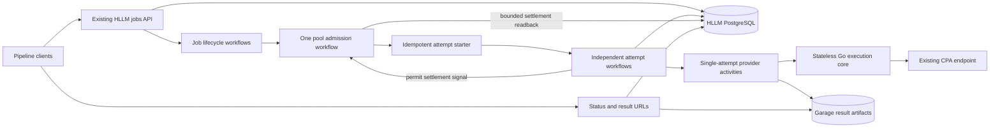

# CPA durable execution architecture and scheduling algorithm

- Document: `PLAN-HLLM-CPA-EXECUTION-002`.
- Date: 2026-10-18.
- Status: implementation design; proposed changes and acceptance gates below are not implemented or deployed by this document.
- Owner: Harden-LLM for orchestration, persistence, API and client behavior; CLIProxyAPI-setup for CPA configuration and upstream instrumentation; Agent Platform for existing shared-service provisioning.
- Tracking: [implementation issue #134](https://github.com/prls-co/harden-llm/issues/134).
- Scope: 1,000 separate CPA `gpt-6-luna` low-reasoning generations per job; multiple jobs support 10,000 or more queued items. Waiting is acceptable; silent inference replay is not.
- Existing work: [batch implementation PR #127](https://github.com/prls-co/harden-llm/pull/127), [research PR #133](https://github.com/prls-co/harden-llm/pull/133).
- Evidence: [frozen research report](https://github.com/prls-co/harden-llm/blob/75909d998b470d55232bf4e7dc7c2741bd899a9c/plans/evidence/harden-llm/cpa-final-research/2026-10-17/report.md).
- Related but independent: [official API fallback issue #96](https://github.com/prls-co/harden-llm/issues/96). This design uses CPA only and does not repurpose that issue.

## 1. Decision and implementation boundary

Use a durable queue with a single admission authority per configured CPA account
pool. Separate that authority from generation ownership: the pool workflow grants
bounded permits; independent attempt workflows own the long-running provider
activity, result persistence and completion notification. The pool can continue
as new while those attempts run, carrying permit identities and capacity state.

Keep the measured starting settings: 128 outstanding permits, a 200-start estimate
over 61 seconds, initial/window burst allowance 200, and a launch pacer of 100
starts/second adapting up to 200. The launch pacer controls spending available
budget; it is not sustained account capacity. These remain configurable operating
estimates, not universal provider RPM, TPM, concurrency or suspension thresholds.

Extend the current batch path rather than creating another gateway, database,
queue service or credential registry. Reuse self-hosted Temporal, the HLLM
database/role and pool, Garage, the existing worker image and diagnostic sinks.
No Firebase or Google Cloud service is part of the architecture. No automatic
direct-API fallback, account rotation, request grouping or human impersonation
is included. Jitter is an optional recovery measure, not camouflage or a speed claim.

Pool identity represents a capacity domain, initially the shared Codex account
pool. Do not use one global CPA-endpoint bucket for unrelated providers, or
invent separate model buckets unless their quota independence is established.
The same orchestration protocol can later host other providers with separately
qualified policies/adapters in the stateful layer; CPA's numbers are not their defaults.

The frozen implementation in PR #127 already has job admission, idempotency,
scoped persistence/results, a controller, retries for explicit refusals and
waiting diagnostics. It currently owns inference inside the dispatcher,
drains active activities during rollover, schedules round-robin across jobs,
and caps generation at 180 seconds. These are the baseline, not completed
versions of the changes below. Neither draft PR establishes deployment.

## 2. Components and ownership



| Component | Responsibility |
| --- | --- |
| Gateway / OpenAPI | Existing bearer validation, key-derived scope, immutable input validation, durable submission and status/result contracts |
| Job lifecycle workflow | Registration, overall job deadline and lifecycle; no provider retries |
| Pool workflow | Fair ready queues, permit allocation, admission budget, pacing, cooldown, one recovery probe, policy state and rollover |
| Attempt workflow | One permit's execution lifecycle, safe result recording and durable notification; no workflow retry that repeats inference |
| Provider activity | Claim before dispatch, exactly one local execution path, transport progress, validation and artifact storage |
| PostgreSQL | Accepted manifests, idempotency, attempt claims, immutable settlements and scoped result references |
| Garage | Immutable, path-scoped result artifacts; no public bearer URL |
| CPA owner | Native retry configuration, cooling and safe upstream-attempt diagnostics |

The root library receives no incoming API key, Temporal client, storage pool or
telemetry SDK. Concrete orchestration/effects remain under `stateful/batch` and
gateway composition. Phoenix uses OpenAPI and server-held credentials through
its host. It does not become a second scheduler or persistence owner.

Run control/workflow and provider-activity SDK workers on separate task queues
inside the existing worker process/image. Reserve control capacity so 128 slow
generations cannot starve settlement, status or cooldown work. Replicas share
the same namespace, stable pool workflow ID and policy; adding workers never
multiplies the account budget. Worker queue separation is not a substitute for
the pool's global permit limit.

## 3. State, identifiers and safety invariants

Keep the current scoped `batch_jobs` and `batch_items`. Add an additive schema
migration with a `batch_attempts` ledger and an item-to-current-permit reference.
The attempt ledger also acts as the durable completion mailbox; no outbox daemon
or inference-reconciliation service is required.

Persist trusted `pool_id` and an enqueue sequence on the job, with ready-item,
pool/scope/job-cursor and unsettled-permit indexes. These support bounded queue
pagination and scope/job round-robin after continuation; the existing manifest
tables remain the durable source rather than a second queue database.

An attempt row contains:

- `permit_id`, trusted `pool_id`, immutable `(api_key_hash, job_id, item_index)` and ordinal;
- unique attempt workflow ID, grant/expiry timestamps, admission epoch/window ID and policy revision;
- resolved generation deadline, `reserved | dispatching | settled` state and unique invocation claim ID;
- dispatch/transport-stop timestamps, settlement revision, bounded outcome/error classification and artifact reference;
- reported usage and nullable native-attempt information, with no provider credential in the row.

Use a unique key for `permit_id` and a unique item/ordinal tuple. Allow only one
unsettled attempt per item. Allocate a deterministic permit ID from the pool's
monotonic sequence and item reference; carry the sequence across rollover.
Temporal attempt workflow IDs derive from permit IDs and reject reuse after
completion. Retried start RPCs use the same ID; workflow existence means the
same lifecycle already exists, not permission to start another generation.

The pool's durable state contains its controller, fair-queue cursors, ready
references, monotonic sequence and outstanding permit map. The map contains
bounded references, not requests, output text or credentials. Archive completed
job references after their outstanding permits settle so snapshots do not grow
with historical throughput. Persisted queued items remain queryable by scope/job.
Cap a continuation snapshot below 256 KiB; spill excess queued references into
the existing scoped database manifest, carrying cursors rather than full inputs.

Invariants:

1. At most 128 permits are outstanding under the initial policy, including
   reserved, executing and unresolved local-execution states. Lowering the cap
   stops new grants until usage drops; it does not cancel existing inference.
2. Temporal is the only admission authority. PostgreSQL proves claim/settlement
   state; it does not independently mint capacity or estimate a new quota window.
3. A provider activity must positively confirm its own atomic
   `reserved -> dispatching` claim before calling the core. A second invocation
   cannot reuse the first invocation's claim to execute inference.
4. Unknown claim COMMIT or failed/absent readback fails closed. Unknown inference
   is never replayed automatically. There is no exactly-once provider promise.
5. A settled result is immutable and fenced by permit ID, ordinal and claim ID.
   Late results cannot overwrite a terminal item or another attempt's result.
6. Capacity is released once per permit, after validated settlement. Duplicated
   start/completion messages and stale callbacks cannot release it twice.
7. Automatic reservation expiry requires a compare-and-set proving it never
   reached `dispatching`. A claimed invocation may separately acknowledge that
   it never entered the provider path, fenced by its own claim ID. A heartbeat
   timeout or lease expiry alone proves neither condition.
8. Only the current probe can reopen admission. Old completions may settle their
   own permits but cannot invalidate a newer recovery episode.
9. The cap covers caller-side admitted work. Remote execution after a lost
   connection is unobservable; never claim the cap proves an upstream generation count.

The current API can continue representing uncertain inference as a failed item
with diagnostics `kind=unconfirmed`; any new `counts.unconfirmed` field is a
documented subset of `failed`, not an additional item category in the total.

## 4. Submission, fairness and permit execution

### 4.1. Durable submission

1. Validate the configured bearer and derive scope after matching it. Reject
   caller-provided scope, pool and credential selectors.
2. Validate 1..1,000 independent items, unique custom IDs, immutable requests and
   the configured CPA/model/reasoning contract. Resolve timeout policy now and
   store it in the immutable generation snapshot.
3. Commit the manifest with `(scope, idempotency key, input digest)`. Same key
   and input returns the existing job; changed input returns `409`.
4. Start the stable job workflow idempotently. Return `202` only after Temporal
   acknowledges the start. Ambiguous submission is retried with the same key;
   it is not a second inference request.
5. Enqueue references into the configured pool. Do not load all prompts into
   workflow histories or start 1,000 provider calls immediately.

### 4.2. Fair selection

Select round-robin across validated key scopes, then round-robin across that
scope's jobs, then FIFO items within a job. This prevents one key obtaining a
larger share merely by submitting more jobs. All callers sharing one configured
HLLM key also share that scope's allocation; do not invent a user registry or
trust a caller-supplied client ID. Existing work is non-preemptive. Inactive
scopes reserve no idle capacity; a single busy scope may use every free slot.

### 4.3. Admission loop

```text
on enqueue, settlement notification, policy update, or eligible timer:
    drain signals; read any newly settled outstanding permit rows
    apply each previously unseen settlement exactly once
    expire queued items whose overall deadline has passed

    if pool is PAUSED:
        publish the cause; wait for explicit operator resume
    else if pool is COOLING and now < next_eligible:
        publish next_eligible; wait durably
    else if pool is PROBING:
        wait for that probe's settlement
    else:
        while there is ready work and outstanding permits < concurrency:
            if recovering:
                grant exactly one probe; enter PROBING; stop this loop
            if estimated admission budget is occupied or pacer has no credit:
                arm the earliest eligible durable timer; stop this loop
            item = next scope/job/item under fair selection
            permit = reserve deterministic ID, capacity and window credit
            start its attempt lifecycle idempotently

    if continuation is required:
        finish short metadata commands and drain signals
        carry queues/cursors, controller and outstanding permit identities
        continue the pool as new without waiting for independent generations
```

Reuse and extend the existing deterministic controller rather than rewriting its
recovery semantics. Its only clock is workflow time. Accrue elapsed pacing
credits between workflow decisions, bounded by the configured burst; do not
require an expensive Temporal decision for every 5–10 ms launch interval.

Credits are reservations, not tokens earned by fast completions. Refund only a
confirmed never-sent grant or explicit refusal against its own still-current
window. Unknown and ordinary failed inference retain the reservation. The
single recovery probe is an explicit exception to the estimated window guard;
diagnose it separately rather than describing 200 as a strict upstream limit.

Anchor a new window to the pool's first confirmed dispatch-claim notification,
using workflow receipt time to avoid trusting worker clock skew. Before that
first confirmation, at most the initial budget can be reserved and no automatic
window refill occurs. This adds startup latency that must be measured in the
real stack. Preserve the first anchor; later starts do not keep postponing it.
Record grant-to-claim and claim-to-HTTP timing. The budget is a caller estimate,
not a hard guarantee about the upstream's physical request-start clock.

### 4.4. Attempt workflow protocol

The pool reserves capacity in its recorded workflow state before a retryable
metadata activity inserts the attempt row and idempotently starts the independent
attempt workflow. The activity never calls the provider. A lost start RPC is
retried with the same permit/workflow IDs. Failed or uncertain start acknowledgement
does not free the reservation or grant a replacement ID.

The attempt workflow invokes one provider activity with `MaximumAttempts=1` and
no workflow-level inference retry. The activity atomically claims the attempt
with a fresh invocation claim ID, checks deadlines, and executes the existing
single-attempt core policy. A competing/redelivered invocation cannot dispatch
after observing an existing claim. Requests still disable repair, rerun and cache.

An invocation that loses the claim returns `claim_owned_elsewhere`, not a
terminal inference failure. Its workflow waits for the original claim owner's
bounded observation/settlement or performs metadata-only artifact readback.
Losing a claim must not overwrite that owner's eventual result. The claimed
invocation durably stages its bounded terminal observation (artifact reference,
diagnostics and local-stop evidence) before returning when possible; only the
idempotent settlement transaction finalizes the item. If observation persistence
fails, the workflow can retry that metadata with the same bounded return, or
recover a positively validated artifact. Missing evidence remains unconfirmed.

Use an initial proposed five-second dispatch-reservation lifetime. Expiry before
claim is settled by `reserved -> settled(never_dispatched)` CAS and safely returns
the item to the queue; a late worker's claim then fails. Once claimed, that TTL
does not revoke execution or authorize another call. Check `start_by` immediately
before entering the provider path; an expired claim owner that has not invoked
that path may positively settle `never_dispatched`. Once execution starts, use
the generation context, not a five-second context that would cut off the response.
Excessive dispatch lag triggers diagnostics/backpressure; this is not an atomic
guarantee about physical network scheduling. The lifetime is a tuning proposal
requiring real-stack acceptance, not measured CPA capacity.

A never-sent expiry also closes a separate worker-dispatch backpressure gate.
Use bounded 2..30-second backoff and one metadata-only readiness activity on the
provider queue before reopening it. This prevents repeated short-lived permits
from flooding an unavailable worker queue. It does not halve CPA launch pace,
consume a provider retry, reset the quota estimate or execute an inference probe.

On a valid result, store the immutable Garage artifact under the attempt identity,
then retry only the metadata settlement transaction. Its positive readback updates
attempt/item state and counters idempotently. Lost persistence acknowledgement
reuses the same outcome and artifact; it never re-executes inference. Known
refusals settle to a retry-waiting item; unknown execution settles to terminal
`unconfirmed`. Late artifact writes are fenced from replacing terminal outcomes.

After settlement, a metadata activity signals the stable pool workflow ID with
permit ID and settlement revision, omitting Run ID. Signals carry references,
not authoritative result bodies. The pool validates settlement through the ledger,
applies it once and removes the permit only when local execution is known stopped.
Otherwise it marks the permit `awaiting_local_stop` and retains the paused gate;
later local-stop evidence advances a settlement revision without changing the
terminal item result. A bounded query of its outstanding IDs
every five seconds catches lost/duplicated/boundary notifications; no full-table
scan or inference replay occurs. This is metadata recovery, not a second queue.

If a provider activity times out without proof its local transport stopped,
retain the permit as unresolved and pause further admission until its local
termination or an explicit operator resolution is established. Ordinary client
timeouts with confirmed transport closure can settle/release locally while
retaining uncertain upstream outcome. Never use a lease TTL alone to assume a
possibly executing request has disappeared.

The provider activity records local transport closure in a bounded finalizer
even if Temporal has stopped accepting its normal return. A worker process crash
may prevent that finalizer; missing proof remains explicit and requires positive
process-termination evidence or operator resolution, not a heartbeat-based
inference replay. Before declaring a lost activity's output unknown, metadata
recovery may read its deterministic Garage path and positively validate an
already-stored artifact. Failed/absent readback remains unknown; it never causes
another provider request or overwrites an already finalized result.

## 5. Throttle classification and recovery algorithm

| Observation | Item action | Pool action |
| --- | --- | --- |
| Valid terminal and independent output validation | Persist success | Release permit; adapt pace only in the current open episode |
| Explicit temporary capacity refusal before useful output | Settle attempt; requeue item within refusal budget | Close admission; schedule one recovery probe |
| `auth_unavailable` without a trusted temporary recovery indication | Terminal configuration/account diagnostic | Pause for operator review; do not treat missing credentials as spare capacity |
| 401/403, billing/account restriction or policy warning | Retain terminal diagnostic | Pause; no aggressive retries, identity rotation or fallback |
| Timeout, disconnect, generic 5xx, incomplete stream or uncertain result | Terminal failed/unconfirmed outcome | Honor a positive retry hint for future admission; never replay the item |
| Validation/schema/content failure | Terminal item error | Release after settlement; no inference repair in this contract |
| Proven never-dispatched reservation | Requeue without a provider retry | Release and refund only its own valid reservation |

Classification considers HTTP status, trusted code, stream progress and any
retry hint together. A 429 or cooldown label after partial output is not proof
that no inference ran. Tests must cover that boundary. CPA's own retries may
hide native attempts; the caller activity's one-attempt setting is not a claim
that CPA performed one native generation.

On the first throttle in an episode, halve launch pace with a floor of one
start/second, clear its success counter and enter `COOLING`. Further refusals
from that episode may extend the deadline but do not repeatedly halve pace.

With a valid server hint, `floor = observed_at + retry_after`. Without one,
`floor = max(now + probe_backoff, episode_first_dispatch + 61s)`, initially
using two seconds of probe backoff. Failed probes double that backoff up to
60 seconds; this cap never truncates a longer server-supplied wait. Keep the
latest already-recorded recovery deadline when old responses arrive.

Recovery jitter defaults to zero. An operator may enable 0..1,000 ms of padding
after the floor. Derive it deterministically from pool/episode/probe IDs and
policy revision, or record the choice in history. Apply padding once to each
scheduled probe deadline, never cumulatively once per rejected call. Do not
add random delay to ordinary dispatch or reset a cooldown after restart.

At eligibility, admit one queued item as the probe even if the estimated normal
window is occupied, subject to the global outstanding-permit limit. Success
reopens at the reduced pace without replenishing an initial burst; the regular
window budget remains independently enforced. Every 100 current-episode validated
successes doubles pace up to 200 starts/second. Only this probe may reopen the
gate. Failed/unconfirmed probes keep their item terminal and select another
queued item later; explicit refusals alone may retry their own item.

Bound each item to at most 16 provider dispatches, including explicit-refusal
retries, and its original overall deadline. Proven never-sent reservations do
not consume that provider-dispatch count. Retry-budget exhaustion becomes a terminal item error.
Long server waits beyond a job's remaining time expire that job without forcing
an early provider retry. Restriction state survives an idle queue. Operator
resume permits one probe and never resets the request budget.

## 6. Deadlines, public progress and diagnostics

Propose a 300-second default generation budget and a configurable maximum of
900 seconds for new jobs. These are product choices to qualify, not newly
measured provider guarantees. Persist the resolved value with the accepted
generation. Existing accepted jobs retain their original 180-second snapshot;
an operator policy update does not silently rewrite them.

Generation starts after admission/claim, excludes queue and cooldown wait, and
ends no later than the job's remaining overall deadline. Set provider activity
Start-to-Close to the resolved generation budget plus 30 seconds of bounded
local cleanup/artifact allowance, with a separate 30-second heartbeat timeout.
Retries of result persistence and completion notification are metadata-only.
Keep the two-hour default overall job deadline; a client waiter has its own
explicit hard deadline. Five-second progress does not indefinitely extend any
deadline. Update OpenAPI, gateway validation, core timeout propagation, activity
options, clients and workflow-version handling together before enabling longer calls.

At the job execution deadline, expire never-started items and stop active provider
work. Allow at most 30 seconds of explicitly reported finalization grace to record
a result whose validated provider terminal occurred before that deadline, or to
record cancellation/uncertainty. Expose execution and finalization deadlines
separately in the contract. Grace does not authorize another inference or extend
provider execution. After grace, finalized outcomes remain immutable while unresolved
local-stop evidence may still keep the pool paused.

Keep `/v1/jobs`, authenticated status/result URLs, `202` while pending and NDJSON
terminal results. Downloads may be repeated without inference. Add documented
optional status diagnostics for `admission_window`, `provider_throttled`,
`account_restricted`, `dispatch_pending`, `workflow_rollover`,
`persistence_wait`, `worker_unavailable` and `unresolved_execution`.
Distinguish:

- status read time;
- worker heartbeat time;
- actual last state/byte progress;
- next eligible admission/probe, which is not a promised result ETA;
- queued, reserved/active, retry-waiting, succeeded and failed counts;
- oldest active call, current generation/job deadlines and waiting cause.

Persist five-second heartbeats coalesced per job/pool; no per-token SQL writes.
Log scope-safe job/item/attempt/permit IDs, policy revision, episode/probe ID,
grant/claim/HTTP/headers/first-output/terminal/persistence timestamps, local
transport-stop certainty, queue/cooldown/metadata durations, input/output/cache
usage, safe error codes and bounded CPA correlation suffix. Label every clock
origin; current core first-output time is not interchangeable with dispatch-to-headers.
Unavailable native attempt counts or usage stay null. Do not log prompts,
responses, credentials, raw auth records or full CPA trace prefixes.

CPA upstream-attempt timing/count and trustworthy quota/reset metadata require
an explicit owner change in CLIProxyAPI-setup. Until that is deployed and
verified, callers report those values as unknown. Keep current shared CPA retry
settings and cooling. Request-retry zero is a separate consumer-qualified rollout,
not part of enabling this controller and not a quota increase.

## 7. Rollover, recovery and upgrade

Independent attempt workflows are started through the Temporal client with
stable IDs, not attached as cancel-on-parent-close children of the pool. Their
execution survives the pool's Continue-As-New. A pool continuation waits only
for its own short metadata commands/handlers to finish, drains notifications,
and carries outstanding permit IDs, queues/cursors, window state, cooldown,
probe identity and policy revision. It never clears capacity or reissues permits.
Periodic ledger readback catches a settlement notification crossing the boundary.

This follows the documented [fresh-run/state handoff](https://docs.temporal.io/develop/go/workflows/continue-as-new)
and [message-passing](https://docs.temporal.io/develop/go/workflows/message-passing)
model. The current slow generation can still determine whole-batch completion;
the intended guarantee is that unrelated eligible work continues, not that
removing a 119-second admission stall saves 119 seconds from every batch.

Upgrade sequence:

1. Ship compatibility readers/worker registrations and additive schema migration
   support. The gateway never applies DDL at startup. Preserve all accepted
   manifests/outcomes/artifacts and HLLM scope isolation; no dataset reset.
2. Stop new batch submissions briefly. Keep ordinary synchronous traffic's
   existing behavior explicit; it is not silently moved into the pool.
3. Signal the V1 pool to quiesce new grants. Wait for all its owned activities
   to settle and local execution to end. Unresolved execution blocks cutover.
4. Continue the same stable pool workflow ID into the V2 type/control queue,
   carrying controller restrictions, remaining queues and sequence state.
   Keep the deployed pool ID string stable even if it contains `v1` historically.
5. Ensure compatibility `Enqueue` activities for existing job lifecycles resolve
   the new pool generation; a delayed V1 enqueue must not create a second V1
   authority. Start routing new jobs only after the V2 state query confirms ownership.
6. New attempts use the new provider queue; existing job lifecycle workflows
   may finish on their old queue. Retain the compatibility worker until those
   histories drain. Do not mix workers that cannot execute newly scheduled types.
7. Roll back by stopping submissions/grants and preserving accepted work. A
   source/schema-compatible worker drains V2 attempts; an old binary must not
   be pointed at incompatible schema or pending workflow types. Transferring
   authority back requires a drained, explicitly fenced handoff too.

The stable workflow identity plus a persisted pool-generation marker in HLLM
storage is the migration fence. Each grant-start activity validates that marker;
an obsolete generation cannot insert or start a fresh attempt. The marker does
not replace preserved Temporal capacity state or permit a second admission owner.

## 8. Build sequence and acceptance

| Phase | Concrete deliverable | Required evidence before proceeding |
| --- | --- | --- |
| P0 | Inventory PR #127/#133 adoption and add explicit pool-generation/state contract | Source/schema/workflow identities and existing accepted-job compatibility recorded |
| P1 | Timeout policy, precise progress and error classification | T0/T1 OpenAPI/gateway/client fixtures; partial-output 429 stays unconfirmed; virtual-time generation beyond 180s succeeds once within the configured longer budget |
| P2 | Attempt ledger, claims, settlement fencing and idempotent starter | T1 stubs plus T3 real SQL transaction/unknown-COMMIT boundaries; duplicate starts cannot duplicate dispatch; persistence retries reuse one artifact/outcome |
| P3 | Independent attempt workflows and fair pool scheduler | SDK tests/replay: one probe, scope/job fairness, 128 combined permits across replicas, restart/cooldown/policy continuity, stale events and safe never-sent expiry |
| P4 | Rollover and lifecycle fault acceptance | Real Temporal/PostgreSQL/Garage: a slow call remains active while another job starts eligible work across rollover; no duplicate/missing results, leaked permits or reset budget |
| P5 | Scale and caller integration | 1,000 then 10,000 distinct local native-SSE calls; two keys/many jobs, complete ID/count checks, bounded snapshot/history/resources and scheduler lag; actual HTTP starts/overlap measured |
| P6 | Environment rollout and representative CPA acceptance | Provisioned private namespace/network and HLLM-scoped artifacts, schema command, verified API/worker images, HTTP auth/status checks, then explicitly opted-in bounded real-provider case |

Add deterministic regressions before implementation. Extend the canonical
`SPEC-HARDEN-LLM-SELF-HOSTED-TESTS-001` catalog and existing TEST-474/476/477/478/481/484
coverage where the invariant belongs; allocate new IDs through that catalog if
a distinct boundary needs one. Keep failure oracles and hard deadlines unchanged.
Run `make test-fast` for implementation, then focused SQL/Temporal integration,
race and replay gates. Browsers are not authorized or required for this backend
work. A full release/provider gate is separate from this design document.

Fault cases must include: lost start acknowledgement, provider activity redelivery,
claim COMMIT ambiguity, stale reservation expiry racing claim, crash after HTTP
dispatch, late result after expiry, lost settlement acknowledgement, duplicate or
boundary completion signals, persistence outage, account pause across idle/CAN,
dispatch lag across a window boundary, and policy/cap changes with active work.
No fixture may silently retry an uncertain inference to make the oracle pass.

Use the same worker image/process and existing storage/services; record added
workflow/event counts, database load, CPU/RAM and queue lag before declaring the
new lifecycle faster. Its extra per-attempt workflows are deliberate overhead
for isolation and continuity, not a provider capacity improvement.

## 9. Concrete 1,000-call behavior and limits

With unused estimated budget and short calls, admit up to 128 immediately,
refill available slots until 200 reservations are spent, then wait for the
window. Subsequent 200-call admission episodes occur near 61/122/183/244 seconds,
adjusted for initial dispatch confirmation and scheduling lag. Responses from
earlier episodes need not all finish before another eligible request starts.

Ten 1,000-item jobs share that same budget/cap; they do not each receive 128
slots or 200 starts. Fair scheduling apportions future grants as clients arrive
and finish. Direct CPA calls, another namespace or an ordinary `/v1/responses`
client remain outside this authority. Route participating pipelines through
`/v1/jobs`; a shared-account guarantee cannot cover bypassing clients.

Do not add a numerical TPM gate without usable signals or a qualified workload
policy. Longer prompts, outputs and reasoning affect usage and latency, but the
research did not identify a stable token ceiling. Do not promise a five-minute
completion deadline, exactly-once upstream execution or a ban-safe rate.

Implementation is complete only when these lifecycle/adoption gates are met,
not when a plan, draft PR, health check or configured worker count exists.
