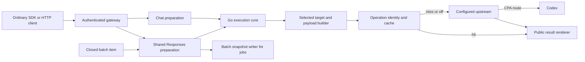

# 1. Harden LLM ordinary API option forwarding

- Document ID: PLAN-HLLM-186. Version: 3.1. Date: 2026-11-23. Status: Implementation in progress.
- Owners: gateway maintainers for ingress and public responses, provider/runtime maintainers for translation and recovery, stateful maintainers for batch identity. CPA owns its Codex translator.
- Configuration: implementation base `dev@29cdd3d`; historical reproduction at `9554f5f`; plan branch [research/issue-186-gateway-rca](https://github.com/prls-co/harden-llm/blob/research/issue-186-gateway-rca/plans/protocol-aware-option-forwarding-plan.md).

Fix three defects in [issue #186](https://github.com/prls-co/harden-llm/issues/186) and replace manual native-option forwarding on ordinary Responses and Chat Completions. Harden consumes its controls, forwards eligible native JSON to matching endpoints and translates supported options at the selected destination. The two tool fixes can ship independently. Ship the expanded forwarding contract after ingress, translation, recovery and schema qualification pass together. This document specifies future work. [Historical reproduction and evidence](issue-186-gateway-contract-rca-and-plan.md)

## 2. Design consensus and trade-offs

| Topic | Verdict | Decision and rationale |
| --- | --- | --- |
| Forwarding | FOR | Keep one Go execution path. Preserve the JSON members the engine does not own. Both scalar-copy lists in `internal/gateway/httpapi/handlers.go` omit an explicitly decoded `store: false`. |
| Translation | DECISION | Use the destination switch in `internal/providers/payload.go`. A matching format admits native tuning. A different endpoint requires a known equivalent for every forwarded option. Perplexity `/agent` is distinct from `/responses` even when the connection label says Responses. |
| Compatibility switches | AGAINST | Dropping fields, retrying a reduced request, or selecting another provider on a translation error could return success for different instructions. Keep one public policy. |
| Scope of typed fields | DECISION | Type what Harden executes or renders. Native tuning can evolve independently. Chat token probabilities and Responses reasoning summaries require output that the public renderers cannot return. Reject each at admission and name the requested field. |
| Search and cache | DECISION | Validate declarations while the selected tool still has its type. Valid search uses the existing native/Jina capability decision. Block the unsupported combination of functions and explicit caching at admission. A cache-codec redesign would also affect Go clients and existing records. |
| Persistence | DECISION | Share Responses preparation with jobs. The job snapshot and inference cache answer different identity questions. Retain their respective writers and equality rules. |

## 3. Stakeholder and system needs

- **Problem and users.** In authenticated loopback reproductions, the upstream lost an explicit storage opt-out, a search selector became a request for a function, and a cache hit returned a function call as text. Ordinary HTTP callers, pinned SDK consumers and batch submitters need predictable wire and replay behavior.
- **Value and success.** All three issue cases pass. One invented native tuning field reaches a matching endpoint without a production registration. Invalid requests make zero prohibited calls. Existing job submissions retain their serialized identity.
- **Scope and non-goals.** Cover `POST /v1/responses` and `POST /v1/chat/completions`, their shared Go path and contracts. The batch boundary is a preservation requirement. Stored-response retrieval, token-probability and reasoning-summary rendering, new hosted tools, cache migrations and production promotion are outside this change.
- **Storage decision and upstream behavior.** Harden forwards explicit `store: false` to native Responses, leaves an omitted `store` absent on the wire and rejects explicit `store: true` at admission. The selected upstream owns the default. Direct OpenAI Responses documents a default of true. The pinned CPA translator sets false independently, removes `temperature` and preserves `max_output_tokens`. Evidence of delivery stops at each owner's boundary. [OpenAI Responses](https://developers.openai.com/api/reference/resources/responses/methods/create) · [Pinned CPA translator](https://github.com/router-for-me/CLIProxyAPI/blob/f7ae8feeb3710319f524730849fbe32fde1751e4/internal/translator/codex/openai/responses/codex_openai-responses_request.go#L31-L46)

## 4. SRS and acceptance requirements

| ID | Type | Accepted outcome |
| --- | --- | --- |
| REQ-600 | int | Matching Responses and Chat endpoints receive eligible caller values with presence, object contents, array order and integer precision intact. On native Responses, explicit `store: false` reaches the upstream as a boolean, omission leaves the key absent, and explicit true yields HTTP 400 naming `store` before dispatch. |
| REQ-601 | func | Ordinary Responses accepts `text.verbosity` alone and beside a normalized `text.format`. Responses `reasoning.summary` and Chat `logprobs: true` each return HTTP 400 before cache, search or model access. Set `error.param` to `reasoning.summary` or `logprobs`, respectively. A lone `top_logprobs` names that field. |
| REQ-602 | func | An explicit Responses search selector requires a declared search tool. A contradiction yields 400 naming `tool_choice` with zero search/model calls. Valid aliases, named functions and generic function-only `required` retain their meanings. |
| REQ-603 | func | Either public endpoint rejects declared functions plus explicit `cache` or `refresh` with 400 naming `harden.cache`, before cache access, dispatch or stream headers. Omitted cache and `off` yield an SDK-readable function call. |
| REQ-604 | security | Existing authentication, key scope, single-object/body limits and stateless exclusions hold. Strict `harden` controls stay local. Caller options cannot set credentials, URL, transport settings or internal cache markers. Field errors identify the caller path and exclude opaque values. |
| REQ-605 | int | Each translated option has an equivalent on the actual destination or a local 400 naming the original field before that attempt dispatches. Existing schema, tool and search semantics survive. |
| REQ-606 | reliability | Ordinary options survive same-target retries and target switches. An explicit recovery-target output-token limit may raise or lower the caller’s limit for that attempt. A target without an override inherits the caller’s original limit. Recovery preserves prior accounting and avoids preparation beyond the attempt budget. |
| REQ-607 | data | The prepared operation determines inference-cache identity. Changed semantic values separate entries, reordered object keys preserve identity, and a valid hit skips model and search. |
| REQ-608 | data | Batch admission stays closed, shares Responses preparation and produces the same serialized generation for a previously valid item. |
| REQ-609 | int | Canonical OpenAPI, its bundled copy and public behavior agree. Guidance accurately distinguishes Harden delivery, CPA translation and model enforcement. |
| REQ-610 | nfr | An invented same-format tuning field requires zero production registrations. Both handler copy lists and the unused `putValue` helper are removed. |



```text
Person: API caller -> Container: Go gateway -> Component: stateless execution core
  -> Component: target builder -> External system: configured provider or CPA -> Codex
  -> Component: result normalization and public renderer -> API caller
Stateful composition -> injected cache; batch admission -> immutable job snapshot
Managed search -> native tool or configured Jina -> evidence for the model request
```

## 5. Iterative implementation and test plan

Use the existing branch policy for implementation from current `dev`. Sequence subtasks within each phase. A RED step passes its own gate only with a runnable assertion failing for the stated reason. Compilation errors, missing test selection and infrastructure failures do not qualify. RED and GREEN use identical commands. Keep expected failures on the implementation branch. Preserve existing assertions. Tag every added or modified test file with `SPEC-HARDEN-LLM-SELF-HOSTED-TESTS-001` and a grep-able comment for each applicable test ID.

- **Compute controls.** `branch_limits: 1` active implementation branch. `reflection_passes: 1` architecture review at each phase exit. `early_stop%: 100` of required assertions before advancement. Stop immediately for a scope or privacy conflict. Planning scores below are estimates, with YAGNI on a 1–5 scale where 5 means directly needed.
- **Phase exits.** Proceed when the phase assertions and measurements pass and the log records the source SHA, design diff and verification output. Escalate an ambiguous contract or unstable fixture. Stop if a fix needs a new provider capability, stored format or privacy policy. Resume from the last green SHA after recording the decision and rerunning the affected command. Checkpoints are commit SHAs at phase boundaries.
- **Risks.** If a native member vanishes, compare ingress and captured wire before changing the builder. If an option requests output the renderer cannot represent, reject it by field. If a batch golden changes, compare snapshot bytes before altering admission. If recovery loses caller intent, compare original and selected-target options. Preserve the assertion in each case.
- **Tailoring.** Requirements, tests and checkpoints supply standards-informed lifecycle evidence. Formal certification and safety-critical assurance are outside the product scope. Estimated runtimes are scheduling budgets. Any acceptance metric threshold change requires an ADR.

Phase score order: confidence %, long-term robustness %, internal interfaces, external contracts, complexity %, feature creep %, technical debt %, YAGNI, MoSCoW, scope, architectural changes. External contracts count reference points, not live calls.

### Phase P00: Previously accepted batch submissions have a byte-level baseline

- Goal and scope: Previously accepted batch submissions have a byte-level baseline. REQ-608.
- Design/code surfaces: `internal/gateway/httpapi/jobs_test.go`, `stateful/batch/store.go`.
- Lifecycle evidence: Compare the authenticated job fixture with the bytes used by the existing digest. Fix the source SHA before editing ingress. Risk: equivalent JSON can serialize differently. Record the linked requirements, diff, command outcomes and green SHA in section 11. Apply the common exit gates in section 5.
- Estimated phase metrics: 96/95/2/0/12/2/2/5/Must/local/0. A fixed input exercises the existing writer.

- P00.S01 Capture the accepted batch snapshot
  - Action: Add a characterization subtest using the current serializer and record its exact bytes. No refactor needed: this characterizes the current writer.
  - Why now: Protect idempotency before altering shared preparation.
  - Files/surfaces: `internal/gateway/httpapi/jobs_test.go`.
  - Requirement link: REQ-608
  - Verification link: TEST-475
  - Verification mode: VERIFY
  - Command/procedure: `make test-api`
  - Expected result: Existing accepted item reproduces identical bytes.
  - Evidence produced: Golden and baseline SHA.
  - Stop/escalate condition: Stop on unexplained variation.
  - Unlocks: P00.S02.

- P00.S02 Measure snapshot stability
  - Action: Compare serialized bytes and rejected-item submission counts.
  - Why now: Freeze the oracle for P02.
  - Files/surfaces: `internal/gateway/httpapi/jobs_test.go`.
  - Requirement link: REQ-608
  - Verification link: EVAL-600
  - Verification mode: MEASURE
  - Command/procedure: `make test-api`
  - Expected result: Zero byte differences and zero invalid submissions.
  - Evidence produced: Byte comparison and counts.
  - Stop/escalate condition: Escalate an unstable snapshot.
  - Unlocks: phase exit.

### Phase P01: Contradictory tool requests fail before effects

- Goal and scope: Contradictory tool requests fail before effects. REQ-602, REQ-603.
- Design/code surfaces: `internal/gateway/httpapi/requests.go`, `internal/gateway/httpapi/handlers.go`, `client_cache.go`.
- Lifecycle evidence: Exercise both public routes and the pinned SDK. Validate selection before its tool type is lost and cache mode before effects. Risk: rejecting valid search aliases or ordinary function calls. Record the linked requirements, diff, command outcomes and green SHA in section 11. Apply the common exit gates in section 5.
- Estimated phase metrics: 94/94/3/0/27/3/3/5/Must/local/0. Independent admission rules bound the change.

- P01.S01 Reproduce the explicit search mismatch
  - Action: Declare only a function and select web search. Retain positive alias and function controls.
  - Why now: Capture the observed 200 before modifying normalization.
  - Files/surfaces: `internal/gateway/httpapi/web_search_request_test.go`.
  - Requirement link: REQ-602
  - Verification link: TEST-535
  - Verification mode: RED
  - Command/procedure: `make test-api`
  - Expected result: Contradictory selector reaches dispatch or lacks the required 400.
  - Evidence produced: Failing case and effect counts.
  - Stop/escalate condition: Stop on fixture failure.
  - Unlocks: P01.S02.

- P01.S02 Validate the selected search declaration
  - Action: Compare decoded tools and selector before reducing it to required.
  - Why now: The mismatch is reproducible.
  - Files/surfaces: `internal/gateway/httpapi/requests.go`, `internal/gateway/httpapi/handlers.go`.
  - Requirement link: REQ-602
  - Verification link: TEST-535
  - Verification mode: GREEN
  - Command/procedure: `make test-api`
  - Expected result: Named 400 and zero dispatches. Valid search still uses native or Jina.
  - Evidence produced: Diff and passing controls.
  - Stop/escalate condition: Stop if search routing changes.
  - Unlocks: P01.S03.

- P01.S03 Reproduce cached function type loss
  - Action: Exercise cache and refresh on both endpoints, including a pre-existing entry, disabled choice and streaming.
  - Why now: Keep this fix independently shippable.
  - Files/surfaces: `internal/gateway/httpapi/openai_contract_test.go`.
  - Requirement link: REQ-603
  - Verification link: TEST-403
  - Verification mode: RED
  - Command/procedure: `make test-api`
  - Expected result: Explicit caching touches the cache or returns success.
  - Evidence produced: Failing SDK and counter assertions.
  - Stop/escalate condition: Stop if the fixture returns plain text on a fresh uncached call.
  - Unlocks: P01.S04.

- P01.S04 Reject explicit function caching
  - Action: Apply one public admission rule after tools and cache mode are known. Document omission and off with the fix.
  - Why now: The cache codec also serves structured Go results.
  - Files/surfaces: `internal/gateway/httpapi/handlers.go`, `docs/api-and-library.md`.
  - Requirement link: REQ-603
  - Verification link: TEST-403
  - Verification mode: GREEN
  - Command/procedure: `make test-api`
  - Expected result: Named JSON 400 before stream headers; omitted and off retain call IDs, arguments and Chat finish reason.
  - Evidence produced: Diff and SDK results.
  - Stop/escalate condition: Stop if codec changes are required.
  - Unlocks: P01.S05.

- P01.S05 Inspect shared admission ownership
  - Action: No refactor needed if both endpoints call one cache rule and search validation stays with its decoder. Remove any duplicate introduced before proceeding.
  - Why now: Both fixes have passing controls.
  - Files/surfaces: `internal/gateway/httpapi/handlers.go`, `internal/gateway/httpapi/requests.go`.
  - Requirement link: REQ-602, REQ-603
  - Verification link: TEST-535, TEST-403
  - Verification mode: VERIFY
  - Command/procedure: `make test-api`
  - Expected result: One owner per rule.
  - Evidence produced: Review and test output.
  - Stop/escalate condition: Stop on duplicate decisions.
  - Unlocks: P01.S06.

- P01.S06 Measure invalid-request dispatches
  - Action: Read cache, model and search counters from the deterministic fixtures.
  - Why now: Quantify the user-visible boundary.
  - Files/surfaces: `internal/gateway/httpapi/openai_contract_test.go`, `internal/gateway/httpapi/web_search_request_test.go`.
  - Requirement link: REQ-602, REQ-603
  - Verification link: EVAL-601
  - Verification mode: MEASURE
  - Command/procedure: `make test-api`
  - Expected result: Zero forbidden effects in every case.
  - Evidence produced: Per-case counts.
  - Stop/escalate condition: Escalate any nonzero count.
  - Unlocks: phase exit.

### Phase P02: Ordinary requests preserve options and batch admission stays closed

- Goal and scope: Ordinary requests preserve options and batch admission stays closed. REQ-600, REQ-601, REQ-604, REQ-608, REQ-610.
- Design/code surfaces: `internal/gateway/httpapi/requests.go`, `internal/gateway/httpapi/handlers.go`, `internal/gateway/httpapi/jobs.go`, `types.go`, `client.go`, `internal/runtime/types.go`.
- Lifecycle evidence: Inspect the request at preparation and the public admission error. Compare batch bytes with P00. Risk: accidentally interpreting untrusted native JSON as target configuration. Record the linked requirements, diff, command outcomes and green SHA in section 11. Apply the common exit gates in section 5.
- Estimated phase metrics: 88/91/5/0/55/12/8/5/Must/non-local/1. Two public codecs and a durable consumer share preparation.

- P02.S01 Expose field loss at preparation
  - Action: Add ingress assertions for the section 8 fixture, both verbosity shapes, summary requests with and without a valid `reasoning.effort`, Chat probability requests, reserved names and batch isolation.
  - Why now: Separate decoder loss from downstream translation.
  - Files/surfaces: `internal/gateway/httpapi/openai_contract_test.go`, `internal/gateway/httpapi/jobs_test.go`.
  - Requirement link: REQ-600, REQ-601, REQ-604, REQ-608, REQ-610
  - Verification link: TEST-403, TEST-475
  - Verification mode: RED
  - Command/procedure: `make test-api`
  - Expected result: New ordinary member or nested text is rejected, or a named error is missing. Existing security and batch controls pass.
  - Evidence produced: Failing assertions and batch comparison.
  - Stop/escalate condition: Stop on an unrelated authentication failure.
  - Unlocks: P02.S02.

- P02.S02 Carry native members through shared preparation
  - Action: Use one bounded member collection with number preservation. Consume Harden and execution-owned leaves. Carry source format beside `Request.ProviderOptions` into runtime. Reject `reasoning.summary` at Responses admission while the original field path is available. Preserve the supported effort-only request and the Chat output checks.
  - Why now: Preparation evidence identifies which values are lost.
  - Files/surfaces: `internal/gateway/httpapi/requests.go`, `internal/gateway/httpapi/handlers.go`, `types.go`, `client.go`, `internal/runtime/types.go`.
  - Requirement link: REQ-600, REQ-601, REQ-604, REQ-608, REQ-610
  - Verification link: TEST-403, TEST-475
  - Verification mode: GREEN
  - Command/procedure: `make test-api`
  - Expected result: Ordinary options reach the core intact; named rejections precede effects; batch bytes match.
  - Evidence produced: Go diff and captured prepared input.
  - Stop/escalate condition: Stop if native fields can set transport or scope.
  - Unlocks: P02.S03.

- P02.S03 Remove scalar copying from both handlers
  - Action: Delete both forwarding lists and `putValue`. Reuse Responses preparation for batch while keeping its closed decoder, timeout defaults and worker snapshot settings.
  - Why now: Both routes now supply the same options representation.
  - Files/surfaces: `internal/gateway/httpapi/handlers.go`, `internal/gateway/httpapi/jobs.go`.
  - Requirement link: REQ-600, REQ-608, REQ-610
  - Verification link: TEST-403, TEST-475
  - Verification mode: REFACTOR
  - Command/procedure: `make test-api`
  - Expected result: Same admission results and identical batch bytes after deletion.
  - Evidence produced: Deletion diff and passing controls.
  - Stop/escalate condition: Stop if a second batch forwarding list appears.
  - Unlocks: P02.S04.

- P02.S04 Measure admission and snapshot outcomes
  - Action: Read field error paths, effect counts and byte comparisons.
  - Why now: Demonstrate preservation before expanding destination support.
  - Files/surfaces: `internal/gateway/httpapi/openai_contract_test.go`, `internal/gateway/httpapi/jobs_test.go`.
  - Requirement link: REQ-601, REQ-604, REQ-608
  - Verification link: EVAL-600, EVAL-601
  - Verification mode: MEASURE
  - Command/procedure: `make test-api`
  - Expected result: Zero prohibited effects and zero snapshot differences.
  - Evidence produced: Comparison output.
  - Stop/escalate condition: Keep the expanded contract off deployed routes until downstream forwarding is complete.
  - Unlocks: phase exit.

### Phase P03: Each selected endpoint accounts for every caller option

- Goal and scope: Each selected endpoint accounts for every caller option. REQ-600, REQ-601, REQ-604, REQ-605, REQ-610.
- Design/code surfaces: `internal/providers/payload.go`, `internal/providers/router.go`, `internal/gateway/httpapi/openai_contract_test.go`, `internal/providers/requests_test.go`.
- Lifecycle evidence: Capture actual method, path and JSON on loopback, including a CPA-shaped destination. Risk: provider labels conceal a different endpoint or a generic copy is mistaken for a translation. Record the linked requirements, diff, command outcomes and green SHA in section 11. Apply the common exit gates in section 5.
- Estimated phase metrics: 89/92/4/1/52/9/7/5/Must/non-local/1. Existing destination builders cover the distinct protocols.

- P03.S01 Capture matching and translated requests
  - Action: Add gateway wire captures plus destination parity cases from section 7.3, including standalone verbosity and an unmappable Gemini field.
  - Why now: Ingress is available for a full-path test.
  - Files/surfaces: `internal/gateway/httpapi/openai_contract_test.go`, `internal/providers/requests_test.go`.
  - Requirement link: REQ-600, REQ-601, REQ-604, REQ-605, REQ-610
  - Verification link: TEST-403, TEST-012
  - Verification mode: RED
  - Command/procedure: `make test-api` then `make test-parity`
  - Expected result: At least one wire assertion fails on the unmodified builder, such as a dropped sibling or silently accepted foreign field.
  - Evidence produced: Captured path, body and failure.
  - Stop/escalate condition: Stop if the asserted target was never selected.
  - Unlocks: P03.S02.

- P03.S02 Render options at the selected destination
  - Action: Forward remaining native members directly. Write owned leaves on an attempt-local copy. On translated paths consume known equivalents and reject remaining caller fields before Jina or model dispatch.
  - Why now: The fixture distinguishes native and translated behavior.
  - Files/surfaces: `internal/providers/payload.go`, `internal/providers/router.go`.
  - Requirement link: REQ-600, REQ-601, REQ-604, REQ-605, REQ-610
  - Verification link: TEST-403, TEST-012
  - Verification mode: GREEN
  - Command/procedure: `make test-api` then `make test-parity`
  - Expected result: Both native captures match. Translations emit the expected field or the named 400.
  - Evidence produced: Builder diff and passing wire cases.
  - Stop/escalate condition: Stop if the fix needs a field registry or reduced-request retry.
  - Unlocks: P03.S03.

- P03.S03 Inspect native extension cost
  - Action: No refactor needed if the invented field occurs only in fixtures and the existing switch owns routing. Consolidate any duplicate mapping first.
  - Why now: Both formats now have wire evidence.
  - Files/surfaces: `internal/providers/payload.go`, `internal/gateway/httpapi/handlers.go`.
  - Requirement link: REQ-605, REQ-610
  - Verification link: TEST-012
  - Verification mode: VERIFY
  - Command/procedure: `make test-parity`
  - Expected result: No production registration for the fixture key or second endpoint classifier.
  - Evidence produced: Review and parity output.
  - Stop/escalate condition: Stop on a duplicated translation.
  - Unlocks: P03.S04.

- P03.S04 Measure wire fidelity
  - Action: Compare complete native fixture values, mapped token limits and invalid-target dispatch counts.
  - Why now: Publish measurements for the prepared operation.
  - Files/surfaces: `internal/gateway/httpapi/openai_contract_test.go`, `internal/providers/requests_test.go`.
  - Requirement link: REQ-600, REQ-601, REQ-605
  - Verification link: EVAL-602
  - Verification mode: MEASURE
  - Command/procedure: `make test-api` then `make test-parity`
  - Expected result: Zero mismatches and zero calls on rejected targets.
  - Evidence produced: Wire diffs and counters.
  - Stop/escalate condition: Escalate unexplained provider-specific loss.
  - Unlocks: phase exit.

### Phase P04: Retries preserve caller intent and cache keys describe the effective operation

- Goal and scope: Retries preserve caller intent and cache keys describe the effective operation. REQ-606, REQ-607.
- Design/code surfaces: `internal/runtime/recovery_execute.go`, `internal/providers/router.go`, `internal/providers/web_search.go`, `client_cache_test.go`.
- Lifecycle evidence: Force a model switch and a cache hit without public inference. Compare original input, selected target settings, operation key and attempt accounting. Risk: inheriting another model's native settings. Record the linked requirements, diff, command outcomes and green SHA in section 11. Apply the common exit gates in section 5.
- Estimated phase metrics: 87/93/4/0/54/8/7/5/Must/non-local/1. Two option lifetimes and two target formats interact.

- P04.S01 Expose option loss on a model switch
  - Action: Exercise a caller limit of 128 in two model-switch cases. Give the recovery target an explicit limit of 512 in one case and omit its limit in the other. Capture both attempts in each case. Add cache identity controls before changing recovery.
  - Why now: Current model-target replacement clears generation options.
  - Files/surfaces: `internal/runtime/recovery_plan_test.go`, `internal/gateway/httpapi/openai_contract_test.go`, `client_cache_test.go`.
  - Requirement link: REQ-606, REQ-607
  - Verification link: TEST-008, TEST-403, TEST-011
  - Verification mode: RED
  - Command/procedure: `make test-observability` then `make test-api` then `make test-parity`
  - Expected result: Recovery loses caller intent or permits a protected override. Already-correct cache controls may pass.
  - Evidence produced: Attempt traces, captured options and keys.
  - Stop/escalate condition: Stop if the policy never reaches the second model.
  - Unlocks: P04.S02.

- P04.S02 Bind original options to every reached target
  - Action: Retain immutable ordinary options, replace target-specific options, and apply explicit tuning only on that target. Use the existing tuning precedence for output-token limits. Reject a protected override such as `store: true` in request-local validation. Reuse the prepared operation on same-target retry.
  - Why now: A failing switch identifies the lifetime defect.
  - Files/surfaces: `client.go`, `internal/runtime/types.go`, `internal/runtime/recovery_execute.go`, `internal/providers/router.go`.
  - Requirement link: REQ-606, REQ-607
  - Verification link: TEST-008, TEST-403, TEST-011
  - Verification mode: GREEN
  - Command/procedure: `make test-observability` then `make test-api` then `make test-parity`
  - Expected result: The two cases send limits of 128 then 512, and 128 then 128, respectively. The caller’s original limit stays 128. Explicit false reaches both matching targets and temperature changes only on the configured target. Unused branches stay unprepared.
  - Evidence produced: Wire and accounting assertions.
  - Stop/escalate condition: Stop if a failed translation replays prior work.
  - Unlocks: P04.S03.

- P04.S03 Inspect cache and retrieval identity
  - Action: No refactor needed if `operationPayload` supplies the payload portion of the existing key and Jina uses the same builder after retrieval. Keep native Go/reference model-target replacement intact.
  - Why now: The router already keys the prepared operation.
  - Files/surfaces: `internal/providers/web_search.go`, `internal/providers/router.go`, `internal/cachekey/cache.go`.
  - Requirement link: REQ-606, REQ-607
  - Verification link: TEST-008, TEST-011
  - Verification mode: VERIFY
  - Command/procedure: `make test-observability` then `make test-parity`
  - Expected result: Existing key domains, expiration and search provenance controls pass.
  - Evidence produced: Key comparisons and review.
  - Stop/escalate condition: Stop on a second hash or legacy lookup.
  - Unlocks: P04.S04.

- P04.S04 Measure target and replay effects
  - Action: Read attempted/prepared target counts, key comparisons and replay counters.
  - Why now: Qualify the complete forwarding behavior before publication.
  - Files/surfaces: `internal/runtime/recovery_plan_test.go`, `client_cache_test.go`, `internal/gateway/httpapi/openai_contract_test.go`.
  - Requirement link: REQ-606, REQ-607
  - Verification link: EVAL-603
  - Verification mode: MEASURE
  - Command/procedure: `make test-observability` then `make test-api` then `make test-parity`
  - Expected result: Zero original-input mutations, incompatible-target dispatches and effects on valid hits.
  - Evidence produced: Per-target counts, hashes and accounting.
  - Stop/escalate condition: Escalate lost accounting.
  - Unlocks: phase exit.

### Phase P05: Published contracts and deterministic qualification agree

- Goal and scope: Published contracts and deterministic qualification agree. REQ-609; regression coverage for REQ-600 through REQ-610.
- Design/code surfaces: `api/openapi.yaml`, `frontend/packages/harden_llm_ui/priv/openapi.yaml`, `docs/api-and-library.md`, `docs/adr/`, `plans/from_utility-llm/harden-llm-self-hosted-test-spec.md`.
- Lifecycle evidence: Exercise schema acceptance against the same fixtures and verify packaged bytes. Risk: opening a shared schema reference also opens job items. CPA evidence is version-specific. Record the linked requirements, diff, command outcomes and green SHA in section 11. Apply the common exit gates in section 5.
- Estimated phase metrics: 95/94/4/1/29/4/3/5/Must/non-local/0. One canonical schema already has a bundled-copy parity gate.

- P05.S01 Expose ordinary and batch schema differences
  - Action: Add contract cases for the native fixture, omitted and explicit storage settings, verbosity, the forbidden Responses `reasoning.summary` property, Chat output restrictions, closed batch text and strict Harden controls. Retain package-copy parity.
  - Why now: Contract changes are observable even when runtime code passes.
  - Files/surfaces: `api/contract_test.go`, `internal/testkit/reference_history_contract_test.go`.
  - Requirement link: REQ-609
  - Verification link: TEST-600, TEST-436
  - Verification mode: RED
  - Command/procedure: `make test-parity` then `go test ./internal/testkit/... -count=1`
  - Expected result: The old ordinary schema rejects new valid examples; closed batch and existing parity controls pass.
  - Evidence produced: Schema validation matrix.
  - Stop/escalate condition: Stop if the test exercises only a private schema.
  - Unlocks: P05.S02.

- P05.S02 Publish the verified ordinary contract
  - Action: Open only ordinary option boundaries. Share the format definition, keep batch text closed, copy canonical YAML to the UI, and amend ADR-032, client guidance and catalog selectors. Correct the batch token-limit description.
  - Why now: The tested candidate now implements the advertised behavior.
  - Files/surfaces: `api/openapi.yaml`, `frontend/packages/harden_llm_ui/priv/openapi.yaml`, `docs/adr/ADR-HLLM-032-openai-inference-contract.md`, `docs/api-and-library.md`, `plans/from_utility-llm/harden-llm-self-hosted-test-spec.md`.
  - Requirement link: REQ-609
  - Verification link: TEST-600, TEST-436
  - Verification mode: GREEN
  - Command/procedure: `make test-parity` then `go test ./internal/testkit/... -count=1`
  - Expected result: Ordinary, batch and packaged contract assertions pass. Docs describe requested limits and CPA ownership accurately.
  - Evidence produced: Schema diff, ADR and results.
  - Stop/escalate condition: Stop on an unintended response or batch contract change.
  - Unlocks: P05.S03.

- P05.S03 Review the single contract source
  - Action: No refactor needed if UI bytes are a copy and each constraint has one runtime owner. Preserve supported typed httpclient behavior.
  - Why now: The package consumes the canonical OpenAPI through its bundled copy.
  - Files/surfaces: `api/openapi.yaml`, `httpclient/responses.go`, `internal/testkit/reference_history_contract_test.go`.
  - Requirement link: REQ-609
  - Verification link: TEST-436
  - Verification mode: VERIFY
  - Command/procedure: `go test ./internal/testkit/... -count=1`
  - Expected result: Packaged bytes equal the canonical source.
  - Evidence produced: Parity output and review.
  - Stop/escalate condition: Stop on independently authored UI validation.
  - Unlocks: P05.S04.

- P05.S04 Qualify the implementation candidate
  - Action: Run the fast gate on the pinned toolchain and record candidate SHA and CI. If dev deploys, record branch, image identities, URL, health/auth and a deterministic invalid request.
  - Why now: All scoped RED/GREEN pairs are complete.
  - Files/surfaces: `Makefile`, `test/test-tiers.json`, `.github/workflows/test-hierarchy.yml`, `docs/preview-environments.md`.
  - Requirement link: REQ-609
  - Verification link: EVAL-604
  - Verification mode: MEASURE
  - Command/procedure: `make test-fast`
  - Expected result: Fast gate passes and each required case has recorded evidence.
  - Evidence produced: Candidate receipt in section 11.
  - Stop/escalate condition: Stop release on a missing case. Roll back forwarding and its contract together; independent tool fixes can stand.
  - Unlocks: phase exit.

## 6. Evaluations

Evaluations read assertions and counters from the named tests. Fixed acceptance is 100% of listed cases and zero prohibited effects. Timings are warm-run estimates from command start, excluding dependency provisioning. No benchmark service or model judge is needed.

```yaml
- id: EVAL-600
  purpose: holdout
  metrics: [batch_snapshot_byte_differences, invalid_submissions]
  thresholds: {batch_snapshot_byte_differences: 0, invalid_submissions: 0}
  seeds: [fixed_batch_item]
  runtime_budget: 90s
  command: make test-api
- id: EVAL-601
  purpose: adversarial
  metrics: [incorrect_admission_results, forbidden_effects]
  thresholds: {incorrect_admission_results: 0, forbidden_effects: 0}
  seeds: [fixed_tool_and_output_cases]
  runtime_budget: 90s
  command: make test-api
- id: EVAL-602
  purpose: dev
  metrics: [wire_mismatches, unmapped_field_dispatches]
  thresholds: {wire_mismatches: 0, unmapped_field_dispatches: 0}
  seeds: [fixed_native_and_translated_requests]
  runtime_budget: 240s
  commands: [make test-api, make test-parity]
- id: EVAL-603
  purpose: holdout
  metrics: [original_option_mutations, invalid_target_calls, unexpected_hit_dispatches]
  thresholds: {original_option_mutations: 0, invalid_target_calls: 0, unexpected_hit_dispatches: 0}
  seeds: [fixed_two_target_policy, fixed_cache_operations]
  runtime_budget: 330s
  commands: [make test-observability, make test-api, make test-parity]
- id: EVAL-604
  purpose: dev
  metrics: [failed_fast_tasks, missing_required_cases]
  thresholds: {failed_fast_tasks: 0, missing_required_cases: 0}
  seeds: [repository_fast_fixtures]
  runtime_budget: 20m
  command: make test-fast
```

## 7. Tests

### 7.1 Inventory

The `Makefile`, `test/test-tiers.json` and `.github/workflows/test-hierarchy.yml` define the runners. Default Go tests use `*_test.go`, local HTTP and injected effects. Phoenix uses `frontend/test/**/*_test.exs` and `frontend/packages/harden_llm_ui/test/`. Node uses `frontend/assets/test/*.test.mjs` and `scripts/test/*.mjs`. Docker-backed Go integration, browser and Compose suites are separate repository tiers. New cases extend existing selected functions or match the active selector. A command reporting no selected tests cannot satisfy a gate.

### 7.2 Suites

| Suite | Purpose and runner | Command | Estimated budget and trigger |
| --- | --- | --- | --- |
| Unit | Default-tag Go behavior, full local selection | `make test-unit` | 5 min, development; default-tag coverage also runs in fast CI |
| Integration | Process-local HTTP/SDK boundary | `make test-api` | 90 s, pre-commit and fast CI coverage |
| Unit | Runtime, gateway, deployment and evaluation Go packages | `make test-observability` | 90 s, pre-commit runtime qualification |
| Static | Go parity/contract cases and Node fixtures | `make test-parity` | 150 s, pre-commit and fast CI coverage |
| Static | Packaged contract and policy tests, Go | `go test ./internal/testkit/... -count=1` | 45 s, pre-commit and fast CI coverage |
| Integration | Aggregate offline Go, Phoenix/LiveView and Node selection | `make test-fast` | 20 min CI job budget, implementation pushes/PRs |
| Integration | Existing real-service Go slices | `make test-integration` | Separate scheduled/selected tier; no storage engine change planned |

Browser E2E (`make test-browser`), release certification (`make test-release`) and feedback benchmarking (`make benchmark-test-feedback`) are separate opt-ins. This plan uses deterministic correctness evaluations; no model-quality, latency or data-drift campaign is required.

### 7.3 Definitions

All commands run from the repository root with section 9's toolchain. Use fixed synthetic values, private fixtures, test-owned loopback servers, existing harness timeouts and counters. Tests requiring a clock use the existing injected clock. No stochastic seed or external credential is required. Runtime figures cover the listed command, including unrelated selected tests. Register the new schema case in the canonical test catalog; retain the existing IDs for the other extensions.

- TEST-475 — Batch admission and snapshot. Type: integration. Verifies: REQ-608. Location: `internal/gateway/httpapi/jobs_test.go`. Command: `make test-api`. Fixtures, controls and pass criteria: Existing job fixture, configured CPA model, one item with false store, numeric 1.0, token limit, worker stream and default timeout. Assert the serialized generation matches the fixed baseline, including historical omission of store. Reject fixture-only fields and verbosity before Submit. Expected runtime: 15–90 s.
- TEST-535 — Search declaration and choice. Type: integration. Verifies: REQ-602. Location: `internal/gateway/httpapi/web_search_request_test.go`. Command: `make test-api`. Fixtures, controls and pass criteria: Extend the existing WebSearchRequestParity cases. Pair a lookup function or empty tools with explicit search. Assert the named 400 and zero search/model calls. Cover standard/preview aliases, native and Jina fixtures, mixed declarations, generic required and named function. Expected runtime: 15–90 s.
- TEST-403 — Ordinary public contract and provider wire. Type: integration. Verifies: REQ-600, REQ-601, REQ-603, REQ-604, REQ-606, REQ-610. Location: `internal/gateway/httpapi/openai_contract_test.go`. Command: `make test-api`. Fixtures, controls and pass criteria: Extend TestOpenAIContract cases using real authenticated handlers, loopback TLS, a counting cache and the pinned SDK with retries disabled. Vary only `store` in the native Responses fixture: inspect the absent key, the explicit boolean false and the named rejection of true before dispatch. Check both text shapes. For `reasoning.summary: "auto"` alone and beside `reasoning.effort: "low"`, require `error.param="reasoning.summary"`, HTTP 400 and zero cache reads/writes, searches or model calls. Effort alone must still succeed. Verify the named Chat probability errors, protected controls and recovery wire limits from P04.S02. Preload a function entry. Cache/refresh fail before effects even with choice none or streaming. Omitted/off preserve ID, call ID, name, arguments and Chat finish reason. Text, schema, search and JSON containing a tool_calls property retain their projections. Expected runtime: 15–90 s.
- TEST-012 — Destination payload parity. Type: integration. Verifies: REQ-605, REQ-610. Location: `internal/providers/requests_test.go`. Command: `make test-parity`. Fixtures, controls and pass criteria: Extend TestProviderRequestParity. Capture matching formats, Chat to Responses including false store, Gemini token limit 128 and responseJsonSchema, Anthropic and Perplexity /agent. Unrepresentable fixture and storage options name the original field and make zero calls. Keep provider-specific search semantics. Expected runtime: 30–150 s.
- TEST-008 — Recovery option lifetime. Type: unit. Verifies: REQ-606. Location: `internal/runtime/recovery_plan_test.go`. Command: `make test-observability`. Fixtures, controls and pass criteria: Use the process-local executor with a fixed attempt budget, deterministic failures and distinct native target settings. Assert same-target reuse, 512 on the explicitly overridden target and the original 128 when the target omits its override, original options intact, no preparation past budget, accounting retained on later failure, and existing Go/reference replacement semantics. Expected runtime: 15–90 s.
- TEST-011 — Effective cache identity and replay. Type: integration. Verifies: REQ-607. Location: `client_cache_test.go`. Command: `make test-parity`. Fixtures, controls and pass criteria: Extend TestCacheReplay with injected cache and counting provider/search. Change native values and omission versus false, reorder object keys, exercise native and Jina identity. Assert semantic differences split keys, equivalent operations hit, and hits cause zero dispatches. Expected runtime: 30–150 s.
- TEST-600 — Ordinary versus durable schema. Type: unit. Verifies: REQ-609. Location: `api/contract_test.go`. Command: `make test-parity`. Fixtures, controls and pass criteria: Add TestOrdinaryOptionContract under the existing parity selector. Validate section 8 fixtures through api.Validate. Accept omitted store, explicit false, standalone verbosity and effort-only reasoning on ordinary Responses. Reject explicit true, reasoning summaries with or without effort, unsupported Chat output settings and reserved controls. Keep batch and Harden objects closed. Expected runtime: 30–150 s.
- TEST-436 — Packaged contract parity. Type: static. Verifies: REQ-609. Location: `internal/testkit/reference_history_contract_test.go`. Command: `go test ./internal/testkit/... -count=1`. Fixtures, controls and pass criteria: Use existing TestReferenceHistoryContract. Read repository YAML files, require byte equality and retain existing reference schema assertions. Expected runtime: 5–45 s.

## 8. Data contract

Native Responses example; exchange `input` for a valid `messages` array and use `max_completion_tokens` for the Chat counterpart.

```json
{"model":"fixture","input":"hello","store":false,"temperature":0,"max_output_tokens":128,"fixture_option":{"values":[null,false,9007199254740993]},"harden":{"cache":"off"}}
```

- Assert presence as well as value with a number-preserving decoder. Remove only locally owned fields from the forwarded members. Authenticated scope and transport settings are server-owned. Reserve existing internal controls including `timeout`, `cacheMode`, `useResponsesApi` and `__harden_llm_web_search`. Treat names inside user schemas and prompts as data. Keep diagnostics free of prompts, opaque values and credentials.
- `{"text":{"verbosity":"low"}}` as a request fragment produces ordinary text without injecting a format. With a supported schema, write only `text.format` and retain verbosity. Preserve `reasoning.effort` and eligible native siblings. A supplied `reasoning.summary` requests additional output and receives the field-specific admission error in REQ-601. Keep function declarations and unsupported output projections strict.
- Use existing `Request.ProviderOptions` and source-format metadata on the Go handoff. Preserve native settings for direct Go, reference and stored batch calls. During recovery the ordinary input is immutable. Use the same target-local precedence for temperature and `max_output_tokens`. A configured recovery limit of 512 overrides a caller limit of 128 on that attempt alone. Each subsequent target starts from 128 unless it has its own override. A target cannot enable storage on the stateless API. An incompatibility discovered later leaves earlier accounting intact.
- Share `prepareResponses` and keep job admission closed at its current boundaries. Preserve explicit sampling, token limit, forced worker streaming, default timeout and historical omission of false store from the job snapshot. Existing key scopes, generic expiration and cached search provenance continue under their existing identities.
- Document `BatchGenerationRequest.max_output_tokens` as the requested output limit sent to CPA. The pinned owner test observes 128 in the completed response. Only that owner can qualify its translation. [CPA qualification record](https://github.com/prls-co/CLIProxyAPI-setup/blob/572119cae42d4b345549baa6b3cf0a6ec83f5235/docs/patched-cpa-image.md#L73-L76)

## 9. Reproducibility

Use the trusted Linux checkout or hosted `ubuntu-latest` with Go 1.26.11, Node 22.22.1, Elixir 1.20.2 and OTP 28.4.3. On the reference host prefix PATH with `/home/kirill/.local/elixir-1.20.2/bin:/home/kirill/.local/otp-28.4.3/bin`. Use repository dependencies and the existing private Go module provisioning. The selected gates use CPU, synthetic credentials and loopback only. No accelerator, driver or container image is required. Record source SHA, tool versions, fixture labels, command, exit status and elapsed time. Keep historical overlay results attached to their original SHA; current acceptance uses the forward assertions.

## 10. Requirements Traceability Matrix

| Phase | REQ-### | TEST-### | Test Path | Command |
| --- | --- | --- | --- | --- |
| P00 | REQ-608 | TEST-475 | `internal/gateway/httpapi/jobs_test.go` | `make test-api` |
| P01 | REQ-602 | TEST-535 | `internal/gateway/httpapi/web_search_request_test.go` | `make test-api` |
| P01 | REQ-603 | TEST-403 | `internal/gateway/httpapi/openai_contract_test.go` | `make test-api` |
| P02 | REQ-600 | TEST-403 | `internal/gateway/httpapi/openai_contract_test.go` | `make test-api` |
| P02 | REQ-601 | TEST-403 | `internal/gateway/httpapi/openai_contract_test.go` | `make test-api` |
| P02 | REQ-604 | TEST-403 | `internal/gateway/httpapi/openai_contract_test.go` | `make test-api` |
| P02 | REQ-608 | TEST-475 | `internal/gateway/httpapi/jobs_test.go` | `make test-api` |
| P02 | REQ-610 | TEST-403 | `internal/gateway/httpapi/openai_contract_test.go` | `make test-api` |
| P03 | REQ-600 | TEST-403 | `internal/gateway/httpapi/openai_contract_test.go` | `make test-api` |
| P03 | REQ-601 | TEST-403 | `internal/gateway/httpapi/openai_contract_test.go` | `make test-api` |
| P03 | REQ-604 | TEST-403 | `internal/gateway/httpapi/openai_contract_test.go` | `make test-api` |
| P03 | REQ-605 | TEST-012 | `internal/providers/requests_test.go` | `make test-parity` |
| P03 | REQ-610 | TEST-012 | `internal/providers/requests_test.go` | `make test-parity` |
| P04 | REQ-606 | TEST-008 | `internal/runtime/recovery_plan_test.go` | `make test-observability` |
| P04 | REQ-606 | TEST-403 | `internal/gateway/httpapi/openai_contract_test.go` | `make test-api` |
| P04 | REQ-607 | TEST-011 | `client_cache_test.go` | `make test-parity` |
| P05 | REQ-609 | TEST-600 | `api/contract_test.go` | `make test-parity` |
| P05 | REQ-609 | TEST-436 | `internal/testkit/reference_history_contract_test.go` | `go test ./internal/testkit/... -count=1` |

## 11. Execution log template

P00 is Done. P01–P05 are Pending.

- P00.S01–S02 / REQ-608 / TEST-475 / EVAL-600. On the production code from `29cdd3d`, two independent `make test-api` runs passed (httpapi 12.303 s and 12.444 s). The existing batch writer produced the pinned bytes both times, with zero additional submissions on rejection. The snapshot includes the worker stream, default timeout, normalized temperature and caller token limit. The test and this entry form the P00 checkpoint. No deviation or ADR change.

Copy this blank entry for each remaining phase. Record observed values only. For a single deterministic observation, record its count and mark dispersion and interval inapplicable.

| Field | Entry |
| --- | --- |
| Phase / status (Pending or Done) | |
| Completed steps / configuration SHA | |
| Quantitative results / sample count / mean ± SD / 95% CI | |
| Issues and resolutions | |
| Failed attempts and retained evidence | |
| Deviations | |
| Lessons learned | |
| ADR updates | |

## 12. ADR index

- ADR-HLLM-015 — Select the lowest sufficient deterministic tier and retain the original assertion.
- ADR-HLLM-019 — Route valid search by capability and retain cached search provenance.
- ADR-HLLM-032 — Ordinary OpenAI-compatible inference contract; amend its field-admission and output boundaries.
- ADR-HLLM-033 — One execution core with concrete stateful composition and key-scoped access.
- ADR-HLLM-034 — Reference history belongs to the stateful boundary; ordinary calls stay outside it. [ADR index](../docs/adr/README.md)

## 13. Consistency check

All eleven requirements appear in the RTM. The eight test definitions supply executable commands and paths. The six phases have ordered subtasks, verification modes, metrics and configuration checkpoints. Behavior-changing steps have a preceding failing assertion and a matching GREEN command. Evaluations reuse the registered suites. All implementation gates and measurements remain pending. This revision changes one planning document.
