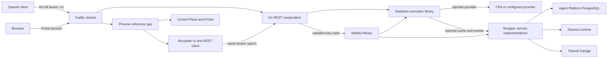

# 1. Restore Reference Workflows and Decouple Harden-LLM

- Project: Harden-LLM.
- Version: 5.0, one API-key storage scope; explicit saves create complete profile snapshots; Model Recall guides component reuse.
- Document ID: `PLAN-HLLM-REFERENCE-DECOUPLING-002`.
- Date: 2026-10-11.
- Owners: Kirill, product and architecture decisions; HLLM maintainer, implementation and release; Agent Platform, Laminar, Garage, Control Plane and Caddy maintainers, their shared-service contracts.
- Status: Accepted current product contract: profiles, drafts, entered provider credentials, cache, history and artifacts are scoped to the validated incoming HLLM API key. Portal controls frontend admission only. Explicit Save creates a new complete profile snapshot. Model Recall is the first interface-design reference for reusable components. Laminar retention and nonblocking recording remain accepted. Earlier [reference-decoupling](../ask_me/reference-decoupling-decisions.md) and [history-policy](../ask_me/shared-history-retention-and-access-decisions.md) records retain historical context; their user-ID ownership, additional REST session verification, mutable saved-profile overrides and deployment-wide deletion rules are superseded by this revision. Implementation remains pending; this revision changes documentation only.
- Planning source: `879106ff5da3b0b0d90f31e9d7e6f897e4888bbc`.
- UI behavior baseline: `754690c8d0890c664d69fbdf526b16b3e5601060`, PR #95, before PR #97.

Restore the baseline Harden-LLM UI and its useful workflows while separating one stateless Go execution engine, a reusable stateful wrapper, shared services, reusable Phoenix components, and shared ingress. Ordinary OpenAI-compatible clients use one base URL and a configured HLLM bearer without profiles or login. Reference REST uses that same bearer contract for API-key-scoped profiles, history, drafts and diagnostics. The core owns no authentication or storage scope. Reuse Agent Platform PostgreSQL for saved application state and Laminar as the sole history owner, and remove superseded code/storage without migrating obsolete HLLM data.

## 2. Design consensus and trade-offs

| Topic | Verdict | Decision and rationale |
| --- | --- | --- |
| Meaning of previous | DECISION | Restore the HLLM markup, styling, interactions and feature semantics at the full baseline SHA above. Do not restore arbitrary older code, utility-llm's React UI, or old database contents. |
| Stateless versus pure | DECISION | Name the core stateless. It performs effects through injected provider/cache/event dependencies; it owns no durable state, service lifecycle, authentication or telemetry SDK. Keep `Client.Call(ctx, request)` where practical. |
| Reliability ownership | FOR | One core owns retries, JSON repair, recovery/error fixers, validation, budgets, cache identity/hit validation and per-call accounting. The wrapper implements concrete service access and application behavior. |
| Libraries and services | DECISION | Add public Go package `stateful/`; extract a Phoenix package under `frontend/packages/harden_llm_ui/`. Compose one Go process and one Phoenix app. Model Recall supplies the first real consumer interface review; its migration is outside this release. An injected interface does not require another HTTP service. |
| Saved profiles | DECISION | `/profiles` is the restored Phoenix page; `/api/v1/profiles` belongs to the stateful wrapper. Explicit Save creates a new complete snapshot of the provider definition and all run inputs. `/v1/models` discovers models and cannot replace profiles, credentials, bundles, pricing or recovery controls. |
| Data scope | DECISION | One `api_key_hash`, derived by SHA-256 from a validated incoming HLLM access key, scopes saved profiles, drafts, entered provider credentials, cache, history and artifacts. Same key means same data across clients/logins; different keys mean separate data. No separate user/owner entity, key-to-user mapping, local user directory or key-issuance API. |
| Configuration ownership | DECISION | Git owns credential-free starting presets. Deployment `.env` supplies accepted HLLM access keys, selected frontend key, initial provider keys and operational secrets. PostgreSQL owns explicitly saved complete profile snapshots, mutable drafts and encrypted entered provider credentials. A selected preset fills the draft; saving copies only that chosen setup, with no live inheritance or restart synchronization. |
| Public API | DECISION | `https://harden-llm.prls.co/v1` with `Authorization: Bearer <HLLM_ACCESS_KEY>` supports the documented OpenAI-compatible subset. `CPA_API_KEY` is upstream-only. The incoming key alone also authorizes reference REST. Neither the core nor clients parse `.env`; deployment loads approved environment sources. |
| Reference API | DECISION | Preserve one feature-complete reference execution route, proposed `/api/v1/run`, with live progress and diagnostics. It shares core validation/execution with `/v1`; wire formats serve distinct consumers. Do not duplicate engines or retain route aliases. |
| Reference access | DECISION | Publish `/api/v1` and `/v1` on the same origin with one bearer-authentication boundary. Derive `api_key_hash` after successful key validation and pass it to wrapper operations; reject caller-supplied ownership/scope fields. No Portal session reference, user ID or second authentication header is required by Go REST. |
| Frontend admission | DECISION | PRLS Portal/Control Plane continue to own logins, passwords, sessions, resets and disabling users. Every enabled login may enter the frontend without company selection or an HLLM grant. Portal identity does not select stored HLLM data; the frontend uses its configured HLLM access key. No user-to-key assignment or new key-selection UI is included. |
| History scope | DECISION | Only reference execution calls enter product history, scoped to their validated HLLM access key. Any holder of that key may read, restore, delete entries or clear history in that scope. Different keys cannot access one another's records, statistics or artifacts. Direct `/v1` calls do not enter product history. |
| History retention | DECISION | Use the existing shared Laminar retention policy. Do not duplicate it in an HLLM expiry setting, require it to be finite, or hide retained records behind an inferred age limit. Verify the actual owner policy; changes to shared retention require separate owner coordination. |
| History failure | DECISION | Accepted 3B: a resolved, authorized call proceeds without a successful history write. Preserve the inference result and report recording separately. Disabled, misconfigured, empty, failed and unconfirmed history states must not be conflated. No alternate store, outbox or inference replay. |
| Debugging | DECISION | One structured error model supplies safe UI messages and detailed operator diagnostics: stable code, operation, correlation IDs, bounded timing, sanitized cause and separate inference/persistence outcomes. Reuse existing logs/traces; never expose credentials or secret connection strings. |
| History owner | DECISION | Laminar is the accepted sole history owner. Verify and complete its supported read/write/delete integration. A missing capability blocks the affected implementation/release; it does not authorize PostgreSQL history, shadow records, an outbox or a runtime fallback. |
| Shared persistence | FOR | Use Agent Platform's existing PostgreSQL service with isolated HLLM database/role and one bounded Go pool. Store key-scoped snapshots, credentials, hidden-preset preferences, cache and drafts there; Laminar alone owns history. No database/service per key and no dedicated HLLM PostgreSQL deployment. Remove Phoenix Ecto persistence after moving its responsibilities. |
| Simplicity | AGAINST | No universal plugin/configuration graph, authentication framework, microfrontend per widget, generic cache microservice, Temporal workflow, compatibility layer, duplicate CSS or second scheduler. Infrastructure configuration stays typed deployment configuration. |
| Clean cut | FOR | Breaking HLLM contracts and deletion of obsolete HLLM-owned data are allowed. Replacing an incoming HLLM key starts a new storage scope; no automatic ownership transfer, dual-key alias or legacy reader. Other products, shared identities/services, credentials and unrelated dirty work remain outside the reset. |
| Acceptance | DECISION | Use browser-free component, contract, database and composed checks. Browser layout and live-provider acceptance require separate explicit requests; neither may be claimed from these checks. |

Baseline capabilities include profile picker/editor/CRUD/bundles/model refresh/credential replacement; prompt/schema inputs; JSON repair/recovery/error-fixer controls; response/JSON viewer; usage/cost/attempt/cache/progress details; history pagination/restore/delete/clear; trace/artifact views and downloads; `/embed/llm`; and Portal login/logout. The accepted behavior changes are API-key ownership for all stored application data and create-on-save profile snapshots containing the complete setup. Preserve the baseline visual design and other feature semantics. Loading/restoring only changes the current key's draft; explicit Save and Run remain separate actions.

### 2.1. Grounded evidence and limits

- Current boundaries are in `AGENTS.md`, `plans/proxy-and-reference-app-simplification-plan.md`, `api/openapi.yaml`, `docs/adr/ADR-HLLM-031-proxy-reference-boundary.md` and ADR-HLLM-032. P00 reconciles these with the new wrapper direction; historical evidence stays historical.
- Current root `client.go` initializes concrete dependencies; Phoenix `frontend/lib/harden_llm/reference.ex` owns Ecto history/drafts. These are the ownership seams to change, not proof that the target already exists.
- Agent Platform source is `/home/kirill/p/agent-platform-infra/compose/base/compose.yaml`; its `postgres` service and `compose/base/postgres/init/00-databases.sh` do not yet provision HLLM. Existing initialized volumes need explicit provisioning, not just a new init file. Live grants/network attachment still need owner verification. Consult `/home/kirill/p/ops/tech/technical_strategy_constraints.xml` and the service records before infrastructure edits.
- Laminar source/runtime inspection on 2026-10-09 matched `/home/kirill/p/laminar-shared/deployment.lock.yaml`, revision `5f14c5c86f1bfc18c852dbc7c712609e44b8d69c`, v0.2.1. This is a dated observation, not a release-time identity assertion.
- Laminar supports project-scoped, SELECT-only `POST /v1/sql/query` with `{query, parameters}` and `{data: [...]}`. HLLM queries use bound parameters, request deadlines, stable time cutoffs and bounded pagination; query windows do not define a second retention policy. The existing HLLM key returned 404; pinned authentication code and an ingest-only rejection log explain that result. Successful history reads have not been demonstrated. Sources: [SQL documentation](https://laminar.sh/docs/platform/sql-editor), [pinned SQL implementation](https://github.com/lmnr-ai/lmnr/blob/5f14c5c86f1bfc18c852dbc7c712609e44b8d69c/app-server/src/api/v1/sql.rs), [pinned authentication](https://github.com/lmnr-ai/lmnr/blob/5f14c5c86f1bfc18c852dbc7c712609e44b8d69c/app-server/src/auth/mod.rs).
- The pinned [`POST /v1/spans` implementation](https://github.com/lmnr-ai/lmnr/blob/5f14c5c86f1bfc18c852dbc7c712609e44b8d69c/app-server/src/api/v1/spans.rs) accepts JSON spans and publishes them to a queue. Use this direct, unsampled path for complete reference records; confirm scoped visibility through SQL. Its acknowledgement does not prove completed storage. No live history write/read/delete was performed for this revision.
- SQL does not delete. The pinned frontend trace-delete route uses native session/project authentication; a supported HLLM service-key deletion contract has not been established. Do not copy operator sessions or write Laminar's internal database. Sources: [delete route](https://github.com/lmnr-ai/lmnr/blob/5f14c5c86f1bfc18c852dbc7c712609e44b8d69c/frontend/app/api/projects/%5BprojectId%5D/traces/route.ts), [frontend authentication](https://github.com/lmnr-ai/lmnr/blob/5f14c5c86f1bfc18c852dbc7c712609e44b8d69c/frontend/proxy.ts).
- `internal/runtime/telemetry.go` excludes prompt/response payloads; `deploy/otel/collector.yaml` removes content attributes and configures tail sampling with a 75-second decision wait. Export acceptance is not query visibility or durable history. Current diagnostic traces cannot simply become complete history through a SQL query.
- Current `frontend/lib/harden_llm_web/router.ex` uses shared `PrlsWeb.Access` with `:require_access`; `/home/kirill/p/masked-recall/web/lib/model_recall_web_web/router.ex` uses the same integration with an additional `{:product, "model-recall"}` requirement. Reuse the shared identity authority, not Model Recall's account/product access policy.
- `/home/kirill/p/prls-portal/lib/prls_portal_web/router.ex` exposes operator-only `/admin`; `admin_live.ex` implements create-user, reset-password and disable-user through Control Plane. `/home/kirill/p/prls-control-plane/contracts/openapi.yaml` and `docs/operations.md` own those contracts. This is source evidence, not a claim that live provisioning was exercised.
- Current Go REST `internal/gateway/httpapi/httpapi.go:authorize` checks one bearer; Phoenix resolves Portal identity for frontend admission/drafts. The target replaces frontend user-ID draft ownership with key scope and generalizes the one HTTP bearer validator to the configured key list. Shared Control Plane token issuance exists in its source, but its account/product permissions are outside this design: do not add that verification path or an HLLM token registry. Source evidence is not deployed acceptance.

### 2.2. API keys, complete saved profiles and frontend admission

The incoming **HLLM access key** authorizes clients to Harden-LLM. It is distinct from upstream provider credentials such as `CPA_API_KEY`, the credential-encryption key, and the Laminar service key. Derive `api_key_hash = hex(SHA256(validated_access_key_bytes))` after bearer validation. Hash the entire exact credential, not its display prefix. The hash is an internal storage scope, not another accepted credential or a browser-supplied selector. Use high-entropy deployment access keys; never persist their plaintext in profiles, drafts, Laminar, Garage metadata, logs or traces.

| Information | Authority | Update rule |
| --- | --- | --- |
| Starting preset IDs, base URLs, model names, prices and options | Credential-free Git catalog | Selecting a template fills a draft. Do not seed every template into every key scope. |
| Accepted HLLM access keys | Connection configuration's `api_key_envs` names plus protected environment values | One required array of environment-variable names is the authoritative allowlist. Initially use `["HARDEN_LLM_TOKEN"]`; add another environment-variable name only for a deliberately separate key. No raw keys in JSON, startup-generated keys, database registry or implicit scalar fallback. |
| Frontend's selected HLLM access key | Protected shared deployment environment, `HARDEN_LLM_TOKEN` | The host passes this server-held key in the ordinary Authorization bearer header. Its environment name is an accepted `api_key_envs` entry. The gateway and frontend receive the same approved `.env` value; do not create a duplicate secret or another gateway authentication path. |
| Initial provider keys and service/encryption secrets | Protected deployment environment / `.env` | Keep deployment credentials environment-backed. Git names only provider connection metadata/environment variable names. |
| Saved profile snapshots, current draft, entered provider credentials and cache | Wrapper-owned HLLM database in Agent Platform PostgreSQL | Key-scoped. Explicit Save creates a new snapshot; autosave updates the draft only. Entered provider credentials remain encrypted separate records referenced by the snapshot. |
| Reference history and artifact access | Laminar history and existing Garage objects | Key-scoped. Every read, statistic, restore, delete, clear and download verifies the same scope. Laminar retains its existing retention policy. |
| Human identities, passwords and sessions | Shared PRLS Control Plane/Portal | Control admission to the frontend only. No human ID becomes an HLLM storage key. |

The same access key gives the same data across SDKs, backends and Portal logins. Different access keys give isolated data. The reference deployment initially selects the existing deployment key, so all its enabled logins share that key's workspace, profiles and history. This is intentional key ownership, not per-person isolation. Another backend/reference host can supply a different configured key through the same REST contract. No automatic Portal-to-key mapping or browser key picker is added.

Use the existing profile-save control to save the complete current setup: provider definition/base URL/model/prices, system/user prompts, schema and shorthand, reasoning, provider options, web search, retries/repair/rerun settings, cache choices and timeout. Save generates a UUID and server UTC timestamp and creates a display name such as `CPA JSON · 2026-10-11 14:32Z · a7c92e` using a short UUID suffix. UUID is the identity; the generated name is display text, not a content hash or an authorization key. Editing a saved setup changes the draft. Saving it creates another snapshot and never updates the old snapshot. Repeated explicit saves are separate records; no deduplication, parent/version graph or automatic snapshot per keystroke.

Keep one complete snapshot representation for saved profiles and history's safe resolved settings. A snapshot references an explicitly selected deployment or entered provider credential; it does not contain a plaintext key. A changed/deleted Git template cannot alter a saved snapshot. Model refresh updates the current draft's model catalog; explicit Save creates the next profile. Credential replacement updates its separate key-scoped credential record and cache identity while saved nonsecret setup remains fixed. Invalid/missing credentials fail before dispatch; never substitute an environment key.

Portal operators continue using the existing `/admin` create/reset/disable flow. The enabled-user check stays in the Phoenix host. Go REST does not call Control Plane, accept a session reference, or require an account/product grant. Changing Portal identity alone does not change the selected HLLM scope. Replacing/removing an HLLM key removes access through that credential; a new key selects a fresh scope. Old rows/objects remain subject to their owning retention and explicit HLLM-only cleanup; no startup deletion or implicit key-to-key transfer is authorized.

The reusable Phoenix client accepts a host-supplied server-held API key. It does not own login, discover keys, copy sessions, or resolve a user ID. The stateless core receives neither incoming keys nor key hashes; scope enters through concrete cache/history/artifact implementations in the wrapper.

### 2.3. History states and actionable diagnostics

Laminar is selected. CHECK-421 verifies its integration contract, not the backend choice. PostgreSQL stores no history. Expose the Laminar implementation with an explicit enabled/disabled setting. Missing required settings while enabled are configuration errors; a runtime outage never changes the setting to disabled.

| Condition | Required behavior |
| --- | --- |
| Explicitly disabled / intentionally not set up | Report history disabled as information; perform no history I/O and do not label inference failed. |
| Enabled with missing or invalid configuration | Validate and report a configuration error on the history feature/readiness surface. Preserve deployment-configured inference; do not silently disable history or discard the diagnostic. |
| Healthy query returns no records | Show an empty history only after a successful read. |
| Ingestion acknowledged, readback pending | Report pending visibility. An enqueue acknowledgement alone does not establish that the complete history record is stored. |
| Complete write confirmed by readback | Report saved after matching the complete record; one complete reference record is expected during healthy operation. |
| Definite write failure | Preserve the result and report not saved, with the cause and execution ID. |
| Write acknowledgement is lost or times out | Preserve the result and report unconfirmed; do not claim either saved or absent. No blind retry of that write or inference. |
| Read failure or delayed visibility | Report unavailable or pending visibility as supported by the Laminar owner; never present a failed read as an empty history. |

Generate an execution ID in memory, validate authorization/profile/credentials, execute once, then attempt bounded recording at the Laminar owner. No acknowledged history start is an inference prerequisite. Progress and current-call statistics come from the execution itself. History-derived totals cover available records only; missing records are not zero-cost calls. Process crashes can lose a record in this synchronous design; interrupted/incomplete records, when present, must remain explicit.

Use one structured failure value for reference responses, UI messages and sanitized logs. Include a stable code, component/operation, execution/request IDs, trace ID when available, history mode, separate inference and persistence outcomes, cause category (configuration/authentication/connection/timeout/schema), duration and a safe corrective action. Bound message size; do not copy raw driver errors containing DSNs, tokens, passwords, cookies, session references or user payloads into diagnostics. Preserve existing OpenAI error envelopes on `/v1`; define new reference fields/codes in OpenAPI before implementing them. Reuse the current logging/Laminar integration rather than adding a debug service.

### 2.4. Confidence review and unresolved engineering checks

The current policy is resolved: inherit Laminar retention and permit every holder of an accepted HLLM key to delete/clear that key's history. Earlier login-wide deletion in the [history-policy record](../ask_me/shared-history-retention-and-access-decisions.md) is superseded; login identity does not determine data scope. Remaining checks below are engineering work; they do not reopen Laminar ownership, UI preservation or shared identity decisions. Detailed step definitions and document consistency checks are not evidence that these integrations already work.

| Confidence area | Current evidence and required follow-up |
| --- | --- |
| Laminar history service contract: low | Successful full payload/read/delete acceptance is still unverified for the deployment credential. P00.S05 must establish supported service access, full-size readback, deletion completion and visibility. Preserve Laminar as owner; no guessed endpoint or replacement backend. |
| Artifact independence and cleanup: low | The earlier draft tied downloads to history and assumed Garage lifecycle cleanup; those assumptions are superseded, and the replacement metadata/cleanup flow remains unverified. P03.S07 must first freeze an owner-backed design that preserves available trace/download behavior when history fails or is disabled, proves the authenticated API-key scope independently of a successful history write, and accounts for unrecorded objects. Do not implement the restrictive draft behavior or claim automatic cleanup as verified. No extra metadata database or scheduler is approved by this uncertainty. |
| Shared service deployment: medium | Source identifies Agent Platform PostgreSQL and existing frontend Portal admission; HLLM database/role grants, actual network access and deployment service-credential scopes still require P05 owner checks. Every configured HLLM access key must be isolated at all storage boundaries; no Go identity-authority integration is required. Repository configuration alone is not live acceptance. |
| Exact baseline preservation: medium | Baseline SHA is fixed, but individual implementation details still need comparison before extraction. This review found that baseline bundle import probes candidate providers; the earlier draft incorrectly removed those probes. Preserve the baseline behavior and its test oracle. Component/HTTP checks do not establish actual browser layout. |

The artifact-design issue is an open engineering gate, not permission to remove downloads, add a fallback store or ask the user to accept a regression. Record the corrected concrete flow in sections 4/8 and its TEST-443/448 assertions before artifact implementation. Independent stateless/profile work can proceed under section 5.1.

## 3. PRD: stakeholder and system needs

- Problem: the simplification removed useful UI workflows and conflated separation of history with removal of application capabilities. The desired core remains a robust LLM caller usable independently.
- Users: ordinary OpenAI-compatible clients; Go library consumers; applications embedding the stateful library or Phoenix components; enabled Portal users of the reference app; shared-service operators.
- Value: familiar API access, preserved reference workflows, reusable components and fewer independently operated services.
- Business goals: restore capability without redesign; maintain one implementation per responsibility; keep service/RAM footprint small; make ownership and release evidence understandable.
- Success metrics: all baseline manifest capabilities pass with the two accepted semantic changes recorded; zero direct-call history records; zero cross-key profile/credential/draft/cache/history/artifact access; same-key data shared across two client contexts; zero overwritten snapshots after redeployment or Git changes; zero duplicate provider calls caused by storage/telemetry failure; zero added production service instances; all required exact-SHA release gates pass. One isolated logical HLLM database reuses shared PostgreSQL. No new throughput/latency SLA is asserted.
- Scope: stateless core boundary, wrapper/profile/cache/draft/history ownership, reference API, reusable UI, shared-service integration, ingress, canonical docs and eventual release.
- Non-goals: full OpenAI/CPA feature parity, provider-token progressive streaming, durable job orchestration, automatic inference replay, old-data migration, unrelated service retirement, high availability or a new identity system.
- Dependencies: Laminar supported read/write/delete integration and key-scoped queries; shared PostgreSQL grants/network; existing Garage; frontend Portal admission; shared Caddy; approved build/deployment credentials. Model Recall is reviewed read-only to guide component contracts; its migration is not a release dependency.
- Risks: hidden baseline behavior, incomplete trace payloads, unsupported deletion, a missed key predicate, unsafe credential exposure, snapshot/draft confusion and accidental replacement of saved credentials by deployment defaults.
- Assumptions: breaking HLLM-only changes remain acceptable; the existing deployment key initially serves the reference host; configured additional keys use the identical bearer contract; replacing a key creates a fresh scope; cache-off inference must work during storage/Control Plane outage; current test/build infrastructure is retained. Missing owner contracts block dependent work rather than creating a fallback.

## 4. SRS: canonical requirements

| ID | Type | Requirement and acceptance criteria |
| --- | --- | --- |
| REQ-420 | func | Restore every capability enumerated in section 2 using the pinned HLLM UI layout/styles/interaction contracts. Record intended ownership changes explicitly; remove no feature silently. |
| REQ-421 | func | Root Go library performs all reliability decisions through injected effects, with immutable per-call configuration and no owned service lifecycle/global state. Concurrent calls cannot mutate one another. |
| REQ-422 | int | One public `/v1` base exposes models, chat completions and responses with a configured HLLM bearer alone. Ordinary SDK/curl requests require no saved profile, Portal identity or custom scope header. Preserve the documented subset, tools, errors and final-only SSE; cache is scoped to the authenticated key without placing that key in the core. |
| REQ-423 | func | Wrapper owns key-scoped complete saved-profile snapshots, deletion/hiding, encrypted bundles, provider credentials, model discovery and starting-template selection. Explicit Save generates a new UUID/date/suffix and snapshots every run input and provider setting. Editing/refresh changes the draft; no saved-profile update or live preset inheritance exists. Resolve one validated snapshot/credential binding before execution; deleted/invalid profiles fail without provider calls or substitution. |
| REQ-424 | data | One shared PostgreSQL pool owns profile/credential/hidden-preset/cache/draft persistence with isolated HLLM resources. Every row/namespace is key-scoped. Core owns cache eligibility/key/hit validation; wrapper owns scope/storage/expiry and bounded write-triggered cleanup. No Phoenix database owner remains. |
| REQ-425 | security | One Go REST bearer boundary validates a configured incoming HLLM key and derives its SHA-256 fingerprint server-side. Both `/v1` and reference `/api/v1` use that credential alone. Missing/invalid keys fail before storage/provider work; caller-supplied ownership/hash/session fields cannot select data. Portal/Control Plane own frontend login/admission only. No HLLM user/password/key-issuance store, per-user key assignment or Go session introspection. |
| REQ-426 | data | Laminar alone records reference executions with server-derived `api_key_hash`, including cache hits and terminal validation errors when enabled. Healthy operation saves one complete record per execution. Disabled/configuration-error/empty/not-saved/unconfirmed/read-failure outcomes differ; recording failure preserves inference. List/detail/stats/restore/delete/clear and associated downloads enforce the same key. Preserve numbered pagination/total counts and full restore into the current draft. Laminar alone controls retention; no shadow history store, second expiry policy or hide-only substitute. |
| REQ-427 | data | Profiles, encrypted entered credentials, hidden-preset preferences, drafts, cache, history and artifacts are scoped to `api_key_hash`, never human user IDs or raw access keys. Different keys cannot read/overwrite/delete each other's data; the same key sees the same data across logins/clients. Saved snapshots survive Git changes/restarts. Replacing the access key gives a fresh scope without copying or automatically deleting the previous scope. |
| REQ-428 | nfr | Reusable Phoenix UI/client package has no dependency on the reference app, internal Go types, Ecto or Portal session implementation. Host supplies a server-held HLLM API key and admission/login routes. Model Recall provides the first consumer interface review; a separate test host proves package independence. Component state is instance-local, persistent drafts are key-scoped, and logic/decoders/styles each have one source. |
| REQ-429 | func | Preserve progress, response/JSON inspection, attempts/cache/usage/cost, trace/artifact views and downloads. Core supplies facts, wrapper aggregates once, UI formats. Recovered errors and history failures do not mark successful calls failed; unknown cost is not zero. One structured diagnostic supplies safe messages plus stable codes, operation/correlation IDs, timing, sanitized causes and separate execution/persistence outcomes. |
| REQ-430 | int | Deploy one Go process and one Phoenix app using existing shared PostgreSQL/Laminar/Garage/Control Plane and Caddy. Serve UI and `/v1` at `harden-llm.prls.co`; no second API hostname is required. |
| REQ-431 | reliability | Cache-off configured inference neither opens nor waits for application storage or human identity services. Local bearer validation and key-scoped client construction perform no network I/O; constructors do not ping databases. Authorization/profile/credential failures prevent reference inference, history availability does not. Release DB resources before provider work; bounded sink failure never replays inference or switches credentials/stores. |
| REQ-432 | security | Incoming HLLM keys, deployment provider keys, database/encryption/service secrets stay in protected environment configuration. Entered provider keys are encrypted in PostgreSQL with API-key-hash/credential/origin binding. Passwords/sessions stay in Control Plane. Neither raw HLLM keys nor provider secrets appear in read DTOs, exports, traces, Laminar, Garage metadata, logs or evidence. Hashes cannot authenticate or be supplied as ownership selectors. No environment-to-database key sync/fallback; retain bounded sanitized diagnostics. |
| REQ-433 | nfr | Preserve assertion purposes and canonical test identifiers; add failing deterministic coverage before changed behavior. Retain the existing runner, tier policy and browser/provider opt-ins; every changed test file carries specification and test tags. |
| REQ-434 | reliability | A complete release has a recorded source SHA, successful exact-SHA release attempt, component image identities, shared-owner configuration evidence, URL and browser-free checks. Docs/build/local tests alone never count as deployed acceptance. |
| REQ-435 | nfr | Maintain one engine, route per operation, persistence owner and component/style source. Delete superseded HLLM paths/data only; no migration/fallback/compatibility model or unrelated shared-resource reset. |

Performance constraints retain ADR-HLLM-032's current 256 KiB request, 16 MiB upstream/encoded response, 60-second inference and 64 KiB diagnostics bounds. Baseline reference features that demonstrably cannot fit require an explicit contract decision; do not silently truncate history or increase limits to pass a test. Test runtime estimates below are scheduling estimates, not production SLAs.

Errors use the existing OpenAI envelope on `/v1` and typed OpenAPI errors on reference operations. Authentication, invalid profiles/credentials and failed profile resolution prevent provider invocation; history configuration/storage errors do not. Apply the explicit history outcomes and diagnostic fields in section 2.3. A successful result remains successful when recording fails or is unconfirmed. Interrupted records remain visibly incomplete; this synchronous design does not promise crash-proof exactly-once completion. Diagnostic export is bounded and separate from history acceptance; history payloads follow their approved access/retention policy.



```text
System: Harden-LLM
  People: enabled Portal users             External clients: OpenAI SDK/curl
  Ingress: caddy-shared, one public origin
  Containers:
    Phoenix reference app -> reusable UI/REST client -> reference REST
    Go gateway composition -> stateless core + stateful library
  Components:
    core: reliability decisions, resolved inputs, injected effects
    wrapper: profiles, cache persistence, drafts, Laminar history, diagnostics
  External systems:
    Agent Platform PostgreSQL; Laminar; Garage; Control Plane; CPA/provider
  Trust boundaries:
    /v1 and reference REST: configured HLLM bearer -> server-derived key hash
    browser admission: Portal -> Phoenix; identity does not select data
    stateless core: resolved inputs/effects only, no incoming credential or scope
  Data authority:
    credential-free presets: Git; deployment secrets: protected environment
    key-scoped saved snapshots/credentials/drafts/cache/preferences: shared PostgreSQL
    human passwords/sessions: Control Plane
    key-scoped reference history: Laminar only; retention remains with Laminar
```

### 4.1. Implementation map and package rules

The names below are the target API, not claims that these symbols already exist. Preserve existing types/functions when listed; move their implementation once instead of wrapping a second copy. P00 copies these contracts into OpenAPI and the canonical specifications. Do not restore an entire old commit over current fixes.

| Responsibility | Current or baseline source | Target and named entry points |
| --- | --- | --- |
| Execution | Current `client.go`, `types.go`, `connections.go`, `cache.go`, `internal/runtime/` | Keep `hardenllm.New(Options)`, `Client.Call`, `Client.Models`, `CacheStore` and the one `runtime.Execute`. Add public aliases `Executor`, `ProviderCall`, `ProviderConnection`, `ProviderCredential`, `PreparedOperation`, `ProviderResult` for the existing runtime types needed by an external executor; alias the prepared cache-operation types too. |
| Concrete provider and telemetry construction | Current `client.go`, `internal/providers/`, `internal/runtime/telemetry.go` | Move construction into `stateful/client.go: NewClient(ClientOptions)`. Move OTEL implementation to `internal/observability/telemetry.go`. `internal/providers/` stays one concrete implementation; do not add provider transports. |
| Profile definitions and encryption | Baseline `internal/profiles/{profiles,credentials,default_catalog}.go` and `default-profile-catalog.json` | Move reusable validation/types/encryption into `stateful/{profile,credential,presets}.go`; catalog into `stateful/presets.json`. Keep `ValidateCatalog`, `NormalizeModels`, `CredentialVault.Seal/Open`; bind to the incoming key hash and remove old user/seeding/live-inheritance assumptions. |
| Wrapper persistence | Current Phoenix `frontend/lib/harden_llm/reference.ex`; baseline storage semantics | New `stateful/store.go`, `profile_store.go`, `cache.go`, `draft.go`, `schema.sql`. Direct pgx queries in this package; no generic repository interface and no restored `internal/postgres/` package. |
| Reference execution | Baseline `internal/gateway/{run_service,runtime_profiles}.go` | New `stateful/run.go: Service.Run`, `resolve.go: resolveRun`, `project.go: projectRun`. Reuse the baseline `RunOutput` projection, not its old engine/storage/resolver. |
| History and artifacts | New history integration; baseline `internal/artifacts/garage.go` and `internal/gateway/artifact_coordinator.go` | New `stateful/{history,laminar,artifact}.go`; restore only the Garage object operations needed by `ArtifactStore`. Laminar holds history; Garage holds large artifact bytes already represented as artifacts. |
| Reference HTTP | Current `internal/gateway/httpapi/httpapi.go`; baseline reference route contracts | New `reference.go`, `reference_access.go`, `reference_stream.go` in that package. Extend the existing `net/http.ServeMux` and `Config`; do not restore the old router framework. |
| UI | Baseline `frontend/lib/harden_llm_web/live/{workspace_live,profiles_live,embedding_live,profile_widget_component}.ex`, associated templates, forms, trace components and CSS | Restore the workspace shell first in P03. Move reusable parts once into `frontend/packages/harden_llm_ui/` in P04. The host keeps its Router, LiveViews and Portal integration. |

Core dependency rule: root/runtime/retry/accounting/cache-key decision code may depend on value types, standard-library context/time and injected interfaces. They must not import pgx, concrete providers, OTEL SDK, slog, Phoenix or application profile/history packages. Library constructors validate values but perform no network I/O. Nil cache disables cache; nil observer performs no observation. A missing executor is a construction error, not a hidden default provider.

### 4.2. Stateless call and recovery contract

- Replace concrete-effect fields in root `Options` with `Connections ConnectionCatalog`, `DefaultConnection string`, `Executor Executor`, `DiscoverModels ModelDiscoverer`, `Observer Observer`, and existing `Cache CacheStore`. Define `type ModelDiscoverer func(context.Context, Connection) ([]Model, error)`. `Client.Models` calls it; absence returns the typed unsupported-operation error. `Client.Call` never discovers models.
- `stateful.ClientOptions` contains the current concrete construction settings: connections/default connection/cache, endpoint policy, web search, tracer provider, meter provider and logger. `stateful.NewClient(ClientOptions) (*hardenllm.Client, error)` is the ready-to-use library constructor. Its private `newEffects` helper creates provider router/model discovery/observer once; `NewService` reuses that helper. Both call the same root constructor. Delete `internal/gateway.NewStaticClient` after its callers use this composition.
- Define `Observer` using the existing start/finish contracts: `StartRuntime`, `StartProvider`, `StartAttempt`, `StartCache`; expose the existing observation/target types through public aliases. `StartCall(ctx, CallObservation)` finishes with `func(CallSummary, error)`, where `CallSummary` contains only IDs, selected/generation targets, status, durations, attempt count, cache outcome and existing accounting ledgers. It must not contain output, messages, credentials or prepared operations. Replace effectful telemetry methods with `StartRetry(ctx, target, callType, classification, delay) (context.Context, func(error))` and `StartValidation(ctx, connection, repair) (context.Context, func(error))`. Core itself performs waiting and validation and calls each finish once. A nil observer must not change results, retry count, timing budgets or cancellation. Move concrete metric/span tests with the OTEL code, retaining names and bounded labels.
- Keep `Request`, `Result`, `ProgressEvent`, `CacheRecord`, `CacheStore` and their supported wire meanings. Add the optional Go-only `Request.CaptureDiagnostics func(DiagnosticCapture)` callback (`json:"-"`) for reference artifacts, as defined below. No database/user/profile identifier, incoming API key or key hash becomes necessary for a root call. Prepared provider payloads and credentials must never be exposed to telemetry merely to reuse `CallRecord`; use its safe observation projection.
- Preserve `retry.Policy` and its validation. Add `ConnectionID string` with JSON name `upstream` to `retry.RecoveryTarget`, applicable to `source:"model"`. Absent `upstream` means the request's connection. `source:"generation"` selects the actual generation target. A supplied nonexistent connection fails validation before any provider dispatch.
- Add an immutable resolved connection/credential map to runtime input, keyed by connection ID. Resolve all referenced targets before execution. `preparePlannedGeneration`, `preparePlannedRepair` and rerun planning select from that map; each planned work item carries the selected credential. Do not read profiles, query storage or reread environment during an attempt.
- The wrapper accepts the baseline `source:"profile", profileId` targets at the five existing leaf positions: `jsonRepair.initial`, `jsonRepair.escalation`, `rerun.target`, `rerun.jsonRepair.initial`, and `rerun.jsonRepair.escalation`. `resolveRun` binds them to the authenticated key scope's resolved connections and rewrites them to the core model/upstream form. Assign fixed per-call connection IDs `generation`, `repair-initial`, `repair-escalation`, `rerun`, `rerun-repair-initial`, `rerun-repair-escalation`; do not use potentially 1500-byte profile names as 128-byte upstream IDs. It does not follow the referenced profile's recovery policy recursively. Missing/deleted/unauthorized repair profiles or keys fail before the first generation. Shared history restore never bypasses this check.
- Add optional `Pricing *Pricing` to resolved `Connection`, using a public alias to the existing `internal/accounting.Pricing` value. Price each dispatched attempt with that attempt's snapshot, using `accounting.ResolveCost`; provider-reported cost wins. Nil rate is unknown and a zero rate is known zero. Sum the existing ledger once, including repair/rerun targets with different rates. Cache hits retain recorded accounting and identify cached usage without inventing a new billed invocation. Never price aggregate tokens retrospectively using the current selected profile.

The existing `internal/traces` and `internal/diagnostics` packages already provide storage-neutral trace projection, artifact projection and redaction. Preserve their assertion oracles. Define public value aliases `Trace` and `ArtifactProjection` to the existing trace types, and `DiagnosticCapture{Trace Trace; Artifacts []ArtifactProjection}`. At terminal core completion, when the request callback is non-nil, use `traces.Project` and `traces.ArtifactProjections` once to produce detached, bounded values redacted with the resolved credential values. Invoke the callback once, including parse-failure evidence when available. An authenticated-encryption key or whole prepared operation is never part of this public capture. Capture/projection failure becomes a diagnostic, preserving inference.

The wrapper callback only assigns this per-call capture in memory; it performs no storage or logging. Wrapper `publishArtifacts` uploads the existing baseline trace/parse-failure projections through Garage after core completion with the baseline two-second persistence bound, then adds returned metadata to `RunOutput` before Laminar records it. Keep `internal/diagnostics.Build` and its 4 MiB support-bundle bound rather than rebuilding diagnostics in Phoenix. The OTEL observer receives only safe `CallSummary`, never this payload capture. A nil callback produces no artifact work for ordinary `/v1` calls. Do not restore the baseline PostgreSQL artifact journal, 30-second reconciler, publisher-versus-store fallback or secondary scheduler.

### 4.3. Stateful library contract

`stateful.Config` fields remain `Client ClientOptions`, `Pool *pgxpool.Pool`, `Presets Catalog`, `Vault *CredentialVault`, `History *LaminarHistory`, and `Artifacts *ArtifactStore`. `NewService(Config) (*Service, error)` calls `newEffects` once and retains shared concrete effects for immutable call clients. `Service.ClientForKey(apiKeyHash string) (*hardenllm.Client, error)` binds one `PostgresCache` scope to that key and the deployment credential snapshot, then uses the one root constructor. It performs no database/identity/network lookup. `/v1` uses this composition for every authenticated key; there is no unscoped cache path or duplicated engine. Standalone `stateful.NewClient(ClientOptions)` remains the storage/auth-free convenience constructor for library consumers.

The executable owns pool/client shutdown; `Service` neither provisions a database nor creates another pool. Optional storage/history/artifact configuration errors remain typed feature status and do not prevent deployment inference. A nil pool/vault produces explicit storage/credential configuration errors on affected operations; it never substitutes environment credentials. `LaminarHistory` retains enabled/configuration status. Inject clock and ID functions through unexported test options; no general dependency container.

Use `ProfileCredentialBinding{Source string, DeploymentUpstreamID string, EnteredCredentialID string}` with wire names `source`, `deploymentUpstreamId`, `enteredCredentialId`; source is `deployment` or `entered` and exactly its one source-specific ID is present. `ProfileRecord{APIKeyHash, ID, Name, PresetID string; Definition, Inputs json.RawMessage; Binding ProfileCredentialBinding; CreatedAt time.Time}` represents an immutable complete saved profile. `PresetID` is provenance only, never an inheritance link. `Draft{DraftKey string; Revision int64; Payload json.RawMessage}` and `SaveDraftInput{Revision int64; Payload json.RawMessage}` preserve mutable draft compare-and-swap. `ResolvedProfile` contains validated definition, saved inputs and detached connection/credential metadata; never serialize it whole.

`validateSnapshot` is the value-only validator for a complete definition plus saved inputs. Git template selection and saved-profile loading both fill the same draft shape. Missing optional input fields normalize once through existing core/provider validation; explicit false/zero/empty values keep their meaning. Remove the earlier override merge/reset protocol. Core retry and provider semantics remain the single validators; the UI only serializes chosen fields.

| Operation | Go signature and file |
| --- | --- |
| Resolve profile | `ResolveProfile(ctx context.Context, apiKeyHash, profileID string) (ResolvedProfile, error)` in `resolve.go`; saved definitions never reread a Git template; template IDs resolve only as starting choices. |
| List/get profiles | `ListProfiles(ctx context.Context, apiKeyHash string) ([]ProfileView, error)` and `GetProfile(ctx context.Context, apiKeyHash, profileID string) (ProfileDraft, error)` in `profile.go`; list projects picker fields, detail returns the full safe setup. |
| Save/delete | `SaveProfile(ctx context.Context, apiKeyHash string, input SaveProfileInput) (ProfileView, error)` and `DeleteProfile(ctx context.Context, apiKeyHash, profileID string) error` in `profile.go`; Save always creates a fresh UUID; deleting a Git template hides it only for this key. |
| Model refresh | `RefreshModels(ctx context.Context, apiKeyHash, profileID string) (ProfileDraft, error)` in `profile.go`; discover models with the current explicit credential, return changed draft, never update a saved snapshot or invoke generation. |
| Bundles | `ExportBundle(ctx context.Context, apiKeyHash string) ([]byte, error)` and `ReplaceBundle(ctx context.Context, apiKeyHash string, bundle []byte) error` in `bundle.go`; one encrypted current format, same access-key scope/encryption key only. |
| Drafts | `GetDraft(ctx context.Context, apiKeyHash, draftKey string) (Draft, error)` and `SaveDraft(ctx context.Context, apiKeyHash, draftKey string, input SaveDraftInput) (Draft, error)` in `draft.go`. |
| Run | `Run(ctx context.Context, apiKeyHash string, input RunInput) (RunOutput, RunState, error)` in `run.go`; baseline execution fields plus recording outcome. |
| History | `ListHistory(ctx context.Context, apiKeyHash string, query HistoryQuery) (HistoryPage, error)`, `GetHistory(ctx context.Context, apiKeyHash, runID string) (HistoryRecord, error)`, `DeleteHistory(ctx context.Context, apiKeyHash, runID string) error`, `ClearHistory(ctx context.Context, apiKeyHash string, query HistoryQuery) (ClearResult, error)` and `Statistics(ctx context.Context, apiKeyHash string, query HistoryQuery) (Statistics, error)` in `history.go`. |
| Artifacts | `OpenArtifact(ctx context.Context, apiKeyHash, runID, artifactID string) (ArtifactReader, error)` in `artifact.go`; the owner-backed metadata/download flow in section 2.4 must prove scope even without a successful history write. No caller-supplied Garage key/URL. |

`SaveProfileInput` is `{name?, presetId?, definition, inputs, credentialBinding, credential?}`. `definition` contains the complete baseline provider/model/pricing/hardening definition; `inputs` contains the full current run-form values, excluding authentication, scope, result/run/trace IDs and UI process state. Fields are `modelId`, `systemPrompt`, `userPrompt`, `schema`, `schemaShorthand`, `callType`, `reasoningEffort`, `webSearch`, `providerOptions`, `cacheMode`, `cacheVersion`, `timeoutMs`, `recoveryPolicy`, and existing input-origin fields. `ProfileView` is `{id, name, kind:"preset"|"saved", presetId?, createdAt?, definition, credentialStatus}`; its definition supports existing picker/model/repair controls, while full inputs are fetched on selection. `ProfileDraft` is `{sourceProfileId?, presetId?, definition, inputs, credentialBinding?, credentialStatus}` with no credential value; an unconfigured template has no binding until explicitly selected. Explicit Save freezes normalized values, creates ID/time/name and inserts; supplied profile IDs/revisions/creation times are rejected. Credential omission preserves an explicitly selected binding, not an alternative key. Raw provider keys are accepted only on explicit credential save and never echoed. Snapshot save/import retains the existing explicit provider probe; it does not execute the user's prompt.

In `resolveRun`, keep the baseline `rootProfile` option translation: model/reasoning, provider-specific token parameter names, web-search capability, options and per-call choices resolve once. Resolve saved inputs, selected definition, recovery leaves and current credentials into a detached snapshot using one read-only repeatable-read transaction; release it before network I/O. A referenced repair profile must belong to the same API-key hash. History restore uses the recorded safe setup to fill the current draft, never resolves profiles by matching display names. Missing/deleted credential bindings stay unresolved until an explicit current-key choice; Restore never saves or runs automatically. Run retains its selected profile/template ID and submitted per-call inputs. If restored/provider-definition edits have no matching existing snapshot/template, require explicit Save to create that setup before Run; do not discard those edits or introduce an unsaved-provider execution route.

Preserve the baseline bounded provider probe (`"Reply with OK."`, one attempt, ten-second deadline) on explicit profile save. Probe the candidate before the short insert transaction. Failed or unknown probe leaves snapshots/credentials unchanged and is not retried. Refresh does no generation. Explicit bundle import probes each enabled candidate before atomic replacement, as baseline `ProfileService.ReplaceBundle` does. Test with local providers; no startup/deployment probes. Keep the paid-operation message in the editor's existing status/help surface.

Deleting a saved profile removes its key-scoped row without selecting another profile. Hiding a Git preset writes `hidden_presets`; it changes no Git source or other key's picker. Recreating a setup is explicit Save with a new ID; there is no automatic reseed. Credential replacement is a separate key-scoped record update with revision-based concurrency; profile inputs/settings stay immutable. All caller-supplied IDs remain data identifiers, never authority.

### 4.4. HTTP bearer authentication and composition contract

- Replace the gateway's scalar `httpapi.Config.Token` with `APIKeys []string`, resolved only from required connection-configuration `api_key_envs []string`. This array contains environment-variable names, not secret values; deployment loads the existing protected `.env`. Initially configure `["HARDEN_LLM_TOKEN"]`. Validate distinct nonempty names and resolved keys using the existing token constraints; missing/duplicate values fail without printing secrets. No implicit scalar fallback or key-registration API; preserve the existing deployed key value.
- Replace the HTTP composition's single `Config.Client` with `ClientForKey func(string) (*hardenllm.Client, error)` assigned from `Service.ClientForKey`; retain `Reference *stateful.Service`. Update handlers/tests once rather than wrapping old and new client paths. Build provider/telemetry effects once; per-key client construction is immutable local composition and never checks storage out.
- One `authorize` middleware protects `/v1` and `/api/v1`. Validate exactly one Authorization bearer using the existing parser/constant-time comparison rules. Match accepted keys, derive `api_key_hash` once from the matched exact credential, and place the hash plus its locally composed client in private request context. Every handler uses this context; reject scope/owner/user/key-hash/session selectors in request data. A hash alone cannot authenticate. Missing/invalid credentials return 401 before provider, PostgreSQL, Laminar or Garage work.
- No `ResolveAccess`, Go Control Plane request, `X-PRLS-Session-Reference` requirement, account/product permission lookup, key-to-user mapping or persisted incoming-key registry exists. Portal guards the Phoenix host only. `/v1` and reference REST continue to authenticate during Control Plane outage; the frontend's normal sign-in availability is its own boundary.
- Phoenix keeps `HARDEN_LLM_TOKEN` server-side as the selected key and sends only `Authorization: Bearer ...` to gateway REST. `HardenLlmUI.Client.Context` contains `api_key` and base URL/request metadata, not user/session identity. Hosts can provide another accepted key through the same context. Browsers never receive gateway/provider secrets; do not add an automatic user mapping or a key selector to the restored UI.
- Library methods accept the trusted host's `apiKeyHash` as a storage scope, require its canonical 64-character lowercase hexadecimal form, and never derive authority from arbitrary browser fields. HTTP authentication is the sole public derivation boundary; the core owns neither key verification nor this scope.

### 4.5. Phoenix extraction map

Package namespace is `HardenLlmUI`; the host retains `HardenLlmWeb`. Package modules do not import host modules, `HardenLlm.Reference`, Ecto or PrlsWeb. Keep the existing baseline function/event names when moving them so assertions can follow their owner.

| Baseline responsibility | Single package owner |
| --- | --- |
| `HardenAPI`, `APIError`, `LlmDiagnosticsWire` | `lib/harden_llm_ui/{client,api_error,diagnostics_wire}.ex`; keep `list_profiles`, `save_profile`, `run`, `run_stream`, `list_history`, state/bundle/trace/artifact functions; add `get_profile` for complete saved-input loading. All decoding goes through the same OpenAPI-checked fixture set. |
| `ProfileForm`, `ProfileWidgetState`, `ProfileDefaults` | `lib/harden_llm_ui/{profile_form,profile_widget_state,profile_defaults}.ex`; form presentation/template selection only. One complete draft holds all inputs/settings; explicit save creates a new snapshot. Provider definitions/prices come from REST, not a second Elixir catalog. |
| `ProfileWidgetComponent` | `lib/harden_llm_ui/profile_widget_component.ex`; preserve `select-profile`, `profile-save`, credential, refresh and repair/rerun events. Every component instance has an explicit unique `id`. |
| Response, input, stats, pagination and history components | `lib/harden_llm_ui/{input_components,response_components,stats_components,history_components,pagination}.ex`; move the baseline `PrlsUI.Pagination` implementation once to package `HardenLlmUI.Pagination` and preserve numbered pages, total counts and markup; extract other baseline helpers without changing labels/folds/layout. Async HTTP orchestration remains in the host LiveView; component messages are typed tuples including component ID. |
| `LlmTraceProjection`, `LlmTraceComponents`, `WorkspaceSchema` | `lib/harden_llm_ui/{trace_projection,trace_components,workspace_schema}.ex`; preserve projection/helpers once. No independent UI accounting/retry engine. |
| Styles and client decisions | `assets/css/harden_llm_ui.css` and package `assets/js/` hold the moved baseline sources. Host `app.css`/`app.js` import them once; move production run-progress modules and update existing Node test imports. Keep host-only shell CSS outside the package. |

Host `WorkspaceLive` owns its async lifecycle and uses package functions/components; `ProfilesLive` and `EmbeddingLive` use the same picker/editor. Artifact/trace/bundle controllers call the package client using server context. Read Model Recall's current Phoenix forms, routes and `web/mix.exs` in P00 to check the component/API-key context against a real consumer. Record required host responsibilities without modifying Model Recall or adding a migration gate. A minimal independent test host proves reuse without importing `frontend/lib`; it is a fixture, not a second deployed app. Register one package Mix task in the existing runner before using it in `make test-fast`.

## 5. Iterative implementation and test plan

### 5.1. Execution controls and common phase gates

This plan is standards-informed, not a claim of ISO/IEEE/FAA compliance. It is not a safety-critical certification plan. Execute one subtask at a time. A documented blocker permits only work outside its dependency chain. P01 requires P00.S01–S04 and S06; P02 requires P01. P00.S05 may remain blocked while those independent phases proceed. P03 additionally requires P00.S05 to pass; P04–P06 require the preceding phase. P00 cannot be marked Done while its Laminar capability gate is blocked. No blocked gate is a completed gate.

- `branch_limits: 1` active implementation branch per phase; use a feature branch from the then-current `dev` policy. Preserve unrelated work. This planning worktree is not authority to overwrite a newer branch.
- `reflection_passes: 2`: one contract review before implementation and one ownership/duplication review after green coverage. Additional passes require a recorded unresolved defect.
- `early_stop%: 0`: no failed required assertion may be accepted. Stop immediately for secret exposure, wrong data scope or an invalid test environment; after two identical unexplained failures diagnose before another attempt. A retry cannot erase ambiguous effects.
- Warm targeted checks have expected durations in section 7. Existing runner timeouts remain authoritative; investigate overruns rather than raising them. No browser, DOM dependency or real-provider execution is implicit.
- RED must fail an intended behavioral assertion, not compilation, missing credentials or missing fixture infrastructure. Minimal API declarations may precede RED execution; behavior may not. GREEN uses the identical test IDs/commands. Preserve old test purposes when replacing an obsolete owner.
- After focused success, application-changing phases run `make test-fast` once before their boundary checkpoint. Retain every required assertion; additional integration/race/composed gates follow the changed boundary. Documentation/probe-only work uses its focused checks.
- New paths below are proposed and created in their named step before any command targets them. Recheck identifier collisions before registration. Use `SPEC-HARDEN-LLM-SELF-HOSTED-TESTS-001` and the assigned test IDs in Go/Node/Elixir comments; frontend tests also carry their WEB identifiers.
- Phase-boundary checkpoint: record `git rev-parse HEAD`, `git status --short`, selected command results and redacted evidence under `plans/evidence/harden-llm/reference-decoupling/`; commit only reviewed phase changes and push the verified feature checkpoint. Record remote branch/SHA with `git ls-remote origin`. These are boundary actions, not implementation subtasks. Do not mark a known-RED phase green or promote it.
- Proceed: every required phase test/evaluation passes, traceability is complete, and the checkpoint is recorded. Escalate: missing product decision, external contract, unstable test or changed requirement. Stop: acceptance requires a scope change or risks other products' data. Resume after the decision/contract is recorded and the failing step passes with its original oracle.
- Reconcile canonical policy in P00 before production-code changes. Do not rewrite historical release evidence or reuse older plan phase statuses as this plan's results.

| Risk | Trigger | Mitigation and suspension boundary |
| --- | --- | --- |
| Accidental redesign | Baseline markup/style/control removed | Freeze capability manifest and source provenance in P00; reject unexplained changes. |
| Laminar integration incomplete | Missing supported payload/read/delete/retention capability | CHECK-421 records the owner dependency before P03. Laminar remains selected; no alternate store, internal DB writes or tombstones. |
| Cross-key leak | Caller-supplied hash or missing key predicate selects another scope | Derive the hash only in bearer middleware; deny spoofed scope fields and cross-key IDs at PostgreSQL, Laminar, stats, bundle and artifact boundaries. Prove same-key sharing across two clients. |
| Saved setup changes | Live Git inheritance, in-place profile edits or startup seeding changes a snapshot | Test Git changes, repeated Save/new UUIDs, refresh-to-draft, immutable saved inputs and explicit credential replacement in P02; keep one snapshot schema. |
| Resource duplication | New app database/telemetry container appears | P05 topology gate; provision isolated HLLM resources inside existing owners. |
| Outage couples plain inference | Constructor ping, held transaction or global readiness gate | P01/P02 outage and concurrency regressions; keep inference readiness separate. |
| False release evidence | Wrong SHA, skipped job, health-only evidence | P06 exact-attempt and image checks; state browser/provider limitations explicitly. |
| Scope creep | New service, compatibility path or generic abstraction | Stop for a recorded decision; remove superseded paths instead of supporting both. |

### Phase P00: Contracts and Laminar integration requirements are executable

- Phase goal: Freeze baseline behavior, encode accepted product decisions and verify the Laminar integration contract before dependent code changes.
- Scope/objectives: REQ-420, REQ-425, REQ-426, REQ-432, REQ-433, REQ-435; complete only the surfaces below.
- Impacted surfaces: `AGENTS.md`, `api/openapi.yaml`, `docs/architecture.md`, canonical test/frontend specifications, new baseline fixture and ADRs; owner repositories read-only during discovery.
- Lifecycle evidence: requirements are the linked SRS entries; design/code evidence is the reviewed diff against these surfaces; verification is the ordered commands below; validation demonstrates the phase goal; the configuration checkpoint records source SHA, dependency locks and evidence paths under the common boundary policy.
- Risks/assumptions: Key-scoped state, bearer-only REST, complete create-on-save profiles and nonblocking history are accepted. Existing Portal admission stays host-owned. Verify the selected Laminar service integration including scope; source evidence is not a live service guarantee.
- Exit gates: apply section 5.1; proceed only after this phase's checks pass, escalate unresolved contracts, and stop for scope changes.
- Estimated phase metrics, not measured acceptance: Confidence 72% because the contracts have external gaps; long-term robustness 91% because ownership and failure behavior become explicit; internal interactions 4 because this phase crosses that many application seams; external interactions 3 because it touches that many owner/service contracts; complexity 48% because of the listed integration boundaries; feature creep 8% because scope is constrained to restored behavior; technical debt 6% because superseded paths are removed; YAGNI 5/5 (5 is strongest) because infrastructure follows demonstrated needs; MoSCoW Must because later acceptance depends on this outcome; scope non-local because of the listed ownership boundaries; architectural changes 3 because the listed ownership/runtime boundaries change.

- P00.S01 Capture missing architecture and baseline assertions
  - Action: Create the contract test and `test/fixtures/reference-workflows.json`; extract baseline capability/selector/style provenance at the pinned SHA. Record the two accepted deltas: key-scoped state and new complete profile snapshots on Save. Review Model Recall's Phoenix host read-only as the first consumer. Assert canonical policy has one bearer boundary, no user/owner storage identity, server-only keys and truthful history outcomes before production code changes.
  - Why now: Protect the restoration target before extraction.
  - Files/surfaces: internal/testkit/reference_decoupling_contract_test.go; baseline frontend files in section 2.
  - Requirement link: REQ-420, REQ-425, REQ-432, REQ-433, REQ-435.
  - Verification link: TEST-420.
  - Verification mode: RED.
  - Command/procedure: `go test ./internal/testkit -run '^TestReferenceDecouplingContract$' -count=1`.
  - Expected result: The assertion fails because current guidance removes profiles and assigns persistence to Phoenix.
  - Evidence produced: Tagged fixture/test and exact RED output.
  - Stop/escalate condition: Baseline source unavailable or failure is only a missing-file/compiler error.
  - Unlocks: P00.S02.
- P00.S02 Record accepted access and configuration ownership in canonical contracts
  - Action: Transfer current CHECK-420 into ADR-HLLM-033; reconcile AGENTS, architecture, OpenAPI, canonical test/frontend specifications and `.env` ownership with sections 2/4/8. Specify one bearer/key-hash scope for both REST surfaces, complete create-on-save profiles and the host-owned Portal admission/client context. Record Model Recall interface review without adding its migration. Preserve historical evidence.
  - Why now: Accepted access/catalog and history-failure rules determine profile, draft and diagnostic tests.
  - Files/surfaces: `docs/adr/ADR-HLLM-033-stateless-core-stateful-reference.md`, `AGENTS.md`, `docs/requirements-traceability.md`, `plans/from_utility-llm/harden-llm-self-hosted-test-spec.md`, `plans/from_utility-llm/phoenix-liveview-frontend-spec.md`.
  - Requirement link: REQ-420, REQ-425, REQ-432, REQ-433, REQ-435.
  - Verification link: TEST-420, CHECK-420.
  - Verification mode: GREEN.
  - Command/procedure: `go test ./internal/testkit -run '^TestReferenceDecouplingContract$' -count=1`.
  - Expected result: One authenticated API-key scope, complete saved-profile semantics, host-owned admission and distinct recording states are explicit; contract assertions pass.
  - Evidence produced: Decision record, policy diff and GREEN output.
  - Stop/escalate condition: A canonical contract still requires a user/session/owner selector, exports raw keys, or claims a real owner capability from fixtures; record and resolve the concrete mismatch.
  - Unlocks: P00.S03.
- P00.S03 Specify trustworthy history capability reports
  - Action: Create probe tests for supported/unsupported responses, credential redaction, bounded visibility and probe-only deletion.
  - Why now: A false-positive probe could certify an unsupported Laminar integration.
  - Files/surfaces: scripts/test/reference_history_probe_test.mjs; proposed `scripts/probe-reference-history.mjs` declarations only.
  - Requirement link: REQ-426, REQ-432.
  - Verification link: TEST-436.
  - Verification mode: RED.
  - Command/procedure: `node --test scripts/test/reference_history_probe_test.mjs`.
  - Expected result: Capability classification/redaction assertions fail against the unimplemented probe.
  - Evidence produced: Local HTTP fixtures and RED output.
  - Stop/escalate condition: A fixture assumes an undocumented Laminar contract.
  - Unlocks: P00.S04.
- P00.S04 Implement the bounded synthetic history probe
  - Action: Implement the tested report using pinned supported APIs; report unsupported deletion explicitly. Require an owner-provided disposable project, suitable key and synthetic prefix; never use production traces or provider calls.
  - Why now: The accepted Laminar integration needs measured capability, not telemetry health.
  - Files/surfaces: `scripts/probe-reference-history.mjs`, `scripts/test/reference_history_probe_test.mjs`.
  - Requirement link: REQ-426, REQ-432.
  - Verification link: TEST-436.
  - Verification mode: GREEN.
  - Command/procedure: `node --test scripts/test/reference_history_probe_test.mjs`.
  - Expected result: Probe reports limitations honestly and restricts writes/deletes to its synthetic records.
  - Evidence produced: Probe source, GREEN output and documented environment contract.
  - Stop/escalate condition: Service support would require copied sessions, private database writes or an unbounded scan.
  - Unlocks: P00.S05.
- P00.S05 Record Laminar capabilities and the deletion dependency
  - Action: After supported endpoints and a disposable project are supplied, run the synthetic probe. Record full payload/key-hash roundtrip, list/detail/restore, cross-key scope denial, deletion/clear, artifact cleanup, retention, visibility and outage evidence in ADR-HLLM-034. Scope belongs inside the existing eight dimensions; Laminar remains selected and no alternative store is authorized.
  - Why now: Real history acceptance requires service permissions and a supported deletion contract, not a plausible local fixture.
  - Files/surfaces: `scripts/probe-reference-history.mjs`, `docs/adr/ADR-HLLM-034-reference-history-owner.md`, `/home/kirill/p/laminar-shared/deployment.lock.yaml` and owner-provided service API documentation.
  - Requirement link: REQ-426, REQ-432.
  - Verification link: TEST-436, EVAL-420, CHECK-421.
  - Verification mode: MEASURE.
  - Command/procedure: `node --test scripts/test/reference_history_probe_test.mjs`; `node scripts/probe-reference-history.mjs` only with the documented disposable-project environment; otherwise record `blocked: supported Laminar delete/read contract or probe credentials absent` and perform no writes.
  - Expected result: Eight capability dimensions have evidence; any missing supported service operation is an explicit external blocker. No false store-selection or release completion claim.
  - Evidence produced: Redacted probe report with deployment identity/retention/payload/visibility values; ADR-HLLM-034 owner contract or exact missing-capability record.
  - Stop/escalate condition: Read/delete cannot be authorized through a supported service contract, the project is not disposable, or the response cannot retain complete payloads. This blocks P03/P06; independent P01/P02 remain allowed after P00.S02/S04 pass.
  - Unlocks: P00.S06; P03 only after this capability gate passes.
- P00.S06 Review the frozen ownership surface
  - Action: Remove conflicting current-policy statements and duplicate fixtures if found; otherwise record “No refactor needed” because the phase adds one contract and one bounded probe.
  - Why now: Close the decision gate before implementation.
  - Files/surfaces: internal/testkit/reference_decoupling_contract_test.go; `docs/adr/README.md`; new fixture/probe.
  - Requirement link: REQ-420, REQ-433, REQ-435.
  - Verification link: TEST-420, TEST-436.
  - Verification mode: VERIFY.
  - Command/procedure: `go test ./internal/testkit -run '^TestReferenceDecouplingContract$' -count=1` ; `node --test scripts/test/reference_history_probe_test.mjs`.
  - Expected result: Local P00 checks pass and capability findings are preserved. P00.S05 remains visibly blocked if the service contract is missing; this review cannot waive it.
  - Evidence produced: Ownership review, test outputs and phase checkpoint.
  - Stop/escalate condition: An unresolved decision remains hidden in default behavior.
  - Unlocks: P00 exit.


### Phase P01: Stateless execution and ordinary OpenAI access remain independent

- Phase goal: Separate core effects without changing supported plain-client behavior.
- Scope/objectives: REQ-421, REQ-422, REQ-431, REQ-432; complete only the surfaces below.
- Impacted surfaces: `client.go`, `types.go`, `cache.go`, `internal/runtime/`, `internal/gateway/httpapi/`, `cmd/harden-llm-gateway/`, `api/openapi.yaml`.
- Lifecycle evidence: requirements are the linked SRS entries; design/code evidence is the reviewed diff against these surfaces; verification is the ordered commands below; validation demonstrates the phase goal; the configuration checkpoint records source SHA, dependency locks and evidence paths under the common boundary policy.
- Risks/assumptions: Constructor changes can change defaults; retain existing core assertions and final-only SSE.
- Exit gates: apply section 5.1; proceed only after this phase's checks pass, escalate unresolved contracts, and stop for scope changes.
- Estimated phase metrics, not measured acceptance: Confidence 86% because the contracts have repository-backed seams; long-term robustness 93% because ownership and failure behavior become explicit; internal interactions 4 because this phase crosses that many application seams; external interactions 1 because it touches that many owner/service contracts; complexity 52% because of the listed integration boundaries; feature creep 5% because scope is constrained to restored behavior; technical debt 8% because superseded paths are removed; YAGNI 5/5 (5 is strongest) because infrastructure follows demonstrated needs; MoSCoW Must because later acceptance depends on this outcome; scope local because of the listed ownership boundaries; architectural changes 2 because the listed ownership/runtime boundaries change.

- P01.S01 Add failing coverage for injected core effects
  - Action: Add an external-package executor construction case, nil-observer equivalence, cancellation/retry/cache invariants, concurrent snapshot cases and single terminal diagnostic-capture/redaction cases. Add only compile-ready declarations before RED.
  - Why now: The named behavior must have an unchanged acceptance oracle before implementation.
  - Files/surfaces: `types.go`, `client.go`, `internal/runtime/{types,execute,telemetry}.go`, `stateless_contract_test.go`.
  - Requirement link: REQ-421, REQ-424, REQ-431, REQ-432.
  - Verification link: TEST-421.
  - Verification mode: RED.
  - Command/procedure: `go test . -run '^TestStatelessContract$' -count=1`.
  - Expected result: The named behavioral assertion fails; fixture setup and minimal declarations already compile.
  - Evidence produced: Tagged assertion/fixture diff, exact command result and the focused implementation or review diff; add measured counts for MEASURE.
  - Stop/escalate condition: A failure is compilation/infrastructure rather than the intended assertion, or the accepted contract cannot be met.
  - Unlocks: P01.S02.
- P01.S02 Implement injected core effects
  - Action: Implement section 4.2 Options/public aliases and observer boundary. Move actual wait/schema validation into core; inject executor/model discovery; clone immutable inputs. Keep one runtime.Execute; retain the existing trace/artifact projection through the optional per-call value capture, with no persistence in core.
  - Why now: P01.S01 establishes the failing assertions and exact command.
  - Files/surfaces: `types.go`, `client.go`, `internal/runtime/{types,execute,telemetry}.go`, `stateless_contract_test.go`.
  - Requirement link: REQ-421, REQ-424, REQ-431, REQ-432.
  - Verification link: TEST-421.
  - Verification mode: GREEN.
  - Command/procedure: `go test . -run '^TestStatelessContract$' -count=1`.
  - Expected result: All named assertions pass using the same command and test IDs as RED, without skips or weaker expectations.
  - Evidence produced: Tagged assertion/fixture diff, exact command result and the focused implementation or review diff; add measured counts for MEASURE.
  - Stop/escalate condition: A failure is compilation/infrastructure rather than the intended assertion, or the accepted contract cannot be met.
  - Unlocks: P01.S03.
- P01.S03 Add failing coverage for resolved recovery and pricing
  - Action: Add two-provider repair/rerun fixtures with distinct keys/rates and invalid target rejection before dispatch. Freeze exact attempt/ledger expectations.
  - Why now: The named behavior must have an unchanged acceptance oracle before implementation.
  - Files/surfaces: `connections.go`, `internal/retry/`, `internal/runtime/recovery_execute.go`, `internal/accounting/`, `recovery_snapshot_test.go`.
  - Requirement link: REQ-421, REQ-423, REQ-429, REQ-432.
  - Verification link: TEST-437.
  - Verification mode: RED.
  - Command/procedure: `go test . -run '^TestRecoverySnapshot$' -count=1`.
  - Expected result: The named behavioral assertion fails; fixture setup and minimal declarations already compile.
  - Evidence produced: Tagged assertion/fixture diff, exact command result and the focused implementation or review diff; add measured counts for MEASURE.
  - Stop/escalate condition: A failure is compilation/infrastructure rather than the intended assertion, or the accepted contract cannot be met.
  - Unlocks: P01.S04.
- P01.S04 Implement resolved recovery and pricing
  - Action: Add recovery target upstream selection and immutable per-call bindings; price attempts using the existing accounting resolver before aggregation. Preserve all existing policy branches and constraints.
  - Why now: P01.S03 establishes the failing assertions and exact command.
  - Files/surfaces: `connections.go`, `internal/retry/`, `internal/runtime/recovery_execute.go`, `internal/accounting/`, `recovery_snapshot_test.go`.
  - Requirement link: REQ-421, REQ-423, REQ-429, REQ-432.
  - Verification link: TEST-437.
  - Verification mode: GREEN.
  - Command/procedure: `go test . -run '^TestRecoverySnapshot$' -count=1`.
  - Expected result: All named assertions pass using the same command and test IDs as RED, without skips or weaker expectations.
  - Evidence produced: Tagged assertion/fixture diff, exact command result and the focused implementation or review diff; add measured counts for MEASURE.
  - Stop/escalate condition: A failure is compilation/infrastructure rather than the intended assertion, or the accepted contract cannot be met.
  - Unlocks: P01.S05.
- P01.S05 Add failing coverage for reusable concrete construction
  - Action: Create the stateful package declarations and local provider/in-memory exporter cases without a pool or identity configuration.
  - Why now: The named behavior must have an unchanged acceptance oracle before implementation.
  - Files/surfaces: `stateful/client.go`, `internal/observability/telemetry.go`, moved telemetry tests, `stateful/client_test.go`.
  - Requirement link: REQ-421, REQ-431, REQ-432, REQ-435.
  - Verification link: TEST-445.
  - Verification mode: RED.
  - Command/procedure: `go test ./stateful -run '^TestClientComposition$' -count=1`.
  - Expected result: The named behavioral assertion fails; fixture setup and minimal declarations already compile.
  - Evidence produced: Tagged assertion/fixture diff, exact command result and the focused implementation or review diff; add measured counts for MEASURE.
  - Stop/escalate condition: A failure is compilation/infrastructure rather than the intended assertion, or the accepted contract cannot be met.
  - Unlocks: P01.S06.
- P01.S06 Implement reusable concrete construction
  - Action: Move concrete router/discovery/telemetry construction into NewClient/private newEffects. Retain metric/span identities and redaction. No database or service liveness precondition.
  - Why now: P01.S05 establishes the failing assertions and exact command.
  - Files/surfaces: `stateful/client.go`, `internal/observability/telemetry.go`, moved telemetry tests, `stateful/client_test.go`.
  - Requirement link: REQ-421, REQ-431, REQ-432, REQ-435.
  - Verification link: TEST-445.
  - Verification mode: GREEN.
  - Command/procedure: `go test ./stateful -run '^TestClientComposition$' -count=1`.
  - Expected result: All named assertions pass using the same command and test IDs as RED, without skips or weaker expectations.
  - Evidence produced: Tagged assertion/fixture diff, exact command result and the focused implementation or review diff; add measured counts for MEASURE.
  - Stop/escalate condition: A failure is compilation/infrastructure rather than the intended assertion, or the accepted contract cannot be met.
  - Unlocks: P01.S07.
- P01.S07 Add failing coverage for ordinary OpenAI composition
  - Action: Extend existing OpenAI contract cases to invoke the new composition with unavailable application services and only the deployment bearer.
  - Why now: The named behavior must have an unchanged acceptance oracle before implementation.
  - Files/surfaces: `cmd/harden-llm-gateway/server.go`, `internal/gateway/shared_runtime.go`, `internal/gateway/httpapi/openai_contract_test.go`.
  - Requirement link: REQ-422, REQ-431, REQ-432.
  - Verification link: TEST-422.
  - Verification mode: RED.
  - Command/procedure: `go test ./internal/gateway/httpapi -run '^TestOpenAIContract' -count=1`.
  - Expected result: The named behavioral assertion fails; fixture setup and minimal declarations already compile.
  - Evidence produced: Tagged assertion/fixture diff, exact command result and the focused implementation or review diff; add measured counts for MEASURE.
  - Stop/escalate condition: A failure is compilation/infrastructure rather than the intended assertion, or the accepted contract cannot be met.
  - Unlocks: P01.S08.
- P01.S08 Implement ordinary OpenAI composition
  - Action: Wire the executable to stateful.NewClient initially; P02 then composes NewService once and supplies ClientForKey without constructing a second provider transport. Preserve /v1 models/chat/responses and final-only SSE. Delete NewStaticClient after its callers move; retain canonical OpenAPI request limits/errors. P01's ordinary-client gate uses the existing one-key fixture; P02 adds accepted-key isolation through TEST-425 after its RED step.
  - Why now: P01.S07 establishes the failing assertions and exact command.
  - Files/surfaces: `cmd/harden-llm-gateway/server.go`, `internal/gateway/shared_runtime.go`, `internal/gateway/httpapi/openai_contract_test.go`.
  - Requirement link: REQ-422, REQ-431, REQ-432.
  - Verification link: TEST-422.
  - Verification mode: GREEN.
  - Command/procedure: `go test ./internal/gateway/httpapi -run '^TestOpenAIContract' -count=1`.
  - Expected result: All named assertions pass using the same command and test IDs as RED, without skips or weaker expectations.
  - Evidence produced: Tagged assertion/fixture diff, exact command result and the focused implementation or review diff; add measured counts for MEASURE.
  - Stop/escalate condition: A failure is compilation/infrastructure rather than the intended assertion, or the accepted contract cannot be met.
  - Unlocks: P01.S09.
- P01.S09 Remove duplicated concrete ownership
  - Action: Remove moved concrete dependency imports and redundant constructors; compare original retry/cache/accounting assertions and moved OTEL test tags.
  - Why now: All focused behavior is green before deletion.
  - Files/surfaces: root/runtime imports and `internal/observability/`; canonical test catalog.
  - Requirement link: REQ-421, REQ-422, REQ-423, REQ-424, REQ-429, REQ-431, REQ-432, REQ-435.
  - Verification link: TEST-421, TEST-437, TEST-445, TEST-422.
  - Verification mode: REFACTOR.
  - Command/procedure: `go test . -run '^TestStatelessContract$' -count=1` ; `go test . -run '^TestRecoverySnapshot$' -count=1` ; `go test ./stateful -run '^TestClientComposition$' -count=1` ; `go test ./internal/gateway/httpapi -run '^TestOpenAIContract' -count=1`.
  - Expected result: One engine/provider implementation and one telemetry owner remain; prior assertions retain their purpose.
  - Evidence produced: Tagged assertion/fixture diff, exact command result and the focused implementation or review diff; add measured counts for MEASURE.
  - Stop/escalate condition: Any deleted test asserts behavior not covered at the new owner.
  - Unlocks: P01.S10.
- P01.S10 Measure stateless isolation and ordinary access
  - Action: Record exact provider counts, cross-call mutations and plain-client failures from fixed adversarial cases.
  - Why now: Measure the now-green effect boundaries.
  - Files/surfaces: same tests and evidence ledger.
  - Requirement link: REQ-421, REQ-422, REQ-423, REQ-424, REQ-429, REQ-431, REQ-432, REQ-435.
  - Verification link: TEST-421, TEST-437, TEST-445, TEST-422, EVAL-421.
  - Verification mode: MEASURE.
  - Command/procedure: `go test . -run '^TestStatelessContract$' -count=1` ; `go test . -run '^TestRecoverySnapshot$' -count=1` ; `go test ./stateful -run '^TestClientComposition$' -count=1` ; `go test ./internal/gateway/httpapi -run '^TestOpenAIContract' -count=1`.
  - Expected result: EVAL-421 thresholds pass; make test-fast follows once at the phase boundary.
  - Evidence produced: Tagged assertion/fixture diff, exact command result and the focused implementation or review diff; add measured counts for MEASURE.
  - Stop/escalate condition: Any unexpected provider call, mutation or service dependency.
  - Unlocks: P01 exit.

### Phase P02: Profiles cache and drafts have one stateful owner

- Phase goal: Provide one reusable Go wrapper with key-scoped complete profile snapshots, provider credentials, cache/drafts and bearer-only reference access.
- Scope/objectives: REQ-422, REQ-423, REQ-424, REQ-425, REQ-427, REQ-431, REQ-432; complete only the surfaces below.
- Impacted surfaces: New `stateful/`; direct pgx storage in `stateful/`; `api/openapi.yaml`; `internal/gateway/httpapi/`; existing integration pool.
- Lifecycle evidence: requirements are the linked SRS entries; design/code evidence is the reviewed diff against these surfaces; verification is the ordered commands below; validation demonstrates the phase goal; the configuration checkpoint records source SHA, dependency locks and evidence paths under the common boundary policy.
- Risks/assumptions: Explicit snapshots, template-copy-on-selection and API-key ownership are accepted; deployment provider keys stay environment-backed. Two synthetic accepted HLLM keys exercise one service/pool; the database lease is isolated from production.
- Exit gates: apply section 5.1; proceed only after this phase's checks pass, escalate unresolved contracts, and stop for scope changes.
- Estimated phase metrics, not measured acceptance: Confidence 82% because the contracts have repository-backed seams; long-term robustness 92% because ownership and failure behavior become explicit; internal interactions 5 because this phase crosses that many application seams; external interactions 2 because it touches that many owner/service contracts; complexity 64% because of the listed integration boundaries; feature creep 8% because scope is constrained to restored behavior; technical debt 10% because superseded paths are removed; YAGNI 4/5 (5 is strongest) because infrastructure follows demonstrated needs; MoSCoW Must because later acceptance depends on this outcome; scope non-local because of the listed ownership boundaries; architectural changes 2 because the listed ownership/runtime boundaries change.

- P02.S01 Add failing coverage for complete saved-profile snapshots
  - Action: Add complete input/definition fixtures, template loading, explicit false/zero/null/empty values, hidden templates, changed/deleted Git templates after Save, new UUID/date/name on every explicit Save and five-leaf recovery translation. Snapshot selection/restore must not save or execute.
  - Why now: The named behavior must have an unchanged acceptance oracle before implementation.
  - Files/surfaces: `stateful/{profile,presets,resolve}.go`, `stateful/presets.json`, `stateful/profile_test.go`.
  - Requirement link: REQ-423, REQ-427, REQ-432.
  - Verification link: TEST-423.
  - Verification mode: RED.
  - Command/procedure: `go test ./stateful -run '^TestProfileContract$' -count=1`.
  - Expected result: The named behavioral assertion fails; fixture setup and minimal declarations already compile.
  - Evidence produced: Tagged assertion/fixture diff, exact command result and the focused implementation or review diff; add measured counts for MEASURE.
  - Stop/escalate condition: A failure is compilation/infrastructure rather than the intended assertion, or the accepted contract cannot be met.
  - Unlocks: P02.S02.
- P02.S02 Implement complete saved-profile snapshots
  - Action: Move baseline validation and credential-free templates once; implement validateSnapshot, safe picker/detail DTOs and five-leaf recovery translation using core validation. A template fills the same draft shape that Save freezes. No live inheritance, per-key seeded catalog, content deduplication or saved-profile update path.
  - Why now: P02.S01 establishes the failing assertions and exact command.
  - Files/surfaces: `stateful/{profile,presets,resolve}.go`, `stateful/presets.json`, `stateful/profile_test.go`.
  - Requirement link: REQ-423, REQ-427, REQ-432.
  - Verification link: TEST-423.
  - Verification mode: GREEN.
  - Command/procedure: `go test ./stateful -run '^TestProfileContract$' -count=1`.
  - Expected result: All named assertions pass using the same command and test IDs as RED, without skips or weaker expectations.
  - Evidence produced: Tagged assertion/fixture diff, exact command result and the focused implementation or review diff; add measured counts for MEASURE.
  - Stop/escalate condition: A failure is compilation/infrastructure rather than the intended assertion, or the accepted contract cannot be met.
  - Unlocks: P02.S03.
- P02.S03 Add failing coverage for encrypted credential binding
  - Action: Port the baseline AES-GCM oracle and bind it to API-key hash/credential/origin; add tamper, same-key/two-client, cross-key, safe DTO and no-fallback cases.
  - Why now: The named behavior must have an unchanged acceptance oracle before implementation.
  - Files/surfaces: `stateful/credential.go`, `stateful/credential_test.go`.
  - Requirement link: REQ-423, REQ-427, REQ-432.
  - Verification link: TEST-444.
  - Verification mode: RED.
  - Command/procedure: `go test ./stateful -run '^TestCredentialContract$' -count=1`.
  - Expected result: The named behavioral assertion fails; fixture setup and minimal declarations already compile.
  - Evidence produced: Tagged assertion/fixture diff, exact command result and the focused implementation or review diff; add measured counts for MEASURE.
  - Stop/escalate condition: A failure is compilation/infrastructure rather than the intended assertion, or the accepted contract cannot be met.
  - Unlocks: P02.S04.
- P02.S04 Implement encrypted credential binding
  - Action: Move CredentialVault encoding/Seal/Open once with one active 32-byte encryption key; use the existing unambiguous associated-data encoder with API-key hash, credential ID and origin. Exclude plaintext from reads and namespace values.
  - Why now: P02.S03 establishes the failing assertions and exact command.
  - Files/surfaces: `stateful/credential.go`, `stateful/credential_test.go`.
  - Requirement link: REQ-423, REQ-427, REQ-432.
  - Verification link: TEST-444.
  - Verification mode: GREEN.
  - Command/procedure: `go test ./stateful -run '^TestCredentialContract$' -count=1`.
  - Expected result: All named assertions pass using the same command and test IDs as RED, without skips or weaker expectations.
  - Evidence produced: Tagged assertion/fixture diff, exact command result and the focused implementation or review diff; add measured counts for MEASURE.
  - Stop/escalate condition: A failure is compilation/infrastructure rather than the intended assertion, or the accepted contract cannot be met.
  - Unlocks: P02.S05.
- P02.S05 Add failing coverage for the fresh shared database schema
  - Action: Create integration-tag TestReferenceStorage using PostgresLease and schema assertions. Register stateful integration selection in the existing runner before the focused command.
  - Why now: The named behavior must have an unchanged acceptance oracle before implementation.
  - Files/surfaces: `stateful/{schema.sql,store.go}`, `stateful/storage_integration_test.go`, `test/test-tiers.json`.
  - Requirement link: REQ-423, REQ-424, REQ-427, REQ-431, REQ-432.
  - Verification link: TEST-424.
  - Verification mode: RED.
  - Command/procedure: `go test -tags=integration ./stateful -run '^TestReferenceStorage$' -count=1`.
  - Expected result: The named behavioral assertion fails; fixture setup and minimal declarations already compile.
  - Evidence produced: Tagged assertion/fixture diff, exact command result and the focused implementation or review diff; add measured counts for MEASURE.
  - Stop/escalate condition: A failure is compilation/infrastructure rather than the intended assertion, or the accepted contract cannot be met.
  - Unlocks: P02.S06.
- P02.S06 Implement the fresh shared database schema
  - Action: Implement ApplySchema and the section 8.2 constraints/version checks against one injected pool. Test fresh/idempotent initialization and reject an incompatible existing version; no reset in the server.
  - Why now: P02.S05 establishes the failing assertions and exact command.
  - Files/surfaces: `stateful/{schema.sql,store.go}`, `stateful/storage_integration_test.go`, `test/test-tiers.json`.
  - Requirement link: REQ-423, REQ-424, REQ-427, REQ-431, REQ-432.
  - Verification link: TEST-424.
  - Verification mode: GREEN.
  - Command/procedure: `go test -tags=integration ./stateful -run '^TestReferenceStorage$' -count=1`.
  - Expected result: All named assertions pass using the same command and test IDs as RED, without skips or weaker expectations.
  - Evidence produced: Tagged assertion/fixture diff, exact command result and the focused implementation or review diff; add measured counts for MEASURE.
  - Stop/escalate condition: A failure is compilation/infrastructure rather than the intended assertion, or the accepted contract cannot be met.
  - Unlocks: P02.S07.
- P02.S07 Add failing coverage for atomic snapshot creation
  - Action: Add real-database insert/list/detail/delete/hide, immutable saved settings, repeated Save/new IDs, shared same-key drafts, cross-key isolation, credential CAS/transaction rollback and restart cases. Probe only the local candidate provider before transaction acquisition.
  - Why now: The named behavior must have an unchanged acceptance oracle before implementation.
  - Files/surfaces: `stateful/{profile_store,resolve}.go`, `stateful/profile_integration_test.go`.
  - Requirement link: REQ-423, REQ-427, REQ-432.
  - Verification link: TEST-438.
  - Verification mode: RED.
  - Command/procedure: `go test -tags=integration ./stateful -run '^TestProfilePersistence$' -count=1`.
  - Expected result: The named behavioral assertion fails; fixture setup and minimal declarations already compile.
  - Evidence produced: Tagged assertion/fixture diff, exact command result and the focused implementation or review diff; add measured counts for MEASURE.
  - Stop/escalate condition: A failure is compilation/infrastructure rather than the intended assertion, or the accepted contract cannot be met.
  - Unlocks: P02.S08.
- P02.S08 Implement atomic snapshot creation
  - Action: Implement NewService/ClientForKey composition plus hash-scoped List/Get/Save/Delete and hidden-preset storage. Save inserts a full detached snapshot and any explicit provider credential atomically; it never overwrites a prior saved profile. Release transactions before I/O and preserve snapshots/credential bindings on restart.
  - Why now: P02.S07 establishes the failing assertions and exact command.
  - Files/surfaces: `stateful/{profile_store,resolve}.go`, `stateful/profile_integration_test.go`.
  - Requirement link: REQ-423, REQ-427, REQ-432.
  - Verification link: TEST-438.
  - Verification mode: GREEN.
  - Command/procedure: `go test -tags=integration ./stateful -run '^TestProfilePersistence$' -count=1`.
  - Expected result: All named assertions pass using the same command and test IDs as RED, without skips or weaker expectations.
  - Evidence produced: Tagged assertion/fixture diff, exact command result and the focused implementation or review diff; add measured counts for MEASURE.
  - Stop/escalate condition: A failure is compilation/infrastructure rather than the intended assertion, or the accepted contract cannot be met.
  - Unlocks: P02.S09.
- P02.S09 Add failing coverage for cache and draft persistence
  - Action: Cover key/credential namespace, provider-key replacement/recovery-target credential changes, expiry and bounded cache cleanup. Include corrupt cache, same-key draft CAS conflicts, cross-key isolation and pool size one with provider blocked; cache-off calls acquire no connection.
  - Why now: The named behavior must have an unchanged acceptance oracle before implementation.
  - Files/surfaces: `stateful/{cache,draft}.go`, `stateful/cache_draft_integration_test.go`.
  - Requirement link: REQ-424, REQ-427, REQ-431.
  - Verification link: TEST-439.
  - Verification mode: RED.
  - Command/procedure: `go test -tags=integration ./stateful -run '^TestCacheDraftContract$' -count=1`.
  - Expected result: The named behavioral assertion fails; fixture setup and minimal declarations already compile.
  - Evidence produced: Tagged assertion/fixture diff, exact command result and the focused implementation or review diff; add measured counts for MEASURE.
  - Stop/escalate condition: A failure is compilation/infrastructure rather than the intended assertion, or the accepted contract cannot be met.
  - Unlocks: P02.S10.
- P02.S10 Implement cache and draft persistence
  - Action: Implement existing CacheStore through one scoped PostgresCache and mutable revisioned drafts. Bind every operation to the authenticated hash, resolve credential identity once, clean at most 100 expired cache/draft rows on their owning writes, and hold no connection during provider calls. Move Phoenix draft calls after wrapper assertions pass; retain its history until P03.
  - Why now: P02.S09 establishes the failing assertions and exact command.
  - Files/surfaces: `stateful/{cache,draft}.go`, `stateful/cache_draft_integration_test.go`.
  - Requirement link: REQ-424, REQ-427, REQ-431.
  - Verification link: TEST-439.
  - Verification mode: GREEN.
  - Command/procedure: `go test -tags=integration ./stateful -run '^TestCacheDraftContract$' -count=1`.
  - Expected result: All named assertions pass using the same command and test IDs as RED, without skips or weaker expectations.
  - Evidence produced: Tagged assertion/fixture diff, exact command result and the focused implementation or review diff; add measured counts for MEASURE.
  - Stop/escalate condition: A failure is compilation/infrastructure rather than the intended assertion, or the accepted contract cannot be met.
  - Unlocks: P02.S11.
- P02.S11 Add failing coverage for profile probes refresh and bundles
  - Action: Add bounded explicit Save/import probes, model-refresh-to-draft and same-access-key-scope/same-encryption-key bundle success/rejection/rollback. Refresh must preserve old snapshots; bundle candidates are complete snapshots with no exported access/deployment keys.
  - Why now: The named behavior must have an unchanged acceptance oracle before implementation.
  - Files/surfaces: `stateful/{profile,bundle}.go`, `stateful/profile_resources_integration_test.go`.
  - Requirement link: REQ-420, REQ-423, REQ-427, REQ-432.
  - Verification link: TEST-440.
  - Verification mode: RED.
  - Command/procedure: `go test -tags=integration ./stateful -run '^TestProfileResources$' -count=1`.
  - Expected result: The named behavioral assertion fails; fixture setup and minimal declarations already compile.
  - Evidence produced: Tagged assertion/fixture diff, exact command result and the focused implementation or review diff; add measured counts for MEASURE.
  - Stop/escalate condition: A failure is compilation/infrastructure rather than the intended assertion, or the accepted contract cannot be met.
  - Unlocks: P02.S12.
- P02.S12 Implement profile probes refresh and bundles
  - Action: Implement probes using the existing core/provider transport, discovery returning a changed draft and atomic version-4 bundle replacement for one hash scope. No generation on refresh, no profile update, no legacy conversion and no deployment key export; imports use the baseline bounded candidate probes before their transaction.
  - Why now: P02.S11 establishes the failing assertions and exact command.
  - Files/surfaces: `stateful/{profile,bundle}.go`, `stateful/profile_resources_integration_test.go`.
  - Requirement link: REQ-420, REQ-423, REQ-427, REQ-432.
  - Verification link: TEST-440.
  - Verification mode: GREEN.
  - Command/procedure: `go test -tags=integration ./stateful -run '^TestProfileResources$' -count=1`.
  - Expected result: All named assertions pass using the same command and test IDs as RED, without skips or weaker expectations.
  - Evidence produced: Tagged assertion/fixture diff, exact command result and the focused implementation or review diff; add measured counts for MEASURE.
  - Stop/escalate condition: A failure is compilation/infrastructure rather than the intended assertion, or the accepted contract cannot be met.
  - Unlocks: P02.S13.
- P02.S13 Add failing coverage for API-key authentication and isolation
  - Action: Add two accepted bearer keys, missing/invalid/duplicate Authorization, hash-only credentials, supplied user/owner/hash/session selectors, same-key/two-client and cross-key ID cases. Verify Go makes zero Control Plane requests and key-scoped clients remain storage-independent during authority/database outage.
  - Why now: The named behavior must have an unchanged acceptance oracle before implementation.
  - Files/surfaces: `internal/gateway/httpapi/reference_access.go`, `reference_access_test.go`, `api/openapi.yaml`.
  - Requirement link: REQ-425, REQ-427, REQ-432.
  - Verification link: TEST-425.
  - Verification mode: RED.
  - Command/procedure: `go test ./internal/gateway/httpapi -run '^TestReferenceAccess' -count=1`.
  - Expected result: The named behavioral assertion fails; fixture setup and minimal declarations already compile.
  - Evidence produced: Tagged assertion/fixture diff, exact command result and the focused implementation or review diff; add measured counts for MEASURE.
  - Stop/escalate condition: A failure is compilation/infrastructure rather than the intended assertion, or the accepted contract cannot be met.
  - Unlocks: P02.S14.
- P02.S14 Implement API-key authentication and isolation
  - Action: Replace scalar gateway token configuration with the one allowlist; use existing bearer parser/constant-time validation, derive SHA-256 after matching and attach hash/client to private request context. Bind every REST handler to that scope. Remove the proposed ResolveAccess/session boundary; use no scope supplied by HTTP callers.
  - Why now: P02.S13 establishes the failing assertions and exact command.
  - Files/surfaces: `internal/gateway/httpapi/reference_access.go`, `reference_access_test.go`, `api/openapi.yaml`.
  - Requirement link: REQ-425, REQ-427, REQ-432.
  - Verification link: TEST-425.
  - Verification mode: GREEN.
  - Command/procedure: `go test ./internal/gateway/httpapi -run '^TestReferenceAccess' -count=1`.
  - Expected result: All named assertions pass using the same command and test IDs as RED, without skips or weaker expectations.
  - Evidence produced: Tagged assertion/fixture diff, exact command result and the focused implementation or review diff; add measured counts for MEASURE.
  - Stop/escalate condition: A failure is compilation/infrastructure rather than the intended assertion, or the accepted contract cannot be met.
  - Unlocks: P02.S15.
- P02.S15 Consolidate stateful storage ownership
  - Action: Remove duplicate stores, live preset resolvers, saved-profile update paths and user/session-dependent REST/draft ownership. Keep one snapshot validator, AES-GCM implementation and pgx pool; retain Phoenix history until Laminar passes.
  - Why now: Each persistence boundary has its focused tests.
  - Files/surfaces: `stateful/`, Phoenix draft call sites and integration runner.
  - Requirement link: REQ-420, REQ-423, REQ-424, REQ-425, REQ-427, REQ-431, REQ-432.
  - Verification link: TEST-423, TEST-424, TEST-438, TEST-439, TEST-440, TEST-444, TEST-425.
  - Verification mode: REFACTOR.
  - Command/procedure: `go test ./stateful -run '^TestProfileContract$' -count=1` ; `go test -tags=integration ./stateful -run '^TestReferenceStorage$' -count=1` ; `go test -tags=integration ./stateful -run '^TestProfilePersistence$' -count=1` ; `go test -tags=integration ./stateful -run '^TestCacheDraftContract$' -count=1` ; `go test -tags=integration ./stateful -run '^TestProfileResources$' -count=1` ; `go test ./stateful -run '^TestCredentialContract$' -count=1` ; `go test ./internal/gateway/httpapi -run '^TestReferenceAccess' -count=1`.
  - Expected result: One key-scoped implementation per storage responsibility; no live inheritance, seed catalog or premature history removal.
  - Evidence produced: Tagged assertion/fixture diff, exact command result and the focused implementation or review diff; add measured counts for MEASURE.
  - Stop/escalate condition: Deletion would remove an assertion or still-used history path.
  - Unlocks: P02.S16.
- P02.S16 Measure API-key state and pool isolation
  - Action: Run focused persistence/access suites; collect cross-key violations, same-key visibility, overwritten snapshots, credential substitution, stale cache use and connections held during provider waits.
  - Why now: Green transactions can now be measured under concurrency.
  - Files/surfaces: real isolated integration leases and evidence ledger.
  - Requirement link: REQ-420, REQ-422, REQ-423, REQ-424, REQ-425, REQ-427, REQ-431, REQ-432.
  - Verification link: TEST-438, TEST-439, TEST-440, TEST-425, TEST-422, EVAL-422.
  - Verification mode: MEASURE.
  - Command/procedure: `go test -tags=integration ./stateful -run '^TestProfilePersistence$' -count=1` ; `go test -tags=integration ./stateful -run '^TestCacheDraftContract$' -count=1` ; `go test -tags=integration ./stateful -run '^TestProfileResources$' -count=1` ; `go test ./internal/gateway/httpapi -run '^TestReferenceAccess' -count=1` ; `go test ./internal/gateway/httpapi -run '^TestOpenAIContract' -count=1`.
  - Expected result: EVAL-422 thresholds pass; existing aggregate integration gate remains required at the phase boundary.
  - Evidence produced: Tagged assertion/fixture diff, exact command result and the focused implementation or review diff; add measured counts for MEASURE.
  - Stop/escalate condition: Any isolation leak, stale cache acceptance or held connection.
  - Unlocks: P02 exit.

### Phase P03: One restored workspace workflow reaches the Laminar history owner

- Phase goal: Deliver profile selection through repaired response and key-scoped complete history restore in the baseline workspace.
- Scope/objectives: REQ-420, REQ-426, REQ-427, REQ-429, REQ-431, REQ-432; complete only the surfaces below.
- Impacted surfaces: New wrapper history implementation; Laminar owner; `/api/v1/run`; `frontend/lib/harden_llm_web/live/workspace_live.ex`; baseline template; OpenAPI fixtures.
- Lifecycle evidence: requirements are the linked SRS entries; design/code evidence is the reviewed diff against these surfaces; verification is the ordered commands below; validation demonstrates the phase goal; the configuration checkpoint records source SHA, dependency locks and evidence paths under the common boundary policy.
- Risks/assumptions: Selected owner must have passed P00; no full workflow is required by the earlier capability probe.
- Exit gates: apply section 5.1; proceed only after this phase's checks pass, escalate unresolved contracts, and stop for scope changes.
- Estimated phase metrics, not measured acceptance: Confidence 78% because the contracts have external gaps; long-term robustness 90% because ownership and failure behavior become explicit; internal interactions 5 because this phase crosses that many application seams; external interactions 3 because it touches that many owner/service contracts; complexity 70% because of the listed integration boundaries; feature creep 7% because scope is constrained to restored behavior; technical debt 10% because superseded paths are removed; YAGNI 4/5 (5 is strongest) because infrastructure follows demonstrated needs; MoSCoW Must because later acceptance depends on this outcome; scope non-local because of the listed ownership boundaries; architectural changes 2 because the listed ownership/runtime boundaries change.

- P03.S01 Add failing coverage for Laminar wire operations
  - Action: After P00.S05 passes, freeze supported write/SQL/delete fixtures. Cover server-assigned key hash, list/detail/stats/readback/delete scope, numbered pages/counts, acknowledgement/readback distinction and no mutation retries.
  - Why now: The named behavior must have an unchanged acceptance oracle before implementation.
  - Files/surfaces: `stateful/{history,laminar}.go`, `stateful/sql/`, `stateful/laminar_test.go`.
  - Requirement link: REQ-426, REQ-429, REQ-431, REQ-432.
  - Verification link: TEST-442.
  - Verification mode: RED.
  - Command/procedure: `go test ./stateful -run '^TestLaminarContract$' -count=1`.
  - Expected result: The named behavioral assertion fails; fixture setup and minimal declarations already compile.
  - Evidence produced: Tagged assertion/fixture diff, exact command result and the focused implementation or review diff; add measured counts for MEASURE.
  - Stop/escalate condition: P00.S05 lacks a verified service-key delete/read contract; do not invent a fixture/API.
  - Unlocks: P03.S02.
- P03.S02 Implement Laminar wire operations
  - Action: Implement one Laminar client with direct span ingestion, one bound source/environment/key-hash filter shared by list/count/detail/stats/clear, verified delete and bounded timers. Use numbered pagination without a cursor/offset adapter; no PostgreSQL history or diagnostic-export substitute.
  - Why now: P03.S01 establishes the failing assertions and exact command.
  - Files/surfaces: `stateful/{history,laminar}.go`, `stateful/sql/`, `stateful/laminar_test.go`.
  - Requirement link: REQ-426, REQ-429, REQ-431, REQ-432.
  - Verification link: TEST-442.
  - Verification mode: GREEN.
  - Command/procedure: `go test ./stateful -run '^TestLaminarContract$' -count=1`.
  - Expected result: All named assertions pass using the same command and test IDs as RED, without skips or weaker expectations.
  - Evidence produced: Tagged assertion/fixture diff, exact command result and the focused implementation or review diff; add measured counts for MEASURE.
  - Stop/escalate condition: P00.S05 lacks a verified service-key delete/read contract; do not invent a fixture/API.
  - Unlocks: P03.S03.
- P03.S03 Add failing coverage for real Laminar history compatibility
  - Action: Create/register reference-history-owner with existing runner/live tag. Capture failing full-payload/two-key isolation/list/detail/delete/clear/retention acceptance against the owner-provided disposable project. Missing credentials are a blocker, not RED.
  - Why now: The named behavior must have an unchanged acceptance oracle before implementation.
  - Files/surfaces: `stateful/history_integration_test.go`, `test/test-tiers.json`, owner disposable project.
  - Requirement link: REQ-426, REQ-429.
  - Verification link: TEST-427.
  - Verification mode: RED.
  - Command/procedure: `node scripts/run-test-tier.mjs --task reference-history-owner`.
  - Expected result: The named behavioral assertion fails; fixture setup and minimal declarations already compile.
  - Evidence produced: Tagged assertion/fixture diff, exact command result and the focused implementation or review diff; add measured counts for MEASURE.
  - Stop/escalate condition: Actual service differs from documented supported API, resource scope is unsafe, or permissions are missing.
  - Unlocks: P03.S04.
- P03.S04 Implement real Laminar history compatibility
  - Action: Correct the Laminar implementation until full payload, stable list/detail, deletion and readback meet the unchanged real-service assertions. Run only synthetic calls; no provider execution.
  - Why now: P03.S03 establishes the failing assertions and exact command.
  - Files/surfaces: `stateful/history_integration_test.go`, `test/test-tiers.json`, owner disposable project.
  - Requirement link: REQ-426, REQ-429.
  - Verification link: TEST-427.
  - Verification mode: GREEN.
  - Command/procedure: `node scripts/run-test-tier.mjs --task reference-history-owner`.
  - Expected result: All named assertions pass using the same command and test IDs as RED, without skips or weaker expectations.
  - Evidence produced: Tagged assertion/fixture diff, exact command result and the focused implementation or review diff; add measured counts for MEASURE.
  - Stop/escalate condition: Actual service differs from documented supported API, resource scope is unsafe, or permissions are missing.
  - Unlocks: P03.S05.
- P03.S05 Add failing coverage for reference execution and recording outcomes
  - Action: Cover every recording state, invalid credentials before dispatch, canceled request, cache hit, terminal validation and exact provider/ingest counts. Same-key clients see identical records; a second accepted key cannot read/delete/statistically aggregate them. Clear traversal excludes other keys and makes delayed/running-record semantics explicit.
  - Why now: The named behavior must have an unchanged acceptance oracle before implementation.
  - Files/surfaces: `stateful/{run,resolve,project,history}.go`, `stateful/history_test.go`.
  - Requirement link: REQ-426, REQ-429, REQ-431, REQ-432.
  - Verification link: TEST-426.
  - Verification mode: RED.
  - Command/procedure: `go test ./stateful -run '^TestReferenceHistory$' -count=1`.
  - Expected result: The named behavioral assertion fails; fixture setup and minimal declarations already compile.
  - Evidence produced: Tagged assertion/fixture diff, exact command result and the focused implementation or review diff; add measured counts for MEASURE.
  - Stop/escalate condition: A failure is compilation/infrastructure rather than the intended assertion, or the accepted contract cannot be met.
  - Unlocks: P03.S06.
- P03.S06 Implement reference execution and recording outcomes
  - Action: Implement resolveRun → one core Call with per-call diagnostic capture → projectRun → bounded artifact publication → bounded Laminar recording. Preserve baseline RunOutput/progress/core accounting; return inference and persistence outcomes separately. Never replay work.
  - Why now: P03.S05 establishes the failing assertions and exact command.
  - Files/surfaces: `stateful/{run,resolve,project,history}.go`, `stateful/history_test.go`.
  - Requirement link: REQ-426, REQ-429, REQ-431, REQ-432.
  - Verification link: TEST-426.
  - Verification mode: GREEN.
  - Command/procedure: `go test ./stateful -run '^TestReferenceHistory$' -count=1`.
  - Expected result: All named assertions pass using the same command and test IDs as RED, without skips or weaker expectations.
  - Evidence produced: Tagged assertion/fixture diff, exact command result and the focused implementation or review diff; add measured counts for MEASURE.
  - Stop/escalate condition: A failure is compilation/infrastructure rather than the intended assertion, or the accepted contract cannot be met.
  - Unlocks: P03.S07.
- P03.S07 Add failing coverage for authenticated artifacts and cleanup
  - Action: Resolve the artifact independence/cleanup gate using owner-supported APIs and record the concrete flow in section 8.3. Add real Garage byte/digest/key-scope checks, same-key/two-client downloads, cross-key denial during history failure/disablement and partial/unknown deletion cases.
  - Why now: The named behavior must have an unchanged acceptance oracle before implementation.
  - Files/surfaces: `stateful/artifact.go`, baseline Garage methods, `stateful/artifact_integration_test.go`.
  - Requirement link: REQ-426, REQ-429, REQ-432.
  - Verification link: TEST-443.
  - Verification mode: RED.
  - Command/procedure: `go test -tags=integration ./stateful -run '^TestReferenceArtifacts$' -count=1`.
  - Expected result: The named behavioral assertion fails; fixture setup and minimal declarations already compile.
  - Evidence produced: Tagged assertion/fixture diff, exact command result and the focused implementation or review diff; add measured counts for MEASURE.
  - Stop/escalate condition: A failure is compilation/infrastructure rather than the intended assertion, or the accepted contract cannot be met.
  - Unlocks: P03.S08.
- P03.S08 Implement authenticated artifacts and cleanup
  - Action: Implement publishArtifacts plus OpenArtifact streaming through the authenticated wrapper, metadata resolution from history and the ordered cleanup/delete flow. The inference terminal SSE event follows bounded artifact publication and precedes Laminar recording; publication failure preserves output with a diagnostic. No redirect to the retired artifact host or second metadata store.
  - Why now: P03.S07 establishes the failing assertions and exact command.
  - Files/surfaces: `stateful/artifact.go`, baseline Garage methods, `stateful/artifact_integration_test.go`.
  - Requirement link: REQ-426, REQ-429, REQ-432.
  - Verification link: TEST-443.
  - Verification mode: GREEN.
  - Command/procedure: `go test -tags=integration ./stateful -run '^TestReferenceArtifacts$' -count=1`.
  - Expected result: All named assertions pass using the same command and test IDs as RED, without skips or weaker expectations.
  - Evidence produced: Tagged assertion/fixture diff, exact command result and the focused implementation or review diff; add measured counts for MEASURE.
  - Stop/escalate condition: A failure is compilation/infrastructure rather than the intended assertion, or the accepted contract cannot be met.
  - Unlocks: P03.S09.
- P03.S09 Add failing coverage for reference routes and progress
  - Action: Use shared schema-valid fixtures for every reference route, key scope, create-on-save profiles and inference-terminal/recording SSE events. Cover missing bearer and forged scope inputs; no session header or invented backend response.
  - Why now: The named behavior must have an unchanged acceptance oracle before implementation.
  - Files/surfaces: `internal/gateway/httpapi/{reference,reference_stream}.go`, `reference_contract_test.go`, `api/openapi.yaml`.
  - Requirement link: REQ-422, REQ-425, REQ-426, REQ-429, REQ-432.
  - Verification link: TEST-441.
  - Verification mode: RED.
  - Command/procedure: `go test ./internal/gateway/httpapi -run '^TestReferenceContract$' -count=1`.
  - Expected result: The named behavioral assertion fails; fixture setup and minimal declarations already compile.
  - Evidence produced: Tagged assertion/fixture diff, exact command result and the focused implementation or review diff; add measured counts for MEASURE.
  - Stop/escalate condition: A failure is compilation/infrastructure rather than the intended assertion, or the accepted contract cannot be met.
  - Unlocks: P03.S10.
- P03.S10 Implement reference routes and progress
  - Action: Bind section 8.4 routes to the wrapper using the existing ServeMux, one bearer boundary/hash context and shared DTOs. Return safe errors; stream result and recording separately. No user/session prerequisite or internal Go type in Phoenix.
  - Why now: P03.S09 establishes the failing assertions and exact command.
  - Files/surfaces: `internal/gateway/httpapi/{reference,reference_stream}.go`, `reference_contract_test.go`, `api/openapi.yaml`.
  - Requirement link: REQ-422, REQ-425, REQ-426, REQ-429, REQ-432.
  - Verification link: TEST-441.
  - Verification mode: GREEN.
  - Command/procedure: `go test ./internal/gateway/httpapi -run '^TestReferenceContract$' -count=1`.
  - Expected result: All named assertions pass using the same command and test IDs as RED, without skips or weaker expectations.
  - Evidence produced: Tagged assertion/fixture diff, exact command result and the focused implementation or review diff; add measured counts for MEASURE.
  - Stop/escalate condition: A failure is compilation/infrastructure rather than the intended assertion, or the accepted contract cannot be met.
  - Unlocks: P03.S11.
- P03.S11 Add failing coverage for the restored workspace workflow
  - Action: Add baseline form-driven template/profile selection → complete private draft → new snapshot Save → repair/progress/result/stats → key-scoped history restore. Same key shares data across Portal identities; different keys remain isolated; include history warnings and no implicit Save/Run on restore.
  - Why now: The named behavior must have an unchanged acceptance oracle before implementation.
  - Files/surfaces: baseline `WorkspaceLive`/template and helpers, `frontend/test/harden_llm_web/live/restored_workflow_test.exs`.
  - Requirement link: REQ-420, REQ-426, REQ-427, REQ-429.
  - Verification link: TEST-428.
  - Verification mode: RED.
  - Command/procedure: `cd frontend && mix test --seed 104729 test/harden_llm_web/live/restored_workflow_test.exs`.
  - Expected result: The named behavioral assertion fails; fixture setup and minimal declarations already compile.
  - Evidence produced: Tagged assertion/fixture diff, exact command result and the focused implementation or review diff; add measured counts for MEASURE.
  - Stop/escalate condition: A failure is compilation/infrastructure rather than the intended assertion, or the accepted contract cannot be met.
  - Unlocks: P03.S12.
- P03.S12 Implement the restored workspace workflow
  - Action: Restore the baseline workspace shell with existing styles/controls and reference REST calls. Retain output before recording completes; history errors cannot resubmit inference. Move no new business logic to LiveView.
  - Why now: P03.S11 establishes the failing assertions and exact command.
  - Files/surfaces: baseline `WorkspaceLive`/template and helpers, `frontend/test/harden_llm_web/live/restored_workflow_test.exs`.
  - Requirement link: REQ-420, REQ-426, REQ-427, REQ-429.
  - Verification link: TEST-428.
  - Verification mode: GREEN.
  - Command/procedure: `cd frontend && mix test --seed 104729 test/harden_llm_web/live/restored_workflow_test.exs`.
  - Expected result: All named assertions pass using the same command and test IDs as RED, without skips or weaker expectations.
  - Evidence produced: Tagged assertion/fixture diff, exact command result and the focused implementation or review diff; add measured counts for MEASURE.
  - Stop/escalate condition: A failure is compilation/infrastructure rather than the intended assertion, or the accepted contract cannot be met.
  - Unlocks: P03.S13.
- P03.S13 Remove superseded Phoenix persistence
  - Action: After Laminar history and wrapper drafts both pass, delete Phoenix Reference persistence, Ecto schemas/Repo/migrations/deps and retired database task/config. Move all existing persistence assertions to the corresponding Go owner before deletion.
  - Why now: Replacement ownership is now verified end to end at the required boundaries.
  - Files/surfaces: `frontend/lib/harden_llm/reference.ex`, Repo/schema files, `frontend/mix.exs`, runtime config and test runner.
  - Requirement link: REQ-420, REQ-424, REQ-426, REQ-427, REQ-429, REQ-431, REQ-432.
  - Verification link: TEST-426, TEST-427, TEST-428, TEST-439.
  - Verification mode: REFACTOR.
  - Command/procedure: `go test ./stateful -run '^TestReferenceHistory$' -count=1` ; `node scripts/run-test-tier.mjs --task reference-history-owner` ; `cd frontend && mix test --seed 104729 test/harden_llm_web/live/restored_workflow_test.exs` ; `go test -tags=integration ./stateful -run '^TestCacheDraftContract$' -count=1`.
  - Expected result: Phoenix calls REST only; all original data/concurrency assertions remain covered; one Laminar history authority.
  - Evidence produced: Tagged assertion/fixture diff, exact command result and the focused implementation or review diff; add measured counts for MEASURE.
  - Stop/escalate condition: Any needed replacement assertion or real owner gate is missing.
  - Unlocks: P03.S14.
- P03.S14 Measure recording truth and restored execution
  - Action: Record exact history/provider counts, payload fidelity, visibility and failure outcomes; include real Laminar acceptance.
  - Why now: Implementation and owner contracts are both available.
  - Files/surfaces: same history/workspace suites and evidence ledger.
  - Requirement link: REQ-420, REQ-426, REQ-427, REQ-429, REQ-431, REQ-432.
  - Verification link: TEST-426, TEST-427, TEST-428, TEST-442, TEST-443, EVAL-423.
  - Verification mode: MEASURE.
  - Command/procedure: `go test ./stateful -run '^TestReferenceHistory$' -count=1` ; `node scripts/run-test-tier.mjs --task reference-history-owner` ; `cd frontend && mix test --seed 104729 test/harden_llm_web/live/restored_workflow_test.exs` ; `go test ./stateful -run '^TestLaminarContract$' -count=1` ; `go test -tags=integration ./stateful -run '^TestReferenceArtifacts$' -count=1`.
  - Expected result: EVAL-423 passes; no saved claim from queue acknowledgment and no lost-result regression.
  - Evidence produced: Tagged assertion/fixture diff, exact command result and the focused implementation or review diff; add measured counts for MEASURE.
  - Stop/escalate condition: Visibility/payload/delete acceptance fails or a fixture is being mistaken for service proof.
  - Unlocks: P03 exit.

### Phase P04: All reference workflows are reusable without redesign

- Phase goal: Extract reusable components and complete the full baseline capability set.
- Scope/objectives: REQ-420, REQ-423, REQ-425, REQ-428, REQ-429; complete only the surfaces below.
- Impacted surfaces: `frontend/packages/harden_llm_ui/`; baseline profile/widget/embedding/trace/artifact surfaces; Phoenix API client; frontend assets and Node decision modules.
- Lifecycle evidence: requirements are the linked SRS entries; design/code evidence is the reviewed diff against these surfaces; verification is the ordered commands below; validation demonstrates the phase goal; the configuration checkpoint records source SHA, dependency locks and evidence paths under the common boundary policy.
- Risks/assumptions: LiveView/markup evidence does not establish browser layout; browser testing remains explicit opt-in.
- Exit gates: apply section 5.1; proceed only after this phase's checks pass, escalate unresolved contracts, and stop for scope changes.
- Estimated phase metrics, not measured acceptance: Confidence 84% because the contracts have repository-backed seams; long-term robustness 92% because ownership and failure behavior become explicit; internal interactions 4 because this phase crosses that many application seams; external interactions 1 because it touches that many owner/service contracts; complexity 61% because of the listed integration boundaries; feature creep 8% because scope is constrained to restored behavior; technical debt 8% because superseded paths are removed; YAGNI 5/5 (5 is strongest) because infrastructure follows demonstrated needs; MoSCoW Must because later acceptance depends on this outcome; scope local because of the listed ownership boundaries; architectural changes 1 because the listed ownership/runtime boundaries change.

- P04.S01 Add failing coverage for standalone component packaging
  - Action: Create the independent test host/package task and two-instance cases after the Model Recall interface review. Host supplies base URL/API key/admission paths; package cannot import Model Recall, HLLM host or Portal modules. Add failing baseline assertions before extraction.
  - Why now: The named behavior must have an unchanged acceptance oracle before implementation.
  - Files/surfaces: `frontend/packages/harden_llm_ui/{mix.exs,lib,test}`, host imports, `test/test-tiers.json`.
  - Requirement link: REQ-420, REQ-428.
  - Verification link: TEST-429.
  - Verification mode: RED.
  - Command/procedure: `cd frontend/packages/harden_llm_ui && mix test --seed 104729 test/harden_llm_ui/components_test.exs`.
  - Expected result: The named behavioral assertion fails; fixture setup and minimal declarations already compile.
  - Evidence produced: Tagged assertion/fixture diff, exact command result and the focused implementation or review diff; add measured counts for MEASURE.
  - Stop/escalate condition: A failure is compilation/infrastructure rather than the intended assertion, or the accepted contract cannot be met.
  - Unlocks: P04.S02.
- P04.S02 Implement standalone component packaging
  - Action: Move reusable baseline component/form/projection helpers per section 4.5 into HardenLlmUI once. Keep host routing/identity/async lifecycle; package cannot import host modules.
  - Why now: P04.S01 establishes the failing assertions and exact command.
  - Files/surfaces: `frontend/packages/harden_llm_ui/{mix.exs,lib,test}`, host imports, `test/test-tiers.json`.
  - Requirement link: REQ-420, REQ-428.
  - Verification link: TEST-429.
  - Verification mode: GREEN.
  - Command/procedure: `cd frontend/packages/harden_llm_ui && mix test --seed 104729 test/harden_llm_ui/components_test.exs`.
  - Expected result: All named assertions pass using the same command and test IDs as RED, without skips or weaker expectations.
  - Evidence produced: Tagged assertion/fixture diff, exact command result and the focused implementation or review diff; add measured counts for MEASURE.
  - Stop/escalate condition: A failure is compilation/infrastructure rather than the intended assertion, or the accepted contract cannot be met.
  - Unlocks: P04.S03.
- P04.S03 Add failing coverage for the shared REST client
  - Action: Add OpenAPI-checked fixture decoding, same-key/two-host context sharing, different-key credential isolation, complete snapshot detail/save DTOs, safe errors and no-retry SSE lifecycle assertions.
  - Why now: The named behavior must have an unchanged acceptance oracle before implementation.
  - Files/surfaces: `frontend/packages/harden_llm_ui/lib/harden_llm_ui/{client,api_error,diagnostics_wire}.ex`, package client tests.
  - Requirement link: REQ-425, REQ-428, REQ-429, REQ-432.
  - Verification link: TEST-446.
  - Verification mode: RED.
  - Command/procedure: `cd frontend/packages/harden_llm_ui && mix test --seed 104729 test/harden_llm_ui/client_test.exs`.
  - Expected result: The named behavioral assertion fails; fixture setup and minimal declarations already compile.
  - Evidence produced: Tagged assertion/fixture diff, exact command result and the focused implementation or review diff; add measured counts for MEASURE.
  - Stop/escalate condition: A failure is compilation/infrastructure rather than the intended assertion, or the accepted contract cannot be met.
  - Unlocks: P04.S04.
- P04.S04 Implement the shared REST client
  - Action: Move HardenAPI and diagnostics decoder to the package; accept server Context per request, preserve response/error behavior and interpret recording events separately. Replace host calls, then remove old implementations.
  - Why now: P04.S03 establishes the failing assertions and exact command.
  - Files/surfaces: `frontend/packages/harden_llm_ui/lib/harden_llm_ui/{client,api_error,diagnostics_wire}.ex`, package client tests.
  - Requirement link: REQ-425, REQ-428, REQ-429, REQ-432.
  - Verification link: TEST-446.
  - Verification mode: GREEN.
  - Command/procedure: `cd frontend/packages/harden_llm_ui && mix test --seed 104729 test/harden_llm_ui/client_test.exs`.
  - Expected result: All named assertions pass using the same command and test IDs as RED, without skips or weaker expectations.
  - Evidence produced: Tagged assertion/fixture diff, exact command result and the focused implementation or review diff; add measured counts for MEASURE.
  - Stop/escalate condition: A failure is compilation/infrastructure rather than the intended assertion, or the accepted contract cannot be met.
  - Unlocks: P04.S05.
- P04.S05 Add failing coverage for profile editor and picker controls
  - Action: Freeze baseline picker/editor/refresh/bundle/credential and repair/rerun bindings. Assert every explicit Save creates a new date/suffix profile including all run fields; model refresh edits the draft, Git changes leave snapshots fixed, and failed Save preserves the draft.
  - Why now: The named behavior must have an unchanged acceptance oracle before implementation.
  - Files/surfaces: package `profile_widget_component.ex`, baseline `ProfilesLive`/template, `restored_profiles_test.exs`.
  - Requirement link: REQ-420, REQ-423, REQ-428, REQ-432.
  - Verification link: TEST-447.
  - Verification mode: RED.
  - Command/procedure: `cd frontend && mix test --seed 104729 test/harden_llm_web/live/restored_profiles_test.exs`.
  - Expected result: The named behavioral assertion fails; fixture setup and minimal declarations already compile.
  - Evidence produced: Tagged assertion/fixture diff, exact command result and the focused implementation or review diff; add measured counts for MEASURE.
  - Stop/escalate condition: A failure is compilation/infrastructure rather than the intended assertion, or the accepted contract cannot be met.
  - Unlocks: P04.S06.
- P04.S06 Implement profile editor and picker controls
  - Action: Restore these controls through one reusable form/state implementation using complete snapshots. Selecting a saved profile loads definition plus inputs; refresh/edits update the draft; explicit Save selects the newly created snapshot. Keep the visual baseline, safe credential replacement and failed-save draft behavior.
  - Why now: P04.S05 establishes the failing assertions and exact command.
  - Files/surfaces: package `profile_widget_component.ex`, baseline `ProfilesLive`/template, `restored_profiles_test.exs`.
  - Requirement link: REQ-420, REQ-423, REQ-428, REQ-432.
  - Verification link: TEST-447.
  - Verification mode: GREEN.
  - Command/procedure: `cd frontend && mix test --seed 104729 test/harden_llm_web/live/restored_profiles_test.exs`.
  - Expected result: All named assertions pass using the same command and test IDs as RED, without skips or weaker expectations.
  - Evidence produced: Tagged assertion/fixture diff, exact command result and the focused implementation or review diff; add measured counts for MEASURE.
  - Stop/escalate condition: A failure is compilation/infrastructure rather than the intended assertion, or the accepted contract cannot be met.
  - Unlocks: P04.S07.
- P04.S07 Add failing coverage for history trace and artifact controls
  - Action: Add baseline numbered-pagination/count/restore/delete/clear/trace/download events and unavailable/incomplete/unknown states; exercise same-key/two-client sharing and cross-key denial. Restore fills the full draft without automatic Save/Run or name-based profile matching.
  - Why now: The named behavior must have an unchanged acceptance oracle before implementation.
  - Files/surfaces: package history/trace/stats components, baseline controllers, `restored_history_test.exs`.
  - Requirement link: REQ-420, REQ-426, REQ-428, REQ-429.
  - Verification link: TEST-448.
  - Verification mode: RED.
  - Command/procedure: `cd frontend && mix test --seed 104729 test/harden_llm_web/live/restored_history_test.exs`.
  - Expected result: The named behavioral assertion fails; fixture setup and minimal declarations already compile.
  - Evidence produced: Tagged assertion/fixture diff, exact command result and the focused implementation or review diff; add measured counts for MEASURE.
  - Stop/escalate condition: A failure is compilation/infrastructure rather than the intended assertion, or the accepted contract cannot be met.
  - Unlocks: P04.S08.
- P04.S08 Implement history trace and artifact controls
  - Action: Restore history/stats/trace/download controls through one REST projection and the moved baseline pagination component. Enforce key scope; restore recorded settings exactly into the draft and require an explicit valid binding when absent. Never borrow foreign credentials or recompute accounting.
  - Why now: P04.S07 establishes the failing assertions and exact command.
  - Files/surfaces: package history/trace/stats components, baseline controllers, `restored_history_test.exs`.
  - Requirement link: REQ-420, REQ-426, REQ-428, REQ-429.
  - Verification link: TEST-448.
  - Verification mode: GREEN.
  - Command/procedure: `cd frontend && mix test --seed 104729 test/harden_llm_web/live/restored_history_test.exs`.
  - Expected result: All named assertions pass using the same command and test IDs as RED, without skips or weaker expectations.
  - Evidence produced: Tagged assertion/fixture diff, exact command result and the focused implementation or review diff; add measured counts for MEASURE.
  - Stop/escalate condition: A failure is compilation/infrastructure rather than the intended assertion, or the accepted contract cannot be met.
  - Unlocks: P04.S09.
- P04.S09 Add failing coverage for all baseline reference workflows
  - Action: Create remaining manifest cases for /embed/llm, login/logout, schema helpers, bundles and controller downloads. Every baseline row must have executable ownership.
  - Why now: The named behavior must have an unchanged acceptance oracle before implementation.
  - Files/surfaces: baseline `EmbeddingLive`/template, host routes, `restored_workflows_test.exs`, capability manifest.
  - Requirement link: REQ-420, REQ-423, REQ-425, REQ-426, REQ-429.
  - Verification link: TEST-431.
  - Verification mode: RED.
  - Command/procedure: `cd frontend && mix test --seed 104729 test/harden_llm_web/live/restored_workflows_test.exs`.
  - Expected result: The named behavioral assertion fails; fixture setup and minimal declarations already compile.
  - Evidence produced: Tagged assertion/fixture diff, exact command result and the focused implementation or review diff; add measured counts for MEASURE.
  - Stop/escalate condition: A failure is compilation/infrastructure rather than the intended assertion, or the accepted contract cannot be met.
  - Unlocks: P04.S10.
- P04.S10 Implement all baseline reference workflows
  - Action: Complete the baseline host routes and reference compositions with package components. Preserve labels/selectors/layout and existing Portal flow; no local registration or frontend provider calls.
  - Why now: P04.S09 establishes the failing assertions and exact command.
  - Files/surfaces: baseline `EmbeddingLive`/template, host routes, `restored_workflows_test.exs`, capability manifest.
  - Requirement link: REQ-420, REQ-423, REQ-425, REQ-426, REQ-429.
  - Verification link: TEST-431.
  - Verification mode: GREEN.
  - Command/procedure: `cd frontend && mix test --seed 104729 test/harden_llm_web/live/restored_workflows_test.exs`.
  - Expected result: All named assertions pass using the same command and test IDs as RED, without skips or weaker expectations.
  - Evidence produced: Tagged assertion/fixture diff, exact command result and the focused implementation or review diff; add measured counts for MEASURE.
  - Stop/escalate condition: A failure is compilation/infrastructure rather than the intended assertion, or the accepted contract cannot be met.
  - Unlocks: P04.S11.
- P04.S11 Add failing coverage for shared client decision modules
  - Action: Extend existing production-module tests for independent instances, monotonic progress, one inference terminal and later recording/disconnect events.
  - Why now: The named behavior must have an unchanged acceptance oracle before implementation.
  - Files/surfaces: package assets, host `app.js`/`app.css`, `scripts/test/run_progress_test.mjs`.
  - Requirement link: REQ-428, REQ-429.
  - Verification link: TEST-430.
  - Verification mode: RED.
  - Command/procedure: `node --test scripts/test/run_progress_test.mjs`.
  - Expected result: The named behavioral assertion fails; fixture setup and minimal declarations already compile.
  - Evidence produced: Tagged assertion/fixture diff, exact command result and the focused implementation or review diff; add measured counts for MEASURE.
  - Stop/escalate condition: A failure is compilation/infrastructure rather than the intended assertion, or the accepted contract cannot be met.
  - Unlocks: P04.S12.
- P04.S12 Implement shared client decision modules
  - Action: Move production decisions/styles to one package source and update imports. Keep hooks thin; no DOM emulator or new client state framework.
  - Why now: P04.S11 establishes the failing assertions and exact command.
  - Files/surfaces: package assets, host `app.js`/`app.css`, `scripts/test/run_progress_test.mjs`.
  - Requirement link: REQ-428, REQ-429.
  - Verification link: TEST-430.
  - Verification mode: GREEN.
  - Command/procedure: `node --test scripts/test/run_progress_test.mjs`.
  - Expected result: All named assertions pass using the same command and test IDs as RED, without skips or weaker expectations.
  - Evidence produced: Tagged assertion/fixture diff, exact command result and the focused implementation or review diff; add measured counts for MEASURE.
  - Stop/escalate condition: A failure is compilation/infrastructure rather than the intended assertion, or the accepted contract cannot be met.
  - Unlocks: P04.S13.
- P04.S13 Delete duplicate UI sources
  - Action: Compare the baseline capability manifest and moved test tags; delete old helpers/assets/decoders only after callers import the package.
  - Why now: All baseline workflow slices are covered.
  - Files/surfaces: host and package modules/assets; OpenAPI shared fixture references.
  - Requirement link: REQ-420, REQ-423, REQ-425, REQ-426, REQ-428, REQ-429, REQ-432.
  - Verification link: TEST-429, TEST-446, TEST-447, TEST-448, TEST-431, TEST-430.
  - Verification mode: REFACTOR.
  - Command/procedure: `cd frontend/packages/harden_llm_ui && mix test --seed 104729 test/harden_llm_ui/components_test.exs` ; `cd frontend/packages/harden_llm_ui && mix test --seed 104729 test/harden_llm_ui/client_test.exs` ; `cd frontend && mix test --seed 104729 test/harden_llm_web/live/restored_profiles_test.exs` ; `cd frontend && mix test --seed 104729 test/harden_llm_web/live/restored_history_test.exs` ; `cd frontend && mix test --seed 104729 test/harden_llm_web/live/restored_workflows_test.exs` ; `node --test scripts/test/run_progress_test.mjs`.
  - Expected result: One source for each helper/style/client decision; package tests do not depend on host implementation.
  - Evidence produced: Tagged assertion/fixture diff, exact command result and the focused implementation or review diff; add measured counts for MEASURE.
  - Stop/escalate condition: A removed control/style has no accepted reason or an independent host cannot use the package.
  - Unlocks: P04.S14.
- P04.S14 Measure capability preservation and component isolation
  - Action: Evaluate every frozen capability and two-instance state case without changing the manifest to fit the implementation.
  - Why now: Complete extraction can now be compared with the frozen baseline.
  - Files/surfaces: component/workflow suites and capability evidence.
  - Requirement link: REQ-420, REQ-423, REQ-425, REQ-426, REQ-428, REQ-429, REQ-432.
  - Verification link: TEST-429, TEST-431, TEST-446, TEST-447, TEST-448, TEST-430, EVAL-424.
  - Verification mode: MEASURE.
  - Command/procedure: `cd frontend/packages/harden_llm_ui && mix test --seed 104729 test/harden_llm_ui/components_test.exs` ; `cd frontend && mix test --seed 104729 test/harden_llm_web/live/restored_workflows_test.exs` ; `cd frontend/packages/harden_llm_ui && mix test --seed 104729 test/harden_llm_ui/client_test.exs` ; `cd frontend && mix test --seed 104729 test/harden_llm_web/live/restored_profiles_test.exs` ; `cd frontend && mix test --seed 104729 test/harden_llm_web/live/restored_history_test.exs` ; `node --test scripts/test/run_progress_test.mjs`.
  - Expected result: EVAL-424 thresholds pass; browser layout remains explicitly unmeasured.
  - Evidence produced: Tagged assertion/fixture diff, exact command result and the focused implementation or review diff; add measured counts for MEASURE.
  - Stop/escalate condition: Any missing capability, duplicated source or cross-instance state leak.
  - Unlocks: P04 exit.

### Phase P05: Shared deployment topology works through real service boundaries

- Phase goal: Prepare deployable shared-service composition and browser-free acceptance without altering production yet.
- Scope/objectives: REQ-422, REQ-425, REQ-430, REQ-431, REQ-432, REQ-435; complete only the surfaces below.
- Impacted surfaces: `docker-compose.yml`, `deploy/frontend/compose.frontend.yml`, `deploy/preview/`, deployment scripts, Caddy owner contract, shared PostgreSQL provisioning and composed fixtures.
- Lifecycle evidence: requirements are the linked SRS entries; design/code evidence is the reviewed diff against these surfaces; verification is the ordered commands below; validation demonstrates the phase goal; the configuration checkpoint records source SHA, dependency locks and evidence paths under the common boundary policy.
- Risks/assumptions: No application production PostgreSQL; temporary isolated test services are allowed; live owner provisioning needs reviewed scope.
- Exit gates: apply section 5.1; proceed only after this phase's checks pass, escalate unresolved contracts, and stop for scope changes.
- Estimated phase metrics, not measured acceptance: Confidence 78% because the contracts have external gaps; long-term robustness 91% because ownership and failure behavior become explicit; internal interactions 4 because this phase crosses that many application seams; external interactions 4 because it touches that many owner/service contracts; complexity 68% because of the listed integration boundaries; feature creep 7% because scope is constrained to restored behavior; technical debt 9% because superseded paths are removed; YAGNI 4/5 (5 is strongest) because infrastructure follows demonstrated needs; MoSCoW Must because later acceptance depends on this outcome; scope non-local because of the listed ownership boundaries; architectural changes 2 because the listed ownership/runtime boundaries change.

- P05.S01 Add failing coverage for typed reference startup settings
  - Action: Add required api_key_envs metadata parsing, missing/duplicate environment-key references/values and selected frontend key fixtures alongside feature/readiness/schema-command cases. Use synthetic environment maps only; assert no raw keys in JSON or scalar/session fallback.
  - Why now: The named behavior must have an unchanged acceptance oracle before implementation.
  - Files/surfaces: `cmd/harden-llm-gateway/{config,server}.go`, new schema subcommand, `.env.example`, `reference_config_test.go`.
  - Requirement link: REQ-424, REQ-430, REQ-431, REQ-432.
  - Verification link: TEST-449.
  - Verification mode: RED.
  - Command/procedure: `go test ./cmd/harden-llm-gateway -run '^TestReferenceConfig$' -count=1`.
  - Expected result: The named behavioral assertion fails; fixture setup and minimal declarations already compile.
  - Evidence produced: Tagged assertion/fixture diff, exact command result and the focused implementation or review diff; add measured counts for MEASURE.
  - Stop/escalate condition: A failure is compilation/infrastructure rather than the intended assertion, or the accepted contract cannot be met.
  - Unlocks: P05.S02.
- P05.S02 Implement typed reference startup settings
  - Action: Resolve gateway accepted keys once from api_key_envs metadata and protected environment; the frontend uses the same HARDEN_LLM_TOKEN value. Implement typed feature status/schema command, preserve that existing key without printing/rotating it, move DB env ownership from Phoenix and construct one pool without pinging it.
  - Why now: P05.S01 establishes the failing assertions and exact command.
  - Files/surfaces: `cmd/harden-llm-gateway/{config,server}.go`, new schema subcommand, `.env.example`, `reference_config_test.go`.
  - Requirement link: REQ-424, REQ-430, REQ-431, REQ-432.
  - Verification link: TEST-449.
  - Verification mode: GREEN.
  - Command/procedure: `go test ./cmd/harden-llm-gateway -run '^TestReferenceConfig$' -count=1`.
  - Expected result: All named assertions pass using the same command and test IDs as RED, without skips or weaker expectations.
  - Evidence produced: Tagged assertion/fixture diff, exact command result and the focused implementation or review diff; add measured counts for MEASURE.
  - Stop/escalate condition: A failure is compilation/infrastructure rather than the intended assertion, or the accepted contract cannot be met.
  - Unlocks: P05.S03.
- P05.S03 Add failing coverage for shared topology and routing
  - Action: Add one shared PostgreSQL attachment, gateway key allowlist/frontend selected key, server-only secrets, same-origin bearer-only REST and HLLM-only reset fixtures. Portal credentials belong to Phoenix only, with no Go identity-authority dependency.
  - Why now: The named behavior must have an unchanged acceptance oracle before implementation.
  - Files/surfaces: Compose/preview descriptors, `internal/deploytest/reference_topology_test.go`, Agent Platform and Caddy owner diffs.
  - Requirement link: REQ-425, REQ-430, REQ-435.
  - Verification link: TEST-432.
  - Verification mode: RED.
  - Command/procedure: `go test ./internal/deploytest -run '^TestReferenceTopology$' -count=1`.
  - Expected result: The named behavioral assertion fails; fixture setup and minimal declarations already compile.
  - Evidence produced: Tagged assertion/fixture diff, exact command result and the focused implementation or review diff; add measured counts for MEASURE.
  - Stop/escalate condition: A failure is compilation/infrastructure rather than the intended assertion, or the accepted contract cannot be met.
  - Unlocks: P05.S04.
- P05.S04 Implement shared topology and routing
  - Action: Prepare the concrete owner-reviewed isolated HLLM database/role grants and initialized-volume provisioning. Use one Go/one Phoenix service and shared Laminar/Garage/Control Plane/Caddy. Remove superseded aliases and dedicated Phoenix DB configuration. Record exact owner commands before apply.
  - Why now: P05.S03 establishes the failing assertions and exact command.
  - Files/surfaces: Compose/preview descriptors, `internal/deploytest/reference_topology_test.go`, Agent Platform and Caddy owner diffs.
  - Requirement link: REQ-425, REQ-430, REQ-435.
  - Verification link: TEST-432.
  - Verification mode: GREEN.
  - Command/procedure: `go test ./internal/deploytest -run '^TestReferenceTopology$' -count=1`.
  - Expected result: All named assertions pass using the same command and test IDs as RED, without skips or weaker expectations.
  - Evidence produced: Tagged assertion/fixture diff, exact command result and the focused implementation or review diff; add measured counts for MEASURE.
  - Stop/escalate condition: A failure is compilation/infrastructure rather than the intended assertion, or the accepted contract cannot be met.
  - Unlocks: P05.S05.
- P05.S05 Add failing coverage for the composed browser-free boundary
  - Action: Extend the HTTP-only composed suite for two configured access keys, same-key frontend/backends, cross-key state/history/cache/artifact denial, frontend Portal admission, storage/Control Plane outage and recording states on one hostname. Register resource selection before invocation.
  - Why now: The named behavior must have an unchanged acceptance oracle before implementation.
  - Files/surfaces: `internal/smoke/compose_smoke_test.go`, test Compose/local provider/Control Plane fixtures.
  - Requirement link: REQ-422, REQ-425, REQ-426, REQ-430, REQ-431.
  - Verification link: TEST-433.
  - Verification mode: RED.
  - Command/procedure: `make test-compose`.
  - Expected result: The named behavioral assertion fails; fixture setup and minimal declarations already compile.
  - Evidence produced: Tagged assertion/fixture diff, exact command result and the focused implementation or review diff; add measured counts for MEASURE.
  - Stop/escalate condition: A failure is compilation/infrastructure rather than the intended assertion, or the accepted contract cannot be met.
  - Unlocks: P05.S06.
- P05.S06 Implement the composed browser-free boundary
  - Action: Wire actual Go/Phoenix/Caddy containers and isolated PostgreSQL/Garage; use local provider and the verified Laminar HTTP contract fixture for deterministic composition. Real Laminar compatibility remains TEST-427, not claimed by this stub.
  - Why now: P05.S05 establishes the failing assertions and exact command.
  - Files/surfaces: `internal/smoke/compose_smoke_test.go`, test Compose/local provider/Control Plane fixtures.
  - Requirement link: REQ-422, REQ-425, REQ-426, REQ-430, REQ-431.
  - Verification link: TEST-433.
  - Verification mode: GREEN.
  - Command/procedure: `make test-compose`.
  - Expected result: All named assertions pass using the same command and test IDs as RED, without skips or weaker expectations.
  - Evidence produced: Tagged assertion/fixture diff, exact command result and the focused implementation or review diff; add measured counts for MEASURE.
  - Stop/escalate condition: A failure is compilation/infrastructure rather than the intended assertion, or the accepted contract cannot be met.
  - Unlocks: P05.S07.
- P05.S07 Remove superseded service ownership
  - Action: Review descriptor/network/env/reset diffs with shared owners; remove only HLLM-owned obsolete service references and duplicate startup paths.
  - Why now: Composed routing and failure behavior pass before removal/apply.
  - Files/surfaces: deployment descriptors, owner-reviewed provisioning/reset manifest.
  - Requirement link: REQ-422, REQ-424, REQ-425, REQ-426, REQ-430, REQ-431, REQ-432, REQ-435.
  - Verification link: TEST-449, TEST-432, TEST-433.
  - Verification mode: REFACTOR.
  - Command/procedure: `go test ./cmd/harden-llm-gateway -run '^TestReferenceConfig$' -count=1` ; `go test ./internal/deploytest -run '^TestReferenceTopology$' -count=1` ; `make test-compose`.
  - Expected result: No duplicate production service, Phoenix database owner or competing API hostname remains.
  - Evidence produced: Tagged assertion/fixture diff, exact command result and the focused implementation or review diff; add measured counts for MEASURE.
  - Stop/escalate condition: A shared identity/storage resource or unrelated service is in the reset list.
  - Unlocks: P05.S08.
- P05.S08 Measure composed operation and resource count
  - Action: Record service count, route/auth failures, ordinary inference independence and zero browser/real-provider starts.
  - Why now: Exact tested configuration is ready for release review.
  - Files/surfaces: compose report, topology diff and evidence ledger.
  - Requirement link: REQ-422, REQ-425, REQ-426, REQ-430, REQ-431, REQ-435.
  - Verification link: TEST-432, TEST-433, EVAL-425.
  - Verification mode: MEASURE.
  - Command/procedure: `go test ./internal/deploytest -run '^TestReferenceTopology$' -count=1` ; `make test-compose`.
  - Expected result: EVAL-425 passes; CHECK-422 owner review and P06 release gates remain required before apply.
  - Evidence produced: Tagged assertion/fixture diff, exact command result and the focused implementation or review diff; add measured counts for MEASURE.
  - Stop/escalate condition: Any unintended service/provider/browser operation or failed declared route.
  - Unlocks: P05 exit.

### Phase P06: The accepted release is documented pushed and deployed

- Phase goal: Certify and deploy the reviewed implementation at one recorded source revision.
- Scope/objectives: REQ-433, REQ-434; complete only the surfaces below.
- Impacted surfaces: Existing Git/CI/build lifecycle, `plans/gateway-image-build-deployment-spec.md`, production descriptor, shared owners, release record and deployed HTTP acceptance.
- Lifecycle evidence: requirements are the linked SRS entries; design/code evidence is the reviewed diff against these surfaces; verification is the ordered commands below; validation demonstrates the phase goal; the configuration checkpoint records source SHA, dependency locks and evidence paths under the common boundary policy.
- Risks/assumptions: Only proceed under explicit implementation/release authorization; earlier authorization must be honored if it still applies. No browser/provider request is implied.
- Exit gates: apply section 5.1; proceed only after this phase's checks pass, escalate unresolved contracts, and stop for scope changes.
- Estimated phase metrics, not measured acceptance: Confidence 80% because the contracts have repository-backed seams; long-term robustness 92% because ownership and failure behavior become explicit; internal interactions 3 because this phase crosses that many application seams; external interactions 4 because it touches that many owner/service contracts; complexity 55% because of the listed integration boundaries; feature creep 4% because scope is constrained to restored behavior; technical debt 5% because superseded paths are removed; YAGNI 5/5 (5 is strongest) because infrastructure follows demonstrated needs; MoSCoW Must because later acceptance depends on this outcome; scope non-local because of the listed ownership boundaries; architectural changes 0 because release applies already accepted architecture.

- P06.S01 Certify the candidate and record exact release identity
  - Action: Run deterministic/backend and browser-free release gates in the test environment. Push verified checkpoints; promote through current branch policy. Dispatch the existing release workflow and record its exact successful run/attempt/SHA using the existing image-deployment specification.
  - Why now: Production apply requires complete candidate evidence.
  - Files/surfaces: `Makefile`, `.github/workflows/test-hierarchy.yml`, `plans/gateway-image-build-deployment-spec.md`, release evidence directory.
  - Requirement link: REQ-433, REQ-434.
  - Verification link: EVAL-426.
  - Verification mode: MEASURE.
  - Command/procedure: `make verify` ; `make test-release` ; `git diff HEAD --check`; follow the exact dispatch/attempt-validation shell blocks in section 4 of `plans/gateway-image-build-deployment-spec.md`.
  - Expected result: Required gates pass at the accepted revision; a skipped release job is not accepted.
  - Evidence produced: Local/hosted results, exact run URL/attempt/SHA, remote branch identity.
  - Stop/escalate condition: Any failure, ambiguous candidate identity, missing authorization or required owner change.
  - Unlocks: P06.S02.
- P06.S02 Apply the accepted component and shared-owner configuration
  - Action: Complete CHECK-422, apply reviewed HLLM provisioning/migrations and Caddy changes through their owners, build affected images from the accepted SHA using the existing release specification, then apply only the two application services. Do not run service-heavy certification on the production daemon.
  - Why now: All implementation acceptance and owner prerequisites precede release mutation.
  - Files/surfaces: `scripts/production-config.mjs`, protected production descriptor, root/frontend Dockerfiles and owner-reviewed provisioning from P05.
  - Requirement link: REQ-430, REQ-434.
  - Verification link: TEST-434, CHECK-422.
  - Verification mode: VERIFY.
  - Command/procedure: Use section 4 gateway build procedures and the P05-recorded owner commands. For the affected frontend, require a clean checkout at the accepted SHA and an unused release tag, then execute `docker build --secret=id=private_module_token,env=PRIVATE_MODULE_TOKEN --build-arg VERSION="$HLLM_RELEASE_SHA" --tag "harden-llm-web:release-$HLLM_RELEASE_SHA" --file frontend/Dockerfile frontend`; record its image ID in the protected descriptor. Then `node scripts/production-config.mjs apply --services harden-llm-gateway,harden-llm-web --expected-release "$HLLM_RELEASE_SHA"` ; `node scripts/production-config.mjs check --services harden-llm-gateway,harden-llm-web --expected-release "$HLLM_RELEASE_SHA"`.
  - Expected result: Both services converge to the accepted source/config/image identity.
  - Evidence produced: Build IDs, scoped apply output and configuration check.
  - Stop/escalate condition: Unreviewed provisioning command, descriptor mismatch, reused release tag or unsafe reset scope.
  - Unlocks: P06.S03.
- P06.S03 Validate the public origin without paid inference
  - Action: Run explicit HTTP-only acceptance with the production URL, accepted source SHA and protected selected bearer. Check frontend Portal entry, authenticated reference status and scope-selector rejection; no provider call, browser or stored-data mutation. Shared-owner readiness remains separate from inference readiness.
  - Why now: Deployed identity must be paired with actual public access evidence.
  - Files/surfaces: internal/smoke/deployed_reference_test.go; scripts/production-config.mjs.
  - Requirement link: REQ-422, REQ-425, REQ-434.
  - Verification link: TEST-434, TEST-435.
  - Verification mode: VERIFY.
  - Command/procedure: `node scripts/production-config.mjs check --services harden-llm-gateway,harden-llm-web --expected-release "$HLLM_RELEASE_SHA"` ; `go test -tags=live ./internal/smoke -run '^TestDeployedReferenceHTTP$' -count=1`.
  - Expected result: Same-origin UI/API and public reference authentication match the contract; bearer-only private-data access is denied; no provider request is executed.
  - Evidence produced: Redacted HTTP/status report and production config output.
  - Stop/escalate condition: Route/auth behavior differs or checks would mutate user data.
  - Unlocks: P06.S04.
- P06.S04 Publish the release evidence and close the phase ledger
  - Action: Record complete results, limitations and owner revisions; update release/docs evidence and verify pushed source identity. Record “No refactor needed” because this phase deploys accepted code without changing behavior.
  - Why now: Closeout must distinguish implementation, CI, deployment and unperformed checks.
  - Files/surfaces: `docs/release-certification.md`, `docs/requirements-traceability.md`, this plan execution log and evidence directory.
  - Requirement link: REQ-433, REQ-434.
  - Verification link: TEST-420, TEST-434.
  - Verification mode: VERIFY.
  - Command/procedure: `go test ./internal/testkit -run '^TestReferenceDecouplingContract$' -count=1` ; `node scripts/production-config.mjs check --services harden-llm-gateway,harden-llm-web --expected-release "$HLLM_RELEASE_SHA"` ; `git diff HEAD --check`.
  - Expected result: Documentation matches deployed identity; no required phase remains open; browser layout and live-provider inference are explicitly unverified unless separately exercised.
  - Evidence produced: Final branch/SHA/image/URL/check matrix and pushed evidence commit.
  - Stop/escalate condition: Any gate is missing or documentation falsely claims browser/provider acceptance.
  - Unlocks: P06 exit.


## 6. Evaluations

Evaluations reuse the tests below; they do not introduce another harness or production SLA. Counts are exact over the declared fixtures. Record durations and sample counts; do not manufacture confidence intervals for a single observation. Threshold changes require an ADR before acceptance. EVAL-420 measures the completeness of the accepted Laminar integration. A failed capability blocks P03 and release; it never selects a replacement backend. Retain failed evidence and continue only independent core/profile work.

```yaml
evaluations:
  - id: EVAL-420
    purpose: dev
    metrics: [capability_dimensions_reported, history_store_count, unresolved_required_capabilities, visibility_seconds, payload_fidelity]
    thresholds:
      capability_dimensions_reported: "8/8: payload, list/detail, restore, delete/clear, artifacts, retention, visibility, outage"
      history_store_count: "1: Laminar"
      unresolved_required_capabilities: 0
      laminar_integration: "All required capabilities demonstrated through supported APIs; no workarounds"
    seeds: [104729]
    runtime_budget: "10 minutes per disposable probe; stop on missing API or credential"
  - id: EVAL-421
    purpose: adversarial
    metrics: [unexpected_provider_calls, cross_call_mutations, plain_client_failures]
    thresholds: {unexpected_provider_calls: 0, cross_call_mutations: 0, plain_client_failures: 0}
    seeds: [104729, 130363, 155921]
    runtime_budget: "3 minutes for focused cases"
  - id: EVAL-422
    purpose: adversarial
    metrics: [scope_violations, overwritten_saved_snapshots, credential_substitutions, stale_cache_hits_accepted, connections_held_during_provider_wait]
    thresholds: {scope_violations: 0, overwritten_saved_snapshots: 0, credential_substitutions: 0, stale_cache_hits_accepted: 0, connections_held_during_provider_wait: 0}
    seeds: [104729, 130363, 155921]
    runtime_budget: "Existing 40-minute integration ceiling; expected 2–8 minutes"
  - id: EVAL-423
    purpose: adversarial
    metrics: [healthy_reference_records_per_execution, direct_call_records, disabled_history_operations, false_persistence_claims, history_blocked_valid_inferences, secret_diagnostic_leaks, payload_mismatches, replayed_inferences, history_visibility_seconds]
    thresholds:
      healthy_reference_records_per_execution: 1
      direct_call_records: 0
      disabled_history_operations: 0
      false_persistence_claims: 0
      history_blocked_valid_inferences: 0
      secret_diagnostic_leaks: 0
      payload_mismatches: 0
      replayed_inferences: 0
      history_visibility_seconds: "At most 30 seconds in the synthetic owner acceptance probe; exceeding the 2-second response readback budget remains pending, never saved"
    seeds: [104729, 130363, 155921]
    runtime_budget: "10 minutes for Laminar owner checks"
  - id: EVAL-424
    purpose: holdout
    metrics: [baseline_capability_pass_fraction, component_state_leaks, duplicate_production_sources]
    thresholds: {baseline_capability_pass_fraction: 1.0, component_state_leaks: 0, duplicate_production_sources: 0}
    seeds: [104729, 130363, 155921]
    runtime_budget: "5 minutes focused; existing fast-task ceilings for aggregate gate"
  - id: EVAL-425
    purpose: adversarial
    metrics: [composed_contract_failures, added_production_services, browser_starts, real_provider_requests]
    thresholds: {composed_contract_failures: 0, added_production_services: 0, browser_starts: 0, real_provider_requests: 0}
    seeds: [104729]
    runtime_budget: "Existing 30-minute Compose ceiling"
  - id: EVAL-426
    purpose: holdout
    metrics: [failed_required_gates, mismatched_release_identities, missing_acceptance_evidence]
    thresholds: {failed_required_gates: 0, mismatched_release_identities: 0, missing_acceptance_evidence: 0}
    seeds: [104729]
    runtime_budget: "Existing per-task release/CI ceilings; no repeated full suite without a new cause"
```

EVAL-420 command is `node scripts/probe-reference-history.mjs`, created in P00.S04. It reads `HLLM_HISTORY_PROBE_URL` and an owner-issued `HLLM_HISTORY_PROBE_TOKEN` from protected process environment; its disposable project is `HLLM_HISTORY_PROBE_PROJECT_ID`, its synthetic record prefix is `HLLM_HISTORY_PROBE_PREFIX`, and explicit permission to mutate that disposable project is `HLLM_HISTORY_PROBE_ALLOW_WRITE=true`. These probe-only variables never become application configuration. It writes only synthetic records, times out each HTTP operation, bounds the total probe to ten minutes, and exits without further mutation when capability/authentication is missing. It reports no credentials or production content. P00 must document the exact supported ingestion/deletion contracts before those probe operations are enabled. No guessed API endpoint is permitted.

Other evaluation commands are the exact commands in their phase's MEASURE step. Seeded permutations run inside the test cases; repeat the same command, not a new scheduler. The frozen baseline manifest is the holdout for visual/control restoration. P00 explicitly records the accepted API-key ownership and snapshot-save semantic deltas; no other oracle is weakened or capability removed to fit implementation.

## 7. Tests

### 7.1. Existing inventory and command ownership

- Go standard testing/httptest: root `*_test.go`, `internal/**/*_test.go`, `cmd/**/*_test.go`; `make test-unit`, `make test-api`, `make test-parity`, `make test-static`, `make test-race`, `make verify`.
- Real PostgreSQL/Garage integration: integration-tag tests and `internal/integrationtest/`; `make test-integration`, `make test-integration-race`; service leases and selection stay in `test/test-tiers.json` and `scripts/run-test-tier.mjs`.
- Phoenix ExUnit/ConnCase/LiveViewTest/Req.Test: `frontend/test/**/*_test.exs`; `cd frontend && mix test`. Existing `frontend/test/harden_llm/reference_integration_test.exs` persistence assertions move to Go before its Ecto task is removed.
- Dependency-free Node tests: `scripts/test/*_test.mjs`; `node --test scripts/test/run_progress_test.mjs`. Retain the existing client decision code as the test subject.
- Browser-free Compose: `internal/smoke/*` with compose tag; `make test-compose`. Do not silently renumber historical task-tier labels while changing selection.
- Aggregate fast/release: `make test-fast`, `make test-release`; CI owns selection through `.github/workflows/test-hierarchy.yml`.
- Formatting/policy: `git diff HEAD --check`, `make format`, `make lint`; `cd frontend && mix format --check-formatted` after Elixir changes.
- Existing browsers: `make test-browser`, `make test-browser-compose` are inactive unless explicitly requested. Existing live-provider tests remain outside deterministic gates. The new HTTP-only deployed test uses a narrow anchored selector and never calls inference.
- New package/owner test tasks are registered in P03/P04 before invocation. The probe is created in P00. No new framework, DOM emulator or scheduler is required.

Expose the pinned toolchain before Mix or aggregate frontend commands:

```bash
export PATH=/home/kirill/.local/elixir-1.20.2/bin:/home/kirill/.local/otp-28.4.3/bin:$PATH
```

### 7.2. Suites overview

| Suite | Purpose | Runner | Command | Runtime budget | Cadence |
| --- | --- | --- | --- | --- | --- |
| Unit | Core, API, LiveView and client decisions | Existing tier runner | `make test-fast` | Existing constituent task ceilings; no new aggregate SLA | Pre-commit and CI |
| Integration | Real storage/lifecycle/race boundaries | Go plus existing service pool | `make test-integration` and `make test-integration-race` | Existing 40/50-minute ceilings | CI for changed backend boundaries |
| E2E | Actual composed service boundaries with fake provider | Go Compose harness | `make test-compose` | Existing 30-minute ceiling | Release CI |
| Perf | Test feedback/resource measurements, not provider throughput | Existing benchmark runner | `make benchmark-test-feedback` | Existing selected task ceilings, 5 warm/3 cold samples | Only after a measured test-cost regression |
| Data Drift | Frozen baseline and OpenAPI fixture conformance | Go contract checks | `go test ./internal/testkit -run '^TestReferenceDecouplingContract$' -count=1` | Expected 10–30 seconds | CI; no external dataset/nightly service |
| Static | Boundaries, policy and fixture traceability | Existing Make/Node/Go checks | `make test-static` | Existing 120-second task ceiling | Pre-commit and CI |

### 7.3. Concrete test definitions

All proposed tests are created in the phase that first uses them. Existing test files retain their old tags and assertion purposes and receive the new tags for new coverage. Default deterministic controls: fixed synthetic fixtures; process-owned stubs; bounded waits tied to request context; no public network/provider credentials; no automatic retries. Go randomized fixture permutations use seeds 104729, 130363 and 155921 internally. ExUnit uses the seed shown in its exact command; Node event sequences are fixed. Integration requires a healthy isolated service lease before RED/GREEN assertions begin. Deployed checks are explicit exceptions to offline execution and use no user data or paid inference.

- **TEST-420: Architecture and baseline contract**
  - Type: static; verifies: REQ-420, REQ-425, REQ-432, REQ-433, REQ-435.
  - Location: `internal/testkit/reference_decoupling_contract_test.go`.
  - Command: `go test ./internal/testkit -run '^TestReferenceDecouplingContract$' -count=1`.
  - Fixtures/mocks/data: Pinned baseline manifest, canonical documentation and OpenAPI ownership declarations.
  - Deterministic controls: section 7.3 defaults; use the stated isolated real service for integration and exact release identity for deployed checks.
  - Pass criteria: Every baseline capability retains an owner with the two accepted semantic changes recorded. Canonical policy specifies one bearer/key-hash scope, full create-on-save snapshots, Git/`.env`/PostgreSQL authority, frontend-only Portal admission and Model Recall interface review. No Go user/session ownership or conflicting store declaration. These source checks do not substitute for authentication/storage behavioral tests.
  - Expected runtime: 10–30s.

- **TEST-421: Stateless execution and effect boundaries**
  - Type: unit; verifies: REQ-421, REQ-424, REQ-431, REQ-432.
  - Location: `stateless_contract_test.go`.
  - Command: `go test . -run '^TestStatelessContract$' -count=1`.
  - Fixtures/mocks/data: Local provider, recording cache/event ports, injected clock/wait, concurrent distinct profile snapshots.
  - Deterministic controls: section 7.3 defaults; use the stated isolated real service for integration and exact release identity for deployed checks.
  - Pass criteria: Retry/repair/budgets/cache/accounting and optional trace/artifact capture retain their assertions; nil capture does no artifact work, and capture never leaks fixture credentials; no cross-call mutation, infrastructure SDK ownership or repeated inference after sink failure.
  - Expected runtime: 10–30s.

- **TEST-422: Ordinary OpenAI client contract**
  - Type: unit; verifies: REQ-422, REQ-431, REQ-432.
  - Location: `internal/gateway/httpapi/openai_contract_test.go`.
  - Command: `go test ./internal/gateway/httpapi -run '^TestOpenAIContract' -count=1`.
  - Fixtures/mocks/data: Existing official-SDK harness and selected deployment-key fixture, local provider, missing/invalid bearers, unavailable database/Control Plane and supported/unsupported requests. This existing protocol oracle stays runnable in P01 before P02 adds multi-key composition.
  - Deterministic controls: section 7.3 defaults; use the stated isolated real service for integration and exact release identity for deployed checks.
  - Pass criteria: Models/chat/responses accept the selected deployment bearer without login/profile/custom identity header. Errors/tools/final-only SSE match OpenAPI; cache-off calls succeed during storage/identity outage and direct calls create zero history entries. No incoming key/hash enters root Request or diagnostic payload. P02's TEST-425/439 add two-key authentication/cache isolation without changing this existing protocol oracle; rerun this gate after P02 composition changes.
  - Expected runtime: 10–45s.

- **TEST-423: Complete saved profiles and credential bindings**
  - Type: unit; verifies: REQ-423, REQ-427, REQ-432.
  - Location: `stateful/profile_test.go`.
  - Command: `go test ./stateful -run '^TestProfileContract$' -count=1`.
  - Fixtures/mocks/data: Value-only complete snapshot/template fixtures for two API-key hashes, all run fields and explicit false/zero/empty values; changed/deleted Git templates, hidden choices, credential bindings and five recovery leaves. No fake SQL repository.
  - Deterministic controls: section 7.3 defaults; use the stated isolated real service for integration and exact release identity for deployed checks.
  - Pass criteria: One snapshot validator preserves all nonsecret setup/input values. Template selection fills a draft; Save freezes it with a new UUID/time/suffix, never a live override or update. Changed/deleted Git templates leave saved snapshots unchanged. Invalid origin/binding and foreign-key records fail without substitution. Picker/detail DTOs omit secrets, and core retry validation owns policy semantics. Real CRUD/restart/refresh/bundles remain TEST-438/440; encryption remains TEST-444.
  - Expected runtime: 10–30s.

- **TEST-424: PostgreSQL storage and concurrency**
  - Type: integration; verifies: REQ-423, REQ-424, REQ-427, REQ-431, REQ-432.
  - Location: `stateful/storage_integration_test.go`.
  - Command: `go test -tags=integration ./stateful -run '^TestReferenceStorage$' -count=1`.
  - Fixtures/mocks/data: Real PostgreSQL lease; two key hashes; snapshot, hidden-preset, entered-credential, cache and mutable-draft rows; cross-key FKs, invalid binding/hash/null cases, credential/draft positive revisions and incompatible schema version.
  - Deterministic controls: section 7.3 defaults; use the stated isolated real service for integration and exact release identity for deployed checks.
  - Pass criteria: Fresh/versioned ApplySchema is transactional and idempotent; mismatch fails without reset. Composite key-hash predicates/FKs isolate every row and forbid cross-key credential binding. Complete snapshot rows and hidden-preset preferences satisfy their separate constraints. No incoming-key/user/session/history/outbox registry tables. Only leased data is cleaned; cancellation bounds connection checkout. Full transaction/restart/cache behavior remains TEST-438/439/440.
  - Expected runtime: 30–120s with warm service pool; existing aggregate integration gate remains required.

- **TEST-425: API-key REST access and storage isolation**
  - Type: unit; verifies: REQ-425, REQ-427, REQ-432.
  - Location: `internal/gateway/httpapi/reference_access_test.go`.
  - Command: `go test ./internal/gateway/httpapi -run '^TestReferenceAccess' -count=1`.
  - Fixtures/mocks/data: One httptest API with two accepted synthetic HLLM keys and one shared Service/pool composition; invalid bearers, hash-only bearer, caller owner/user/hash/session selectors, same-key/two-client contexts, foreign IDs and a Control Plane request counter.
  - Deterministic controls: section 7.3 defaults; use the stated isolated real service for integration and exact release identity for deployed checks.
  - Pass criteria: A valid key alone authorizes both REST surfaces and derives its hash server-side; missing/invalid bearer fails before storage/provider work. Scope/session selectors cannot redirect data, and fingerprints cannot authenticate. Same key shares profiles/drafts/history/statistics across clients; different keys cannot read/write/delete/bundle/download each other's data. Go performs zero identity-authority requests, including during outage. Portal login/admission remains a separate Phoenix host assertion; ordinary `/v1` is independent.
  - Expected runtime: 10–30s.

- **TEST-426: Reference history semantics**
  - Type: unit; verifies: REQ-426, REQ-429, REQ-431, REQ-432.
  - Location: `stateful/history_test.go`.
  - Command: `go test ./stateful -run '^TestReferenceHistory$' -count=1`.
  - Fixtures/mocks/data: Real Laminar HTTP client against process-owned httptest fixtures and artifact client fixtures, repaired success, cache hit, validation failure, interrupted execution, explicit disablement, partial configuration, empty reads, definite write failure, committed write with lost acknowledgement, delayed visibility/read failure, and synthetic secrets inside driver-error fixtures.
  - Deterministic controls: section 7.3 defaults; use the stated isolated real service for integration and exact release identity for deployed checks.
  - Pass criteria: Healthy enabled recording saves one complete reference record with the authenticated hash; direct/disabled calls do no history I/O. Every detail/list/stats/restore/delete/clear is key-scoped. History outage/configuration failure preserves otherwise authorized inference; invalid profiles/credentials prevent dispatch. Definite failure/pending/unconfirmed/empty/read failure differ. Clear confirms only traversed visible records before its cutoff; pending/running calls may appear later. No inference/ambiguous-write retry, substitute store or secret diagnostic leak.
  - Expected runtime: 10–30s.

- **TEST-427: Laminar history owner contract**
  - Type: integration; verifies: REQ-426, REQ-429.
  - Location: `stateful/history_integration_test.go`.
  - Command: `node scripts/run-test-tier.mjs --task reference-history-owner`.
  - Fixtures/mocks/data: Real Laminar disposable project containing synthetic records for two key hashes, complete inputs/results and artifact metadata; denied/expired service credentials. No provider calls or production data.
  - Deterministic controls: Section 7.3 defaults. Runner task uses `go test -tags=live ./stateful -run '^TestLaminarHistoryIntegration$' -count=1`; the test/probe environment names in section 6 identify the disposable project. Missing permission/configuration fails explicitly and is not RED behavior. Ordinary make verify/test-fast does not run this external project task.
  - Pass criteria: Supported ingestion and complete SQL readback preserve the key hash and payload; numbered list/count/detail/stats scope, foreign-run denial and same-key sharing work through actual Laminar. Confirmed delete/clear removes only selected-key synthetic roots; other key rows remain. Owner retention/window/visibility and outage outcomes pass. Artifact metadata roundtrips; Garage bytes/partial cleanup remain TEST-443.
  - Expected runtime: 2–8min; 10min runner ceiling.

- **TEST-428: Restored workspace vertical workflow**
  - Type: unit; verifies: REQ-420, REQ-426, REQ-427, REQ-429.
  - Location: `frontend/test/harden_llm_web/live/restored_workflow_test.exs`.
  - Command: `cd frontend && mix test --seed 104729 test/harden_llm_web/live/restored_workflow_test.exs`.
  - Fixtures/mocks/data: WEB-TEST-118; OpenAPI-valid private Req fixtures, full saved-input snapshots and baseline selectors/forms; two Portal identities sharing one HLLM key plus a host context using the second key.
  - Deterministic controls: section 7.3 defaults; use the stated isolated real service for integration and exact release identity for deployed checks.
  - Pass criteria: Selection → complete draft/new profile Save → repair/progress/result/stats → same-key history restore works. Portal identity changes do not partition data; a different key does. Restore copies prompts/settings without name lookup or implicit Save/Run. All recording warning states preserve output and forbid resubmission. Baseline markup/style remains, with only accepted snapshot naming/save semantics.
  - Expected runtime: 15–60s.

- **TEST-429: Reusable component library**
  - Type: unit; verifies: REQ-420, REQ-428.
  - Location: `frontend/packages/harden_llm_ui/test/harden_llm_ui/components_test.exs`.
  - Command: `cd frontend/packages/harden_llm_ui && mix test --seed 104729 test/harden_llm_ui/components_test.exs`.
  - Fixtures/mocks/data: WEB-TEST-119; independent test host informed by read-only Model Recall interface review, schema-valid API fixtures and two component instances with host-supplied API-key contexts.
  - Deterministic controls: section 7.3 defaults; use the stated isolated real service for integration and exact release identity for deployed checks.
  - Pass criteria: Picker/input/result/stats/history/pagination components render and dispatch independently; package imports no host/Portal/Ecto module, stores no incoming keys and owns no login. API-key context/instance state do not leak; explicit save/detail and baseline visual bindings work. Assets/decoders/styles have one source; Model Recall migration is not required.
  - Expected runtime: 15–60s.

- **TEST-430: Progress and client decisions**
  - Type: unit; verifies: REQ-428, REQ-429.
  - Location: `scripts/test/run_progress_test.mjs`.
  - Command: `node --test scripts/test/run_progress_test.mjs`.
  - Fixtures/mocks/data: Existing production decision functions, fixed event sequences including duplicate/out-of-order/disconnect cases.
  - Deterministic controls: section 7.3 defaults; use the stated isolated real service for integration and exact release identity for deployed checks.
  - Pass criteria: Progress remains monotonic and terminal outcomes stable; multiple widgets do not leak state; tests import production functions without a DOM emulator.
  - Expected runtime: 1–5s.

- **TEST-431: Complete restored reference workflows**
  - Type: unit; verifies: REQ-420, REQ-423, REQ-425, REQ-426, REQ-429.
  - Location: `frontend/test/harden_llm_web/live/restored_workflows_test.exs`.
  - Command: `cd frontend && mix test --seed 104729 test/harden_llm_web/live/restored_workflows_test.exs`.
  - Fixtures/mocks/data: WEB-TEST-120; baseline profile/editor/bundle/history/trace/artifact/embed cases; private Req ownership and shared OpenAPI fixtures.
  - Deterministic controls: section 7.3 defaults; use the stated isolated real service for integration and exact release identity for deployed checks.
  - Pass criteria: Every baseline manifest capability passes success/error interactions; presets and persisted private customizations/credential replacement remain usable; history messages use the common error contract. No removed controls, replacement layout or second logic/style implementation; shared login/logout and artifact authorization remain correct without an HLLM registration/password flow.
  - Expected runtime: 20–90s.

- **TEST-432: Shared deployment topology**
  - Type: static; verifies: REQ-425, REQ-430, REQ-435.
  - Location: `internal/deploytest/reference_topology_test.go`.
  - Command: `go test ./internal/deploytest -run '^TestReferenceTopology$' -count=1`.
  - Fixtures/mocks/data: Compose/Caddy/env/descriptor fixtures; approved shared-service attachments; HLLM-only reset allowlist.
  - Deterministic controls: section 7.3 defaults; use the stated isolated real service for integration and exact release identity for deployed checks.
  - Pass criteria: One Go and one Phoenix service share UI/`/v1`/`/api/v1` origin. Go validates one configured key-array source for all REST; Phoenix uses its server-held selected key and Portal admission. No Go Control Plane/session requirement, private-only API route, second hostname, dedicated PostgreSQL, Phoenix DB credentials or broad reset. No key issuance, secret echo or per-user key synchronization.
  - Expected runtime: 10–30s.

- **TEST-433: Browser-free composed workflow**
  - Type: e2e; verifies: REQ-422, REQ-425, REQ-426, REQ-430, REQ-431.
  - Location: `internal/smoke/compose_smoke_test.go`.
  - Command: `make test-compose`.
  - Fixtures/mocks/data: Existing fake provider and frontend Control Plane admission fixture, two synthetic HLLM access keys, local Caddy, isolated real PostgreSQL/Garage and verified Laminar protocol fixture, HTTP/LiveView harness.
  - Deterministic controls: section 7.3 defaults; use the stated isolated real service for integration and exact release identity for deployed checks.
  - Pass criteria: Actual one-host boundaries preserve restored workflow and frontend Portal admission without company/product grant. Valid bearer alone reaches reference REST; key A shares data across contexts and key B cannot access it. PostgreSQL/Control Plane outage leaves cache-off REST inference and local key authentication independent; history outage preserves resolved output. No browser or real provider. Real Laminar remains its owner test.
  - Expected runtime: 3–15min within existing 30min runner ceiling.

- **TEST-434: Deployed configuration identity**
  - Type: integration; verifies: REQ-430, REQ-434.
  - Location: `scripts/production-config.mjs`.
  - Command: `node scripts/production-config.mjs check --services harden-llm-gateway,harden-llm-web --expected-release "$HLLM_RELEASE_SHA"`.
  - Fixtures/mocks/data: Protected production descriptor and running Docker metadata; exact successful release-attempt SHA.
  - Deterministic controls: section 7.3 defaults; use the stated isolated real service for integration and exact release identity for deployed checks.
  - Pass criteria: Both selected services match intended source/image/config/network identity; checker exits nonzero for mismatch and emits no secrets.
  - Expected runtime: 5–30s.

- **TEST-435: Deployed HTTP access and contract**
  - Type: e2e; verifies: REQ-422, REQ-425, REQ-434.
  - Location: `internal/smoke/deployed_reference_test.go`.
  - Command: `go test -tags=live ./internal/smoke -run '^TestDeployedReferenceHTTP$' -count=1`.
  - Fixtures/mocks/data: Deployment URL/release SHA plus protected process-env bearer; no browser session, stored user data or provider execution.
  - Deterministic controls: section 7.3 defaults; use the stated isolated real service for integration and exact release identity for deployed checks. Required deployment variables: `HARDEN_LLM_ACCEPTANCE_URL`, `HLLM_RELEASE_SHA`, `HARDEN_LLM_TOKEN`; fail explicitly when absent.
  - Pass criteria: Health/readiness, Portal entry, unauthenticated denial, models, local request-validation errors and bearer-only reference status match contract. Forged ownership/hash/session inputs cannot select another scope. Probe no stored data, paid inference or mutation. These checks do not claim a signed-in interactive workflow or exhaustive deployed cross-key isolation.
  - Expected runtime: 5–30s; each HTTP request bounded to 5s.

- **TEST-436: History capability probe correctness**
  - Type: unit; verifies: REQ-426, REQ-432.
  - Location: `scripts/test/reference_history_probe_test.mjs`.
  - Command: `node --test scripts/test/reference_history_probe_test.mjs`.
  - Fixtures/mocks/data: Local HTTP fixture for SQL success, ingest-only 404, unsupported delete, delayed visibility, oversized/truncated payload and outage.
  - Deterministic controls: section 7.3 defaults; use the stated isolated real service for integration and exact release identity for deployed checks.
  - Pass criteria: Probe distinguishes unsupported capability/auth/outage from success; never prints credentials or touches non-probe records; report includes every history acceptance dimension.
  - Expected runtime: 1–5s.

- **TEST-437: Resolved recovery targets and attempt pricing**
  - Type: unit; verifies: REQ-421, REQ-423, REQ-429, REQ-432.
  - Location: `recovery_snapshot_test.go`.
  - Command: `go test . -run '^TestRecoverySnapshot$' -count=1`.
  - Fixtures/mocks/data: recovery-cross-profile.json; two local providers with independent credentials/rates; fixed clock and attempt budget.
  - Deterministic controls: section 7.3 defaults; real-storage cases use `internal/integrationtest.PostgresLease`/`GarageLease`, unique scopes and bounded cleanup, never production. No browser or real provider.
  - Pass criteria: Cross-profile repair/escalation/rerun invokes the exact resolved targets; invalid targets dispatch zero calls; concurrent snapshots stay isolated; reported/unknown/zero/mixed pricing and cache ledgers remain correct.
  - Expected runtime: 10–30s.

- **TEST-438: Atomic API-key profile snapshots**
  - Type: integration; verifies: REQ-423, REQ-427, REQ-432.
  - Location: `stateful/profile_integration_test.go`.
  - Command: `go test -tags=integration ./stateful -run '^TestProfilePersistence$' -count=1`.
  - Fixtures/mocks/data: Real PostgreSQL lease; key A/two client contexts and key B; full prompt/schema/repair snapshots, hidden templates, changed/deleted Git templates, repeated saves, credential replacement/CAS and concurrent draft writes.
  - Deterministic controls: section 7.3 defaults; real-storage cases use `internal/integrationtest.PostgresLease`/`GarageLease`, unique scopes and bounded cleanup, never production. No browser or real provider.
  - Pass criteria: Every explicit Save inserts a distinct UUID/time/suffix with exact normalized inputs/settings and atomically saves any entered credential. No old profile update exists. List/detail/delete/hide are key-scoped; same-key contexts share rows and foreign keys cannot access/bind them. Git changes/reconstruction leave snapshots fixed. Credential/draft conflicts are explicit and failed transactions/probes preserve prior data. No connection remains held during probes.
  - Expected runtime: 30–120s with warm service pool.

- **TEST-439: Cache and draft ownership**
  - Type: integration; verifies: REQ-424, REQ-427, REQ-431.
  - Location: `stateful/cache_draft_integration_test.go`.
  - Command: `go test -tags=integration ./stateful -run '^TestCacheDraftContract$' -count=1`.
  - Fixtures/mocks/data: Real PostgreSQL lease; two accepted key hashes, same-key concurrent clients, fixed TTL clock, expired/corrupt cache, entered/deployment key changes, recovery-target credential changes, draft conflicts, pool size one and blocked provider.
  - Deterministic controls: section 7.3 defaults; real-storage cases use `internal/integrationtest.PostgresLease`/`GarageLease`, unique scopes and bounded cleanup, never production. No browser or real provider.
  - Pass criteria: Cache/draft ownership is key-scoped; same-key clients share it, different keys do not. Changed provider credentials or recovery credential snapshots cannot hit prior credential-scoped entries. Expired cache cannot be served; at most 100 expired rows are physically deleted per owning write, preserving live/foreign rows. Corrupt records follow core validation. Draft CAS/outage differs from absence. No checked-out connection during provider waits; cache-off calls never acquire pool.
  - Expected runtime: 30–120s with warm service pool.

- **TEST-440: Profile probes models and bundle replacement**
  - Type: integration; verifies: REQ-420, REQ-423, REQ-427, REQ-432.
  - Location: `stateful/profile_resources_integration_test.go`.
  - Command: `go test -tags=integration ./stateful -run '^TestProfileResources$' -count=1`.
  - Fixtures/mocks/data: Real PostgreSQL lease; local provider model discovery and explicit Save/import probes, old/new complete snapshots and full draft values, current encrypted same-hash bundle and wrong-hash/encryption-key/version variants.
  - Deterministic controls: section 7.3 defaults; real-storage cases use `internal/integrationtest.PostgresLease`/`GarageLease`, unique scopes and bounded cleanup, never production. No browser or real provider.
  - Pass criteria: Explicit Save probes once/one attempt; failed/unknown probe never saves/retries. Model refresh returns a changed draft, performs no generation and leaves old snapshot intact. Bundle import is atomic for its matching API-key hash/encryption key and retains candidate probes before the transaction. Complete saved inputs/provenance and hidden preferences roundtrip; no incoming/environment/plaintext key or legacy schema export/import.
  - Expected runtime: 30–120s with warm service pool.

- **TEST-441: Reference HTTP wire and streaming**
  - Type: unit; verifies: REQ-422, REQ-425, REQ-426, REQ-429, REQ-432.
  - Location: `internal/gateway/httpapi/reference_contract_test.go`.
  - Command: `go test ./internal/gateway/httpapi -run '^TestReferenceContract$' -count=1`.
  - Fixtures/mocks/data: OpenAPI-valid shared fixtures, httptest handlers, two synthetic bearer keys, local Laminar/provider clients and SSE recorder; no reference session/Control Plane stub.
  - Deterministic controls: section 7.3 defaults; real-storage cases use `internal/integrationtest.PostgresLease`/`GarageLease`, unique scopes and bounded cleanup, never production. No browser or real provider.
  - Pass criteria: Every section 8.4 route validates one bearer/hash scope and its wire/error schema, including POST snapshot creation and GET full setup. Missing/forged scope authentication dispatches zero providers. SSE emits one inference terminal followed by bounded recording outcome. Ordinary OpenAI contracts remain supported without login, scope headers or root identity fields.
  - Expected runtime: 10–30s.

- **TEST-442: Laminar transport and query contract**
  - Type: unit; verifies: REQ-426, REQ-429, REQ-431, REQ-432.
  - Location: `stateful/laminar_test.go`.
  - Command: `go test ./stateful -run '^TestLaminarContract$' -count=1`.
  - Fixtures/mocks/data: Owner-schema-backed httptest Laminar fixture with synthetic spans for two hashes, equal start timestamps, numbered page/count queries, explicit filters, timer, write rejection/lost acknowledgement and delayed/malformed reads.
  - Deterministic controls: section 7.3 defaults; real-storage cases use `internal/integrationtest.PostgresLease`/`GarageLease`, unique scopes and bounded cleanup, never production. No browser or real provider.
  - Pass criteria: One direct unsampled span records server key scope; callers cannot choose project/source/environment/hash. One fixed parameterized filter drives list/count/detail/stats/clear; numbered pagination/total counts preserve baseline navigation and sort ties. Default reads do not hide retained old rows. Foreign-key run IDs/rows are denied/excluded, no write retry or secret-bearing errors. Delete fixture comes only from verified owner contract.
  - Expected runtime: 10–30s.

- **TEST-443: Artifact streaming and cleanup**
  - Type: integration; verifies: REQ-426, REQ-429, REQ-432.
  - Location: `stateful/artifact_integration_test.go`.
  - Command: `go test -tags=integration ./stateful -run '^TestReferenceArtifacts$' -count=1`.
  - Fixtures/mocks/data: Real Garage lease; key A/two clients and key B, baseline trace/parse-failure bytes/support bundle/media/digest, local Laminar fixture, missing object/digest mismatch, history disabled/failure and interrupted delete.
  - Deterministic controls: section 7.3 defaults; real-storage cases use `internal/integrationtest.PostgresLease`/`GarageLease`, unique scopes and bounded cleanup, never production. No browser or real provider.
  - Pass criteria: Bounded publication preserves baseline bytes/redaction. Same-key authenticated downloads return exact media/bytes even without successful history after the engineering gate is resolved; other keys and guessed foreign IDs cannot read/delete. Metadata binds the authenticated scope; no arbitrary Garage key or external redirect. Delete cleans only selected-scope objects and reports partial/unknown outcomes without replaying inference.
  - Expected runtime: 30–120s with warm service pool.

- **TEST-444: Credential encryption and binding**
  - Type: unit; verifies: REQ-423, REQ-427, REQ-432.
  - Location: `stateful/credential_test.go`.
  - Command: `go test ./stateful -run '^TestCredentialContract$' -count=1`.
  - Fixtures/mocks/data: Fixed 32-byte encryption key/test nonce reader, baseline associated-data encoder using key hash/credential ID/origin, same-key clients, tampered hash/ID/origin/encryption-key/ciphertext and synthetic raw-key leak sentinels.
  - Deterministic controls: section 7.3 defaults; real-storage cases use `internal/integrationtest.PostgresLease`/`GarageLease`, unique scopes and bounded cleanup, never production. No browser or real provider.
  - Pass criteria: One encrypted current format rejects associated-data mismatch and foreign-key decrypt. Plaintext HLLM/provider secrets are absent from read DTOs/bundles/diagnostics/metadata. Credential source is explicit with no environment substitution. Production uses crypto randomness; no legacy decryptor or raw incoming-key registry.
  - Expected runtime: 1–10s.

- **TEST-445: Concrete effects composition**
  - Type: unit; verifies: REQ-421, REQ-431, REQ-432, REQ-435.
  - Location: `stateful/client_test.go`.
  - Command: `go test ./stateful -run '^TestClientComposition$' -count=1`.
  - Fixtures/mocks/data: Existing local provider fixtures; in-memory OTEL exporter; no database config; disabled/failed observer.
  - Deterministic controls: section 7.3 defaults; real-storage cases use `internal/integrationtest.PostgresLease`/`GarageLease`, unique scopes and bounded cleanup, never production. No browser or real provider.
  - Pass criteria: NewClient composes one core engine without database/identity/history requirements; preserved span/metric names and safe attributes; provider/cancellation/retry behavior independent of telemetry outcome; no duplicate transport or root concrete SDK dependency.
  - Expected runtime: 10–30s.

- **TEST-446: Reusable REST client contract**
  - Type: unit; verifies: REQ-425, REQ-428, REQ-429, REQ-432.
  - Location: `frontend/packages/harden_llm_ui/test/harden_llm_ui/client_test.exs`.
  - Command: `cd frontend/packages/harden_llm_ui && mix test --seed 104729 test/harden_llm_ui/client_test.exs`.
  - Fixtures/mocks/data: WEB-TEST-121; OpenAPI fixtures, private Req ownership, two host API-key contexts, same-key client sharing, caller scope-selector rejection, unknown errors and SSE terminal/recording/disconnect sequences.
  - Deterministic controls: section 7.3 defaults; real-storage cases use `internal/integrationtest.PostgresLease`/`GarageLease`, unique scopes and bounded cleanup, never production. No browser or real provider.
  - Pass criteria: One client/decoder uses API key in Authorization only; no session/user/hash authority header. Complete snapshot detail/save fields and pagination decode to canonical schemas. Key A/B context secrets cannot leak across requests or to the browser; errors remain safe. Inference completion differs from recording completion and disconnect never retries work.
  - Expected runtime: 15–60s.

- **TEST-447: Restored profile editor interactions**
  - Type: unit; verifies: REQ-420, REQ-423, REQ-428, REQ-432.
  - Location: `frontend/test/harden_llm_web/live/restored_profiles_test.exs`.
  - Command: `cd frontend && mix test --seed 104729 test/harden_llm_web/live/restored_profiles_test.exs`.
  - Fixtures/mocks/data: WEB-TEST-122; baseline picker/editor/refresh/bundle/credential/repair events, complete snapshot and draft fixtures, two component instances with explicit IDs.
  - Deterministic controls: section 7.3 defaults; real-storage cases use `internal/integrationtest.PostgresLease`/`GarageLease`, unique scopes and bounded cleanup, never production. No browser or real provider.
  - Pass criteria: Existing visual controls select full setups, edit the current draft and save each explicit action as a new UUID/date/suffix profile. Refresh updates draft only; failed Save retains inputs. Delete/hide/recreate/bundles/credential replacement and repair/rerun remain usable. Loading/restoring never saves or executes; secrets are not echoed and form logic has one source.
  - Expected runtime: 15–60s.

- **TEST-448: Restored history trace and artifact interactions**
  - Type: unit; verifies: REQ-420, REQ-426, REQ-428, REQ-429.
  - Location: `frontend/test/harden_llm_web/live/restored_history_test.exs`.
  - Command: `cd frontend && mix test --seed 104729 test/harden_llm_web/live/restored_history_test.exs`.
  - Fixtures/mocks/data: WEB-TEST-123; baseline numbered pages/counts and history/stat/trace/download bindings, key A shared by two contexts, key B and every history/error/cleanup state.
  - Deterministic controls: section 7.3 defaults; real-storage cases use `internal/integrationtest.PostgresLease`/`GarageLease`, unique scopes and bounded cleanup, never production. No browser or real provider.
  - Pass criteria: Numbered pagination/counts and restore/delete/clear/stats/download controls retain baseline bindings. Reads obey key scope; same key shares history and foreign keys cannot access it. Restore fills complete recorded inputs/settings in the draft, without display-name lookup, foreign credentials or automatic Save/Run. Failed reads are not empty; recording preserves output and partial cleanup/unknown costs are explicit.
  - Expected runtime: 15–60s.

- **TEST-449: Reference startup configuration and schema command**
  - Type: unit; verifies: REQ-424, REQ-430, REQ-431, REQ-432.
  - Location: `cmd/harden-llm-gateway/reference_config_test.go`.
  - Command: `go test ./cmd/harden-llm-gateway -run '^TestReferenceConfig$' -count=1`.
  - Fixtures/mocks/data: Synthetic required api_key_envs metadata arrays plus environment maps and selected frontend key, missing/duplicate/empty names/values, forbidden literal secrets in JSON, storage/encryption/feature settings, absent Control Plane settings in Go and schema-command inputs.
  - Deterministic controls: section 7.3 defaults; real-storage cases use `internal/integrationtest.PostgresLease`/`GarageLease`, unique scopes and bounded cleanup, never production. No browser or real provider.
  - Pass criteria: One gateway metadata/env path validates without printing secrets or using scalar/session fallback. JSON contains only key environment names; frontend and gateway use the approved shared HARDEN_LLM_TOKEN value. No DB ping/key generation/identity request at construction. Disabled history differs from bad enabled config; one pool/independent status; schema command cannot reset broad data.
  - Expected runtime: 10–30s.

### 7.4. Decision record and remaining owner checks

- CHECK-420: Current accepted policy is sections 2/4/8: incoming HLLM bearer alone authenticates all Go REST; its server-derived `api_key_hash` scopes every stored application record. Portal controls frontend admission only. Same key shares data across logins/clients, different keys isolate it, and replacing a key starts a fresh scope. Explicit Save creates a complete UUID/date/suffix profile; templates have no live inheritance. Model Recall is the first read-only component interface reference. Laminar retention/nonblocking recording remain; delete/clear applies only to the authenticated key. Historical decision records remain linked for provenance but their conflicting user/session/shared-history/update rules are superseded. P00 updates ADR-HLLM-033/OpenAPI/policy; no new approval is needed for these settled choices.
- CHECK-421: Laminar is already selected. The Laminar owner supplies a supported service-key write/read/delete contract and a disposable project; review all eight probe dimensions. Record the exact deployment revision, endpoint/method/auth/error/deletion-completion schemas, observed Laminar retention policy (finite or unlimited), 17 MiB record acceptance, two-key scoped query/delete/statistics boundaries and actual visibility in ADR-HLLM-034. No deletion endpoint is currently verified. Missing capability blocks P03/release and requires owner work; it does not authorize another history backend, unsupported database writes or removal of delete/clear features. The implementation agent may proceed with independent P01/P02 only.
- CHECK-422: Before release, review the exact HLLM database/role/resource reset allowlist, Laminar access and owner-provided provisioning commands, network/Caddy diff, exact successful release attempt and current deployment authorization. Confirm no shared identity or other product resources are in the reset. Missing review evidence blocks apply; it does not justify inventing a deployment command.

The accepted record and remaining owner checks cannot replace automated behavioral acceptance. No human browser check is required or implied by this plan.

## 8. Data contract

| Record | Storage and schema snapshot | Invariants |
| --- | --- | --- |
| Git preset | Credential-free Git template: ID/provider/base URL/models/prices/default hardening options | Selecting copies one complete setup into the current draft. No catalog seeding or live inheritance. Saved snapshots retain their values after template changes/deletion. |
| Deployment configuration | Connection JSON `api_key_envs`, upstream metadata/environment names and typed shared-service settings | JSON contains names only; protected environment holds incoming/provider/service secrets. One accepted-key path; no startup key generation/rotation. |
| Saved profile | PostgreSQL: `api_key_hash`, UUID, display name, optional provenance preset ID, complete definition/inputs, explicit credential binding, creation time | Explicit Save inserts a new immutable snapshot. The access-key hash is a partition, not another owner/user entity. No raw incoming/provider key or result in snapshot JSON. |
| Entered provider credential | PostgreSQL: `api_key_hash`, credential ID, origin, encrypted payload, nonce, encryption-key ID and revision | Separate mutable secret record. Encrypt with baseline associated-data framing using hash/credential/origin; explicit replacement uses CAS and changes cache identity. No environment fallback. |
| Hidden preset preference | PostgreSQL: `api_key_hash`, preset ID and creation time | Hide affects only this key's template picker; no credential needed and no saved snapshot modified. |
| Human session | Existing Control Plane/Portal | Controls Phoenix admission only. No human ID/session reference in HLLM persistence or Go REST authority. |
| Cache | PostgreSQL: `api_key_hash`, credential namespace, core operation hash, result envelope/expiry/version | Key-scoped adapter implements the existing core CacheStore. Namespace binds the resolved provider credential snapshot. No incomplete/error response treated as success; physical cleanup is bounded. |
| Draft | PostgreSQL: `api_key_hash`, draft key, revision, full payload and update/expiry times | Autosave updates the current key's draft, not saved profiles. Same-key concurrent sessions share it and receive explicit CAS conflicts; no last-writer override or Portal-user partition. |
| Reference history | Laminar: execution ID, `api_key_hash`, server source/environment, start/end/result/error, safe complete setup/accounting/cache/attempt/artifact facts | Only reference executions; one product root per healthy run. Every read/stat/restore/delete/clear is key-scoped. No key plaintext, truncation or alternate durable store; retention stays with Laminar. |
| Recording outcome/diagnostic | Wrapper response/event | Separate inference/storage outcomes, bounded safe error/correlation fields, truthful pending/unconfirmed/disabled states; not another history store. |
| Artifact | Existing Garage bytes and verified metadata/download flow | Execution association and authenticated key scope; same-key clients may download, foreign keys cannot. Scope cannot depend on successful history recording. Section 2.4 resolves metadata/cleanup before implementation. |
| Diagnostic spans | Shared Laminar observability | Safe correlation/usage facts; no double-counted root/child costs or substitute for complete product history. |

Reuse one isolated HLLM database/role on Agent Platform PostgreSQL and existing Laminar/Garage. No service, project or database per HLLM access key is required. Keep preview/test data and service credentials isolated. The authorized clean cut affects obsolete HLLM-owned data only; no shared identity/product reset or old-format migration. Cross-repository consumer changes require their owner; Model Recall is inspected read-only for the interface design.

History deliberately contains prompts/results and safe resolved configuration for holders of its incoming access key. Even if two Portal users differ, the same key grants the same record access. A second key cannot access those records, stats or downloads. Restoring a record fills the complete current-key draft; it does not borrow a different scope's provider credential, match display names, save a profile or invoke inference. Missing/removed credential bindings are explicit until the caller selects an authorized binding.

### 8.1. Configuration names and validation

Existing environment names stay where applicable. Proposed typed fields become OpenAPI configuration schemas, `.env.example`, command config and deployment descriptors in P00/P05. Libraries accept typed values and never parse `.env`. Secret examples contain names only.

| Setting | Composition rule |
| --- | --- |
| `HARDEN_LLM_CONFIG_FILE` | Existing nonempty JSON file, at most 64 KiB and at most 32 upstreams. Add required `connectionFile.APIKeyEnvs []string` with JSON `api_key_envs` beside existing `default_upstream`/`upstreams`. Validate environment names with existing `validEnvironmentName`, load their values once and validate with `auth.ValidToken`. Missing array/name/value or duplicate names/resolved values is a typed startup error; no scalar fallback. Return accepted values in `serverConfig.apiKeys []string`, replacing `serverConfig.token`. No raw key in JSON. |
| `HARDEN_LLM_TOKEN` | Preserve the existing protected value and include its name in `api_key_envs`; this is the initial frontend-selected access key and deployment acceptance credential. Frontend and gateway consume the same approved shared-environment source. Other configured names select genuinely distinct keys using the same protocol, not new user identities. No key issuance/rotation at startup. |
| `CPA_API_KEY` and upstream `api_key_env` names | Provider credentials loaded at startup; preset/deployment bindings name configured upstream IDs, never arbitrary environment variables from a request. These keys do not determine application-data scope. |
| `HLLM_DATABASE_URL`, `HLLM_DATABASE_POOL_SIZE` | Move Phoenix's existing names to Go. One pool, default maximum 10/minimum connections 0. Invalid storage settings become feature diagnostics without blocking independent inference. Acquisition/transaction context is capped at 600 ms, SQL statements at 500 ms, with no fresh budget per statement or constructor ping. |
| `HLLM_CREDENTIAL_KEY` | Required base64 32-byte AES-GCM key when entered provider credentials are used, one key ID `primary`. No generated-on-restart key, alternate decryptor or old-schema import. |
| `HARDEN_LLM_CONTROL_PLANE_URL`, `HARDEN_LLM_CONTROL_PLANE_INTERNAL_TOKEN` | Existing Phoenix admission settings only. Do not supply/consume them as Go REST authentication dependencies. Portal owns passwords/session lifecycle. |
| `HLLM_HISTORY_ENABLED` | Explicit boolean, default false; reference deployment sets true. Disabled performs no history I/O. Enabled invalid settings report configuration error without becoming false or preventing inference. |
| `HLLM_LAMINAR_URL`, `HLLM_LAMINAR_PROJECT_ID`, `HLLM_LAMINAR_API_KEY` | Explicit history endpoint/project/service key for supported ingestion/read/delete; one deployment service credential, separate projects per environment. No browser/native-session credential or auto-discovery. Scope is a bound record/query attribute in that project. |
| `HARDEN_LLM_ENVIRONMENT` | Existing required enabled-history deployment scope. Source/environment/project/key hash come from the server; callers cannot override them. |
| `HLLM_CACHE_TTL_SECONDS` | Positive integer, default 86400. Cache adapter binds `api_key_hash` plus a namespace derived once from the resolved provider credential snapshot and existing core CacheDomain. Never put raw credentials in keys/namespaces. Same key/credential/operation shares cache; different access keys or provider-credential changes do not. |
| Existing `HARDEN_LLM_ARTIFACT_*` endpoint/bucket/access-key/secret-key names | Restore baseline Garage client names. Authenticated same-origin streaming retires external presign/endpoint settings. Scope checks and independent downloads are resolved in section 2.4 before implementation; no additional metadata service. |
| `HLLM_WEB_API_TIMEOUT_MS` | Set reference transport timeout to 75000, matching the Go response bound. Keep 60-second inference budget and bounded post-call recording; no ordinary `/v1` timeout increase. |

`GET /readyz` reports deployment inference readiness. Authenticated `GET /api/v1/status` reports independent storage/history/artifact feature states and safe diagnostics. It returns no access-key list, raw credential, user/session identity or scope selector. Go's key validation and client construction are local and unaffected by Control Plane outage; Phoenix admission can fail independently through its existing owner path.

### 8.2. PostgreSQL schema and transaction rules

Create `stateful/schema.sql` in P02 for the fresh HLLM database provisioned by the shared owner. `ApplySchema(ctx,pool)` transactionally creates version 1 only when the version table is absent; matching version is a no-op and mismatch fails for operator action. P05 creates/tests `harden-llm-gateway schema` before deployment invokes it. The serving process never drops/resets data or auto-converts old schemas.

```sql
CREATE TABLE hllm_schema_version (
  singleton boolean PRIMARY KEY DEFAULT true CHECK (singleton),
  version integer NOT NULL CHECK (version = 1)
);
CREATE TABLE credentials (
  api_key_hash text NOT NULL CHECK (api_key_hash ~ '^[0-9a-f]{64}$'),
  id text NOT NULL,
  origin text NOT NULL,
  key_id text NOT NULL CHECK (key_id = 'primary'),
  nonce bytea NOT NULL CHECK (octet_length(nonce) = 12),
  ciphertext bytea NOT NULL,
  revision bigint NOT NULL CHECK (revision > 0),
  created_at timestamptz NOT NULL,
  updated_at timestamptz NOT NULL,
  PRIMARY KEY (api_key_hash, id)
);
CREATE TABLE profiles (
  api_key_hash text NOT NULL CHECK (api_key_hash ~ '^[0-9a-f]{64}$'),
  id uuid NOT NULL,
  name text NOT NULL,
  preset_id text,
  definition jsonb NOT NULL CHECK (jsonb_typeof(definition) = 'object'),
  inputs jsonb NOT NULL CHECK (jsonb_typeof(inputs) = 'object'),
  credential_source text NOT NULL CHECK (credential_source IN ('deployment', 'entered')),
  deployment_upstream_id text,
  entered_credential_id text,
  created_at timestamptz NOT NULL,
  PRIMARY KEY (api_key_hash, id),
  FOREIGN KEY (api_key_hash, entered_credential_id) REFERENCES credentials (api_key_hash, id),
  CHECK ((credential_source = 'deployment' AND deployment_upstream_id IS NOT NULL AND entered_credential_id IS NULL)
      OR (credential_source = 'entered' AND entered_credential_id IS NOT NULL AND deployment_upstream_id IS NULL))
);
CREATE TABLE hidden_presets (
  api_key_hash text NOT NULL CHECK (api_key_hash ~ '^[0-9a-f]{64}$'),
  preset_id text NOT NULL,
  created_at timestamptz NOT NULL,
  PRIMARY KEY (api_key_hash, preset_id)
);
CREATE TABLE drafts (
  api_key_hash text NOT NULL CHECK (api_key_hash ~ '^[0-9a-f]{64}$'),
  draft_key text NOT NULL,
  revision bigint NOT NULL CHECK (revision > 0),
  payload jsonb NOT NULL CHECK (jsonb_typeof(payload) = 'object'),
  updated_at timestamptz NOT NULL,
  expires_at timestamptz NOT NULL,
  PRIMARY KEY (api_key_hash, draft_key)
);
CREATE TABLE cache_entries (
  api_key_hash text NOT NULL CHECK (api_key_hash ~ '^[0-9a-f]{64}$'),
  namespace text NOT NULL,
  operation_hash text NOT NULL,
  schema_version integer NOT NULL,
  record jsonb NOT NULL CHECK (jsonb_typeof(record) = 'object'),
  expires_at timestamptz NOT NULL,
  PRIMARY KEY (api_key_hash, namespace, operation_hash)
);
CREATE INDEX cache_entries_expiry ON cache_entries (api_key_hash, expires_at);
CREATE INDEX drafts_expiry ON drafts (api_key_hash, expires_at);
```

- Bind every SQL parameter and include `api_key_hash` in reads/writes/FKs. Only bearer middleware derives public request scope. Unknown foreign-key IDs behave as not found. No owner/user/key registry table or different per-key database exists.
- Save allocates UUID/time once after candidate validation/probe, constructs the full detached setup and inserts with its explicit credential binding in one short transaction. Concurrent explicit saves create distinct IDs; no update/upsert/revision for saved profile settings. Generate display name from supplied base name or selected template label, UTC timestamp and first six UUID hexadecimal characters. Apply the baseline 1500-byte name bound to the final generated name and report a field error rather than truncating. Do not derive it from prompts/secret content or use it as identity. Preset provenance has no Git FK and cannot change a saved setup.
- Credential replacement and draft autosave use the existing CAS pattern with hash/ID/expected revision, incrementing only their mutable records. Create expects revision 0. No match returns revision_conflict; never silently overwrite another same-key client's draft. Explicit Save snapshots the submitted current form, not a stale server-global copy. Selecting a saved profile, history restore or model refresh changes the draft only.
- A credential supplied on Save includes its current ID/revision or an explicit new credential, normalized origin and encrypted secret payload. Save key plus profile atomically; any failure rolls back both. AES-GCM associated data keeps the baseline unambiguous framing with API-key hash/credential/origin as the binding values. Fresh crypto nonce per encryption. Changing origin requires a compatible explicit credential; no copied environment key.
- Resolve definition/inputs/recovery profiles/credential bindings once in a read-only repeatable-read transaction; release it before provider/Garage/Laminar I/O. Load saved definitions directly, without Git merge. Deleted/missing Git templates affect starting-template selection only; old snapshots still work with valid credentials. Model refresh returns a changed safe draft. It cannot update the old profile or save implicitly.
- Profile definition/bundle version becomes 4. Identity is the outer snapshot/template ID and display name; remove the embedded v3 `llmProfile` field rather than storing a second identity. Move catalog/ID validation with that outer ID and keep the provider-option/model/pricing/recovery validation once in the moved package. Remove retired endpointCredentialScope, replaced by the explicit binding. Save/detail `definition` and `inputs` use one shared schema also reused by history request snapshots. Reject unknown fields and forbidden scope/secret/result values; encoded complete snapshot/draft is at most 256 KiB. List picker summaries omit prompts/schema/complete inputs; `GetProfile` loads those one at a time within existing response caps.
- `ProfileBundle` version 4 includes schemaVersion/bundleId/createdAt/apiKeyHash, complete snapshots, hidden preferences and encrypted entered credentials. The bundle hash must equal the authenticated scope; it cannot select scope. Import is an explicit atomic catalog replacement for that scope, retaining the baseline workflow, separate from ordinary create-on-save. Require same encryption key and current format; no deployment/incoming plaintext key, resolved Git catalog, cross-key rebind or old-format conversion. Candidate probes happen before transaction; other scopes remain unchanged.
- `PostgresCache` binds one hash/credential namespace and implements existing CacheStore Get/Set/Delete. Namespace derives from a deterministic hash of the resolved generation/repair/rerun connection/origin/credential fingerprints and revisions, plus existing CacheDomain; provider key changes cannot reuse prior credential-scoped rows. Fingerprint actual loaded provider keys once, including environment-backed ones; never store raw key text in the namespace or expose it as an authority. Credentials/recovery targets are detached before execution, with no per-attempt storage/identity lookup.
- Get excludes expired rows, Set upserts a complete validated envelope and Delete removes only the bound hash/namespace/operation. The owning cache write deletes at most 100 expired rows across that access key's namespaces using the expiry index. Draft writes do the same for their key's expired drafts. Cleanup preserves live/other-key rows and creates no worker/scheduler. Dormant or removed-key expired rows wait for explicit operator cleanup; no claim of automatic physical expiry without writes.
- Draft key is workspace for the restored UI; reusable hosts may supply up to 128 UTF-8 bytes. Preserve seven-day expiry and 256 KiB encoded payload bound. Two contexts with the same access key share this draft and encounter explicit revision conflicts; changing Portal identity does not change its partition.
- No users/sessions/incoming_keys/history/history_tombstones/outbox/span table or automatic incoming-key transfer exists. New access key means new hash/scope; old HLLM data is removed only through its selected key's explicit operations, owner retention or reviewed HLLM-only operator cleanup.

### 8.3. Laminar record and transport

`HistoryRecord` schema version 1 is a complete terminal reference execution: `apiKeyHash` (server-derived 64-character SHA-256 fingerprint), `runId` (UUID), `startedAt`, `finishedAt`, `environment`, `source:"harden-llm-reference"`, `request` (safe original form and resolved configuration snapshots), `result` (baseline `RunOutput` excluding recording state), and nullable typed `error`. The result includes original attempts, result/provider accounting, cache facts, trace correlation and artifact metadata. Never persist API keys, authorization headers, session references, decrypted credentials or a serialized whole runtime/HTTP request. Do not redact arbitrary prompt text by heuristic; prompts/results are the intended history content for holders of that HLLM access key.

Create the run ID before validation after authentication. Authentication failures are not history entries. Validated application errors with no provider dispatch are terminal reference records when history is available. One `POST /v1/spans` attempt sends an array with one span:

```json
[
  {
    "name": "hardenllm.reference",
    "startTime": "2026-10-10T12:00:00Z",
    "endTime": "2026-10-10T12:00:01Z",
    "traceId": "00000000-0000-4000-8000-000000000001",
    "spanId": "00000000-0000-4000-8000-000000000002",
    "input": {"schemaVersion": 1, "runId": "00000000-0000-4000-8000-000000000001", "request": {"userPrompt": "synthetic fixture"}},
    "output": {"schemaVersion": 1, "result": {}, "error": null},
    "attributes": {"hllm.source": "harden-llm-reference", "hllm.environment": "test", "hllm.apiKeyHash": "aaaaaaaaaaaaaaaaaaaaaaaaaaaaaaaaaaaaaaaaaaaaaaaaaaaaaaaaaaaaaaaa", "hllm.historySchemaVersion": 1}
  }
]
```

The sample illustrates the Laminar envelope only; the empty result object is intentionally not an application response example. Shared wire fixtures contain the full OpenAPI-valid result. Use `traceId=runId` for this product-history root and a separate random span UUID, generated once. Keep the core diagnostic `traceId` as correlation inside the result; do not overload its W3C identity or create duplicate diagnostic root records. Leave `spanType` absent to use Laminar's supported default. Do not send this record through the sampling/attribute-stripping OTEL collector.

Use `POST /v1/sql/query`, fixed server-owned SELECT strings and bound parameters only. The pinned `spans` schema has UUID `trace_id`/`span_id`, UTC `start_time`, and JSON strings `attributes`/`input`/`output`; source: [pinned spans schema](https://github.com/lmnr-ai/lmnr/blob/5f14c5c86f1bfc18c852dbc7c712609e44b8d69c/frontend/lib/clickhouse/migrations/33_spans_new_order_with_projection.sql). Verify the public query layer's aliases/parameter binding in the owner probe before freezing fixtures. Never accept SQL/table/project names from a browser.

`stateful/sql/history_list.sql` uses the baseline numbered-page query shape below. A single server-owned source/environment/key/window filter supplies list/count/detail/stats/clear; use a named Go builder for only its optional bound date predicate, never caller SQL or duplicated filters:

```sql
SELECT trace_id, span_id, start_time, end_time, attributes, input, output
FROM spans
WHERE name = 'hardenllm.reference'
  AND JSONExtractString(attributes, 'hllm.source') = 'harden-llm-reference'
  AND JSONExtractString(attributes, 'hllm.environment') = {environment:String}
  AND JSONExtractString(attributes, 'hllm.apiKeyHash') = {api_key_hash:String}
  AND start_time < {before:DateTime64(9)}
ORDER BY start_time DESC, trace_id DESC
LIMIT {limit:UInt32} OFFSET {offset:UInt64}
```

- `HistoryQuery` fields are `From`, `Before`, `Page`, `PageSize`. Default page 1/page size 25; allowed sizes 10/25/50/100 retain baseline controls. First page fixes `Before=clock.Now().UTC()` and navigation carries it. Validate positive page/integer-safe `(page-1)*pageSize`; count and list use identical hash/window filters and existing query deadlines. Return `{items,pagination:{page,pageSize,totalCount},window,history}`. No cursor compatibility path, visited-page adapter or UI navigation redesign. Late-visible records are not claimed to form a database snapshot.
- `From` is optional and absent by default, so the normal history view includes all matching records Laminar still retains before the fixed cutoff. An explicit caller date filter adds the fixed predicate `start_time >= {from:DateTime64(9)}` with a bound parameter; it does not expire data. `GetHistory` uses source/environment/key hash/run ID without an implicit age cutoff. Laminar owns retention, including an unlimited policy if that is its configuration. Record the observed owner policy in ADR-HLLM-034; no HLLM retention variable or mirrored TTL. Bounded page sizes/query deadlines remain independent of retention.
- List projects summary fields only; detail/readback fetch input/output. The SQL shown is the full-row readback fixture; derive summary-list/count/stats SELECTs using the same scoped filter and sort definition, not a second filtering implementation. Full records are read one at a time, with a 17 MiB encoded record limit inherited from current reference storage; list responses must stay within the response cap. No successful partial/truncated record.
- `GetHistory` scopes by fixed source/environment plus authenticated key hash and run UUID, without a caller list-window or age restriction. Validate schema version, both IDs, matching key hash and complete payload. A record without the new hash is invalid, not shared legacy data. A missing referenced record returns `history_not_found`; malformed/incomplete content returns `history_record_invalid`. A failed SQL request returns unavailable, never an empty list.
- `Statistics` applies the identical source/environment/key-hash/window selection to the one product root per run. Aggregate `result.accounting.provider` for actual provider usage/cost and retain result accounting for cached output displays. Sum known subtotal and unknown-observation counts; any missing cost leaves total cost partial/unknown. Do not sum Laminar root/child billing columns or estimate costs again. Publish window and `scope:"available_records"`; outage gaps cannot be counted as zero-cost calls.
- Ingest once with a two-second request deadline. After a valid acknowledgement, poll only readback within an additional two-second budget, at 100 ms intervals controlled by an injected timer in tests. Complete matching readback means `saved`; not yet visible means `pending`; timeout/lost acknowledgement or possible partial publish means `unconfirmed`. Read polls never resend ingestion or inference. Configuration validation/oversize/rejection known to precede enqueue means `not_saved` or `configuration_error` as appropriate; transport/5xx outcomes are conservatively unconfirmed.
- A user-triggered history refresh may later confirm pending/unconfirmed data through reads. There is no background reconciliation, local spool or claim of crash-proof history. A process death before terminal recording can leave no history record. A span with no valid terminal output is shown as incomplete; no fabricated terminal success.
- Bound recording with a detached context only after execution has reached its terminal result; retain correlation, drop caller cancellation, and cap total recording at four seconds. Do not let a canceled provider request restart. For SSE, emit the inference result promptly, then the bounded recording outcome; JSON returns one envelope within the explicit 75-second reference transport timeout, retaining the 60-second inference budget.

**Delete/clear integration gate:** a supported project service-key delete endpoint has not been established for the pinned Laminar deployment. `LaminarHistory.Delete` and `Clear` must use the owner-supported contract recorded in ADR-HLLM-034. Do not implement a guessed `DELETE /v1/traces`, copy native login cookies, issue ClickHouse/SQL writes, add PostgreSQL tombstones, or switch history backend. P00.S05 records this as an unresolved external dependency; P03's real delete/clear acceptance and release remain blocked until the Laminar owner supplies/verifies the contract. Independent core/profile work can proceed. The implementation agent must not improvise this API.

Delete first loads the scoped record, removes its known Garage objects, then deletes the Laminar product root using the supported contract and confirms absence. A failed/unknown removal returns a precise error and keeps the remaining record usable for diagnosis; already-removed objects count as removed. A timed-out delete is unconfirmed and may be checked with a read; no blind mutation replay. Any holder of the validated HLLM key may delete/clear only matching-hash history. Clear freezes a cutoff and repeatedly traverses page one of remaining visible retained rows using that exact filter, deleting confirmed IDs without offset-skipping as rows disappear. It never clears another key or the whole project. `complete` confirms the traversed visible set, not a ban on late/pending/running calls appearing afterward. No tombstone or persistent clear watermark is added. Return deleted count and first failed/unconfirmed run ID; stop there. User-initiated continuation is explicit. Native Laminar diagnostic traces remain governed by their own retention. A history deletion does not claim to erase unrelated diagnostic spans.

Artifact lifecycle and download independence are pending the section 2.4 engineering gate. The earlier finite-TTL/history-dependent download proposal remains superseded. The selected metadata flow must enforce the API-key hash on same-key/foreign-key access independently of successful history ingestion. Verify Garage capabilities and resolve the concrete cleanup/download flow before P03.S07; do not mirror Laminar retention into HLLM or promise unsupported automatic expiry. Do not blindly delete uploaded objects after an unconfirmed history write, which might later become visible. Preserve baseline object content/media/digest checks. `OpenArtifact` streams authenticated bytes through the same host and validates metadata; no redirect to the old externally blocked artifact hostname. Cross-system deletion is not atomic; partial cleanup is reported, and deletion tests must exercise it. No second artifact metadata authority is created in PostgreSQL.

### 8.4. Reference REST schema and events

Canonical definitions go in `api/openapi.yaml` before implementation; Go DTO JSON names and the package client use them. Preserve the baseline field names below. Breaking ownership/version changes are deliberate; no aliases for retired endpoints or wire schemas.

| Method/path | Request and response |
| --- | --- |
| `GET /api/v1/status` | Feature states and sanitized diagnostics; no secret settings. |
| `GET /api/v1/profiles` | `{profiles:[ProfileView]}` listing credential-free templates and selected-key saved picker summaries, excluding key-hidden templates. Summary omits full prompts/schema/inputs; kind is preset or saved. |
| `POST /api/v1/profiles` | Complete `SaveProfileInput` → 201 `{profile:ProfileView}` with new server UUID/name/time. No PUT/PATCH update of saved settings or caller-supplied profile revision. |
| `GET /api/v1/profiles/{profileID}` | Full safe `ProfileDraft` for selected-key saved profile or visible Git template; loading fills draft and never saves/runs. |
| `DELETE /api/v1/profiles/{profileID}` | Delete selected-key saved snapshot or hide its Git template → 204; other-key/unknown saved IDs return 404. Credential/draft CAS is separate from immutable profiles. |
| `POST /api/v1/profiles/{profileID}/models:refresh` | Resolve selected-key binding/discover models → full changed `ProfileDraft`. No generation or implicit profile/draft storage; host queues its normal draft save, explicit Save creates a profile. |
| `GET /api/v1/profiles/bundle`, `PUT /api/v1/profiles/bundle` | Export current encrypted bundle; replace with one validated bundle → `{profiles:[ProfileView]}`. Literal bundle route registered explicitly before variable profile handling. |
| `GET /api/v1/state?draftKey=workspace`, `POST /api/v1/state` | `{draftKey,revision,payload}`; POST requires expected revision, returns new revision. Missing/expired draft returns revision 0 and empty payload, not storage-unavailable success. |
| `POST /api/v1/run` | Baseline `RunInput`; JSON response `{result:RunOutput,state:RunState}` or the single SSE variant selected by Accept header. |
| `GET /api/v1/history` | Optional window/page/pageSize → `{items,pagination:{page,pageSize,totalCount},window,history}` for the authenticated hash; disabled/config/read failure is not empty success. |
| `GET /api/v1/history/{runID}`, `DELETE /api/v1/history/{runID}` | Full safe record for restore; deletion → 204 only after confirmed deletion. |
| `DELETE /api/v1/history` | Clear visible retained records matching key/source/environment before cutoff → `{deleted,cutoff,complete}`. Partial/unknown includes typed error and affected ID; delayed/running calls can appear afterward. |
| `GET /api/v1/stats` | Same window as history → counts, core-ledger aggregates, unknown observations and `scope:"available_records"`. |
| `GET /api/v1/traces/{runID}` | Authenticated key-scoped primary trace projection. Exact metadata proof/independent-download flow is frozen by the section 2.4 gate before code; no alternate public lookup or history-success prerequisite. |
| `GET /api/v1/traces/{runID}/artifacts/{artifactID}` | Authenticated stream of the record's artifact, with content type/length/disposition from validated metadata. |

`RunInput` keeps `profileId`, optional `modelId`, `systemPrompt`, `userPrompt`, `callType`, `schema`, `reasoningEffort`, `webSearch`, `providerOptions`, `cacheMode`, `cacheVersion`, `timeoutMs`, `recoveryPolicy`, `origin`. Reject caller `ownerId`, `userId`, `apiKeyHash`, credentials, session references and environment/history selectors; scope is always server-derived. Use the same rejection rule for draft/snapshot data; bundle hash is a compared stored value, never authority. Preserve current inference/request/response/diagnostic limits; bundle import retains the baseline 2 MiB limit from `internal/gateway/httpapi/resources.go`; artifact downloads are streamed and retain validated object metadata/size limits. Do not apply the 256 KiB inference request limit to either operation.

`RunOutput` keeps baseline `schemaVersion`, `runId`, `status`, `output`, `callId`, `traceId`, `origin`, `selectedTarget`, `generationTarget`, `resultSource`, `accounting`, `attempts`, `cache`, `artifacts`, `providerInvoked`, duration/wait/over-budget fields, `usedRepair`, `diagnostics`, `stopReason`, `search`; add `history:RecordingOutcome`. `RunState` keeps `lastRunId`, `lastTraceId`. Store neither `RecordingOutcome` nor a self-referential record inside history. On key-scoped restore, copy the complete recorded safe definition/inputs into the current draft without profile-name matching. A missing/deleted same-key credential binding stays unresolved with an explicit selection message; never borrow a foreign binding. Restore does not save or run; Save creates a fresh snapshot.

`RecordingOutcome` is `{mode:"disabled"|"enabled", status:"disabled"|"configuration_error"|"saved"|"pending"|"not_saved"|"unconfirmed", runId, diagnostic?}`. Query errors use a separate error envelope; a failed read does not change a recorded inference outcome. `pending` specifically means accepted but not confirmed visible; `unconfirmed` means acknowledgement/outcome uncertain.

A diagnostic is `{code, component, operation, requestId, runId?, traceId?, inferenceOutcome, persistenceOutcome, cause, durationMs, message, action}`. `cause` is a bounded enum (`configuration`, `authentication`, `connection`, `timeout`, `schema`, `rejected`, `unknown`), not the raw driver error. `message` and `action` each have a 512-byte limit; aggregate diagnostics retain the existing 64 KiB cap. Logs use these same fields with severity, never a second error projection.

| Code family | HTTP/use semantics |
| --- | --- |
| `unauthorized`, `invalid_api_key` | 401 before storage/provider work; one bearer boundary. |
| `storage_unavailable`, `reference_configuration_error` | 503 on the affected reference operation; configured cache-off inference remains independent. No identity-authority error family in Go REST. |
| `profile_invalid`, `credential_invalid`, `draft_invalid` | 400 with safe `fieldErrors`; secret input never echoed. |
| `profile_not_found`, `preset_not_found`, `history_not_found`, `artifact_not_found` | 404 for absent/foreign scope. Missing Git template does not invalidate saved snapshots; no default substitution. |
| `revision_conflict` | 409 with current revision only; user explicitly reloads/reapplies edits. |
| `history_configuration_error`, `history_write_rejected`, `history_write_unconfirmed`, `history_read_failed`, `history_record_invalid`, `history_delete_unconfirmed`, `artifact_cleanup_failed` | Recording diagnostic preserves successful inference; standalone failed history operations use 502/503, invalid stored schema uses 502. Do not turn a model success into an inference error. |

Reference SSE preserves baseline `run.progress`, `run.completed`, `run.failed` events. Emit exactly one terminal inference event with `{result,state}`. Add `history.recorded` afterward with `RecordingOutcome`, then close; include `runId` and monotonic sequence on every event. The client considers inference terminal separately from recording completion. A disconnect never authorizes inference retry. If the HTTP response ends before a recording event, display recording unconfirmed and allow a history read. Plain `/v1` SSE and its final-only OpenAI contract are unchanged.

### 8.5. Concrete fixture matrix

Create one shared `test/fixtures/reference/` directory in P00; Go validates JSON against OpenAPI and Elixir reads those same files through a test-only path. Fixtures use UTC clock `2026-10-10T12:00:00Z`, UUIDs with the `00000000-0000-4000-8000-` prefix, synthetic HLLM keys A/B with fixed SHA-256 expected hashes verified independently of the implementation helper, two Portal identities only for frontend admission assertions, local httptest provider origins and incoming/provider-key/session leak sentinels. No real credentials or retained live payloads. TEST-425 asserts the helper matches fixed hashes; it cannot generate its own expected value through the helper under test.

| Fixture file | Required assertions |
| --- | --- |
| `access-keys.json` | Fixed key A/B values and independent expected SHA-256 hashes; accepted/missing/invalid/fingerprint-only bearer; same-key/two-client context and foreign-key denial. |
| `presets.json` | CPA response/chat and second-provider repair presets; explicit zero and absent pricing; no keys. |
| `profile-snapshots.json` | Full prompt/schema/provider/repair/cache/timeout values; false/zero/empty preservation; template changed/deleted after save; new UUID/date/suffix; repeated Save; hidden templates and cross-key binding denial. |
| `recovery-cross-profile.json` | Generation A → malformed JSON → repair B, repair escalation and rerun; exact target credentials, bounded attempts and ledger; missing B fails before A dispatch. |
| `run-repaired.json`, `run-cache-hit.json`, `run-validation-error.json` | Complete baseline result envelope; preserve original successful output after repaired errors, zero dispatched provider calls on hit/validation, correct result/provider ledgers. |
| `history-outcomes.json` | Every recording state plus empty success, query failure, visibility delay, malformed/incomplete payload, lost acknowledgement and process-cancel behavior. Provider and ingest request counts are exact. |
| `history-pages.json` | Equal timestamps/distinct UUIDs, numbered navigation/counts/page sizes/fixed cutoff, late visibility, deleting rows and clear-page-one traversal; same-key sharing and cross-key list/detail/stats denial. |
| `reference-errors.json` | All error families with correlation/timing/action, synthetic secret-bearing underlying errors; no sentinel reaches response/log/history. |
| `profile-bundle.json` | Current complete encrypted same-hash bundle; different access hash/encryption key/version, tamper, atomic replacement rollback, hidden preferences and unavailable deployment binding. |
| `artifact-manifest.json` | Digest/media/size, authorized bytes, foreign/unknown artifact, partial cleanup and absent object; no arbitrary Garage key supplied by user. |

Generate ciphertext deterministically only in encryption tests using an injected byte reader; production always uses crypto randomness. Tests that measure transaction/concurrency behavior use real leased PostgreSQL/Garage, not a fake store. Laminar httptest fixtures prove the client protocol and error handling only; TEST-427 against an owner-provided disposable project proves actual service compatibility. No fixture can replace that gate.

## 9. Reproducibility

- Record source SHA, branch, OS/architecture, tool versions, dependency locks, image IDs, test namespace, seeds and commands with each phase report.
- Planning reference: Linux/amd64, Go 1.26.6 from `go.mod`; Elixir 1.20.2 and OTP 28.4.3 from repository host guidance; Node version from the current CI/toolchain declaration. Capture actual versions with `go version`, `node --version`, `elixir --version`, `docker version` when their tracks run. No GPU is required.
- Reuse pinned image identities in `Dockerfile`, `frontend/Dockerfile`, `deploy/images.lock.json`, integration Compose and shared-owner locks. Agent Platform's source uses PostgreSQL 16.4; do not substitute the retired dedicated frontend PostgreSQL 17.9 as production authority. Verify actual shared version before schema acceptance.
- Preserve `go.sum`, `frontend/mix.lock` and asset dependency locks. A fresh worktree may require the existing `mix deps.get` setup before offline execution; dependency download is not test evidence.
- Integration uses existing leased resources, unique namespaces and bounded teardown. No arbitrary sleeps or global serialization to conceal races. Named unavoidable global-resource exceptions require the existing machine-checked rationale.
- Environment: existing `HARDEN_LLM_TOKEN` selected frontend/acceptance key and all protected values named by required connection `api_key_envs`, `CPA_API_KEY`, `HARDEN_LLM_CONFIG_FILE`, Go PostgreSQL/credential-encryption/history settings, Phoenix-only Control Plane admission settings, authorized private-module build token and narrow probe variables. JSON/examples contain environment names only. Preserve deployment keys and saved snapshots across restart; no secret printing, scalar/session fallback or environment-to-database synchronization.
- Test runtimes are estimates on the reference host, not universal limits. Resource comparisons record available CPU/RAM and competing workloads. Statistical reports include sample count; single-run categorical checks use exact counts and mark confidence intervals not applicable.

## 10. Requirements Traceability Matrix

| Phase | REQ-### | TEST-### | Test Path | Command |
| --- | --- | --- | --- | --- |
| P00 | REQ-420 | TEST-420 | `internal/testkit/reference_decoupling_contract_test.go` | `go test ./internal/testkit -run '^TestReferenceDecouplingContract$' -count=1` |
| P00 | REQ-425 | TEST-420 | `internal/testkit/reference_decoupling_contract_test.go` | `go test ./internal/testkit -run '^TestReferenceDecouplingContract$' -count=1` |
| P00 | REQ-432 | TEST-420 | `internal/testkit/reference_decoupling_contract_test.go` | `go test ./internal/testkit -run '^TestReferenceDecouplingContract$' -count=1` |
| P00 | REQ-433 | TEST-420 | `internal/testkit/reference_decoupling_contract_test.go` | `go test ./internal/testkit -run '^TestReferenceDecouplingContract$' -count=1` |
| P00 | REQ-435 | TEST-420 | `internal/testkit/reference_decoupling_contract_test.go` | `go test ./internal/testkit -run '^TestReferenceDecouplingContract$' -count=1` |
| P00 | REQ-426 | TEST-436 | `scripts/test/reference_history_probe_test.mjs` | `node --test scripts/test/reference_history_probe_test.mjs` |
| P00 | REQ-432 | TEST-436 | `scripts/test/reference_history_probe_test.mjs` | `node --test scripts/test/reference_history_probe_test.mjs` |
| P01 | REQ-421 | TEST-421 | `stateless_contract_test.go` | `go test . -run '^TestStatelessContract$' -count=1` |
| P01 | REQ-424 | TEST-421 | `stateless_contract_test.go` | `go test . -run '^TestStatelessContract$' -count=1` |
| P01 | REQ-431 | TEST-421 | `stateless_contract_test.go` | `go test . -run '^TestStatelessContract$' -count=1` |
| P01 | REQ-432 | TEST-421 | `stateless_contract_test.go` | `go test . -run '^TestStatelessContract$' -count=1` |
| P01 | REQ-422 | TEST-422 | `internal/gateway/httpapi/openai_contract_test.go` | `go test ./internal/gateway/httpapi -run '^TestOpenAIContract' -count=1` |
| P01 | REQ-431 | TEST-422 | `internal/gateway/httpapi/openai_contract_test.go` | `go test ./internal/gateway/httpapi -run '^TestOpenAIContract' -count=1` |
| P01 | REQ-432 | TEST-422 | `internal/gateway/httpapi/openai_contract_test.go` | `go test ./internal/gateway/httpapi -run '^TestOpenAIContract' -count=1` |
| P01 | REQ-421 | TEST-437 | `recovery_snapshot_test.go` | `go test . -run '^TestRecoverySnapshot$' -count=1` |
| P01 | REQ-423 | TEST-437 | `recovery_snapshot_test.go` | `go test . -run '^TestRecoverySnapshot$' -count=1` |
| P01 | REQ-429 | TEST-437 | `recovery_snapshot_test.go` | `go test . -run '^TestRecoverySnapshot$' -count=1` |
| P01 | REQ-432 | TEST-437 | `recovery_snapshot_test.go` | `go test . -run '^TestRecoverySnapshot$' -count=1` |
| P01 | REQ-421 | TEST-445 | `stateful/client_test.go` | `go test ./stateful -run '^TestClientComposition$' -count=1` |
| P01 | REQ-431 | TEST-445 | `stateful/client_test.go` | `go test ./stateful -run '^TestClientComposition$' -count=1` |
| P01 | REQ-432 | TEST-445 | `stateful/client_test.go` | `go test ./stateful -run '^TestClientComposition$' -count=1` |
| P01 | REQ-435 | TEST-445 | `stateful/client_test.go` | `go test ./stateful -run '^TestClientComposition$' -count=1` |
| P02 | REQ-422 | TEST-422 | `internal/gateway/httpapi/openai_contract_test.go` | `go test ./internal/gateway/httpapi -run '^TestOpenAIContract' -count=1` |
| P02 | REQ-423 | TEST-423 | `stateful/profile_test.go` | `go test ./stateful -run '^TestProfileContract$' -count=1` |
| P02 | REQ-427 | TEST-423 | `stateful/profile_test.go` | `go test ./stateful -run '^TestProfileContract$' -count=1` |
| P02 | REQ-432 | TEST-423 | `stateful/profile_test.go` | `go test ./stateful -run '^TestProfileContract$' -count=1` |
| P02 | REQ-423 | TEST-424 | `stateful/storage_integration_test.go` | `go test -tags=integration ./stateful -run '^TestReferenceStorage$' -count=1` |
| P02 | REQ-424 | TEST-424 | `stateful/storage_integration_test.go` | `go test -tags=integration ./stateful -run '^TestReferenceStorage$' -count=1` |
| P02 | REQ-427 | TEST-424 | `stateful/storage_integration_test.go` | `go test -tags=integration ./stateful -run '^TestReferenceStorage$' -count=1` |
| P02 | REQ-431 | TEST-424 | `stateful/storage_integration_test.go` | `go test -tags=integration ./stateful -run '^TestReferenceStorage$' -count=1` |
| P02 | REQ-432 | TEST-424 | `stateful/storage_integration_test.go` | `go test -tags=integration ./stateful -run '^TestReferenceStorage$' -count=1` |
| P02 | REQ-425 | TEST-425 | `internal/gateway/httpapi/reference_access_test.go` | `go test ./internal/gateway/httpapi -run '^TestReferenceAccess' -count=1` |
| P02 | REQ-427 | TEST-425 | `internal/gateway/httpapi/reference_access_test.go` | `go test ./internal/gateway/httpapi -run '^TestReferenceAccess' -count=1` |
| P02 | REQ-432 | TEST-425 | `internal/gateway/httpapi/reference_access_test.go` | `go test ./internal/gateway/httpapi -run '^TestReferenceAccess' -count=1` |
| P02 | REQ-423 | TEST-438 | `stateful/profile_integration_test.go` | `go test -tags=integration ./stateful -run '^TestProfilePersistence$' -count=1` |
| P02 | REQ-427 | TEST-438 | `stateful/profile_integration_test.go` | `go test -tags=integration ./stateful -run '^TestProfilePersistence$' -count=1` |
| P02 | REQ-432 | TEST-438 | `stateful/profile_integration_test.go` | `go test -tags=integration ./stateful -run '^TestProfilePersistence$' -count=1` |
| P02 | REQ-424 | TEST-439 | `stateful/cache_draft_integration_test.go` | `go test -tags=integration ./stateful -run '^TestCacheDraftContract$' -count=1` |
| P02 | REQ-427 | TEST-439 | `stateful/cache_draft_integration_test.go` | `go test -tags=integration ./stateful -run '^TestCacheDraftContract$' -count=1` |
| P02 | REQ-431 | TEST-439 | `stateful/cache_draft_integration_test.go` | `go test -tags=integration ./stateful -run '^TestCacheDraftContract$' -count=1` |
| P02 | REQ-420 | TEST-440 | `stateful/profile_resources_integration_test.go` | `go test -tags=integration ./stateful -run '^TestProfileResources$' -count=1` |
| P02 | REQ-423 | TEST-440 | `stateful/profile_resources_integration_test.go` | `go test -tags=integration ./stateful -run '^TestProfileResources$' -count=1` |
| P02 | REQ-427 | TEST-440 | `stateful/profile_resources_integration_test.go` | `go test -tags=integration ./stateful -run '^TestProfileResources$' -count=1` |
| P02 | REQ-432 | TEST-440 | `stateful/profile_resources_integration_test.go` | `go test -tags=integration ./stateful -run '^TestProfileResources$' -count=1` |
| P02 | REQ-423 | TEST-444 | `stateful/credential_test.go` | `go test ./stateful -run '^TestCredentialContract$' -count=1` |
| P02 | REQ-427 | TEST-444 | `stateful/credential_test.go` | `go test ./stateful -run '^TestCredentialContract$' -count=1` |
| P02 | REQ-432 | TEST-444 | `stateful/credential_test.go` | `go test ./stateful -run '^TestCredentialContract$' -count=1` |
| P03 | REQ-426 | TEST-426 | `stateful/history_test.go` | `go test ./stateful -run '^TestReferenceHistory$' -count=1` |
| P03 | REQ-429 | TEST-426 | `stateful/history_test.go` | `go test ./stateful -run '^TestReferenceHistory$' -count=1` |
| P03 | REQ-431 | TEST-426 | `stateful/history_test.go` | `go test ./stateful -run '^TestReferenceHistory$' -count=1` |
| P03 | REQ-432 | TEST-426 | `stateful/history_test.go` | `go test ./stateful -run '^TestReferenceHistory$' -count=1` |
| P03 | REQ-426 | TEST-427 | `stateful/history_integration_test.go` | `node scripts/run-test-tier.mjs --task reference-history-owner` |
| P03 | REQ-429 | TEST-427 | `stateful/history_integration_test.go` | `node scripts/run-test-tier.mjs --task reference-history-owner` |
| P03 | REQ-420 | TEST-428 | `frontend/test/harden_llm_web/live/restored_workflow_test.exs` | `cd frontend && mix test --seed 104729 test/harden_llm_web/live/restored_workflow_test.exs` |
| P03 | REQ-426 | TEST-428 | `frontend/test/harden_llm_web/live/restored_workflow_test.exs` | `cd frontend && mix test --seed 104729 test/harden_llm_web/live/restored_workflow_test.exs` |
| P03 | REQ-427 | TEST-428 | `frontend/test/harden_llm_web/live/restored_workflow_test.exs` | `cd frontend && mix test --seed 104729 test/harden_llm_web/live/restored_workflow_test.exs` |
| P03 | REQ-429 | TEST-428 | `frontend/test/harden_llm_web/live/restored_workflow_test.exs` | `cd frontend && mix test --seed 104729 test/harden_llm_web/live/restored_workflow_test.exs` |
| P03 | REQ-424 | TEST-439 | `stateful/cache_draft_integration_test.go` | `go test -tags=integration ./stateful -run '^TestCacheDraftContract$' -count=1` |
| P03 | REQ-427 | TEST-439 | `stateful/cache_draft_integration_test.go` | `go test -tags=integration ./stateful -run '^TestCacheDraftContract$' -count=1` |
| P03 | REQ-431 | TEST-439 | `stateful/cache_draft_integration_test.go` | `go test -tags=integration ./stateful -run '^TestCacheDraftContract$' -count=1` |
| P03 | REQ-422 | TEST-441 | `internal/gateway/httpapi/reference_contract_test.go` | `go test ./internal/gateway/httpapi -run '^TestReferenceContract$' -count=1` |
| P03 | REQ-425 | TEST-441 | `internal/gateway/httpapi/reference_contract_test.go` | `go test ./internal/gateway/httpapi -run '^TestReferenceContract$' -count=1` |
| P03 | REQ-426 | TEST-441 | `internal/gateway/httpapi/reference_contract_test.go` | `go test ./internal/gateway/httpapi -run '^TestReferenceContract$' -count=1` |
| P03 | REQ-429 | TEST-441 | `internal/gateway/httpapi/reference_contract_test.go` | `go test ./internal/gateway/httpapi -run '^TestReferenceContract$' -count=1` |
| P03 | REQ-432 | TEST-441 | `internal/gateway/httpapi/reference_contract_test.go` | `go test ./internal/gateway/httpapi -run '^TestReferenceContract$' -count=1` |
| P03 | REQ-426 | TEST-442 | `stateful/laminar_test.go` | `go test ./stateful -run '^TestLaminarContract$' -count=1` |
| P03 | REQ-429 | TEST-442 | `stateful/laminar_test.go` | `go test ./stateful -run '^TestLaminarContract$' -count=1` |
| P03 | REQ-431 | TEST-442 | `stateful/laminar_test.go` | `go test ./stateful -run '^TestLaminarContract$' -count=1` |
| P03 | REQ-432 | TEST-442 | `stateful/laminar_test.go` | `go test ./stateful -run '^TestLaminarContract$' -count=1` |
| P03 | REQ-426 | TEST-443 | `stateful/artifact_integration_test.go` | `go test -tags=integration ./stateful -run '^TestReferenceArtifacts$' -count=1` |
| P03 | REQ-429 | TEST-443 | `stateful/artifact_integration_test.go` | `go test -tags=integration ./stateful -run '^TestReferenceArtifacts$' -count=1` |
| P03 | REQ-432 | TEST-443 | `stateful/artifact_integration_test.go` | `go test -tags=integration ./stateful -run '^TestReferenceArtifacts$' -count=1` |
| P04 | REQ-420 | TEST-429 | `frontend/packages/harden_llm_ui/test/harden_llm_ui/components_test.exs` | `cd frontend/packages/harden_llm_ui && mix test --seed 104729 test/harden_llm_ui/components_test.exs` |
| P04 | REQ-428 | TEST-429 | `frontend/packages/harden_llm_ui/test/harden_llm_ui/components_test.exs` | `cd frontend/packages/harden_llm_ui && mix test --seed 104729 test/harden_llm_ui/components_test.exs` |
| P04 | REQ-428 | TEST-430 | `scripts/test/run_progress_test.mjs` | `node --test scripts/test/run_progress_test.mjs` |
| P04 | REQ-429 | TEST-430 | `scripts/test/run_progress_test.mjs` | `node --test scripts/test/run_progress_test.mjs` |
| P04 | REQ-420 | TEST-431 | `frontend/test/harden_llm_web/live/restored_workflows_test.exs` | `cd frontend && mix test --seed 104729 test/harden_llm_web/live/restored_workflows_test.exs` |
| P04 | REQ-423 | TEST-431 | `frontend/test/harden_llm_web/live/restored_workflows_test.exs` | `cd frontend && mix test --seed 104729 test/harden_llm_web/live/restored_workflows_test.exs` |
| P04 | REQ-425 | TEST-431 | `frontend/test/harden_llm_web/live/restored_workflows_test.exs` | `cd frontend && mix test --seed 104729 test/harden_llm_web/live/restored_workflows_test.exs` |
| P04 | REQ-426 | TEST-431 | `frontend/test/harden_llm_web/live/restored_workflows_test.exs` | `cd frontend && mix test --seed 104729 test/harden_llm_web/live/restored_workflows_test.exs` |
| P04 | REQ-429 | TEST-431 | `frontend/test/harden_llm_web/live/restored_workflows_test.exs` | `cd frontend && mix test --seed 104729 test/harden_llm_web/live/restored_workflows_test.exs` |
| P04 | REQ-425 | TEST-446 | `frontend/packages/harden_llm_ui/test/harden_llm_ui/client_test.exs` | `cd frontend/packages/harden_llm_ui && mix test --seed 104729 test/harden_llm_ui/client_test.exs` |
| P04 | REQ-428 | TEST-446 | `frontend/packages/harden_llm_ui/test/harden_llm_ui/client_test.exs` | `cd frontend/packages/harden_llm_ui && mix test --seed 104729 test/harden_llm_ui/client_test.exs` |
| P04 | REQ-429 | TEST-446 | `frontend/packages/harden_llm_ui/test/harden_llm_ui/client_test.exs` | `cd frontend/packages/harden_llm_ui && mix test --seed 104729 test/harden_llm_ui/client_test.exs` |
| P04 | REQ-432 | TEST-446 | `frontend/packages/harden_llm_ui/test/harden_llm_ui/client_test.exs` | `cd frontend/packages/harden_llm_ui && mix test --seed 104729 test/harden_llm_ui/client_test.exs` |
| P04 | REQ-420 | TEST-447 | `frontend/test/harden_llm_web/live/restored_profiles_test.exs` | `cd frontend && mix test --seed 104729 test/harden_llm_web/live/restored_profiles_test.exs` |
| P04 | REQ-423 | TEST-447 | `frontend/test/harden_llm_web/live/restored_profiles_test.exs` | `cd frontend && mix test --seed 104729 test/harden_llm_web/live/restored_profiles_test.exs` |
| P04 | REQ-428 | TEST-447 | `frontend/test/harden_llm_web/live/restored_profiles_test.exs` | `cd frontend && mix test --seed 104729 test/harden_llm_web/live/restored_profiles_test.exs` |
| P04 | REQ-432 | TEST-447 | `frontend/test/harden_llm_web/live/restored_profiles_test.exs` | `cd frontend && mix test --seed 104729 test/harden_llm_web/live/restored_profiles_test.exs` |
| P04 | REQ-420 | TEST-448 | `frontend/test/harden_llm_web/live/restored_history_test.exs` | `cd frontend && mix test --seed 104729 test/harden_llm_web/live/restored_history_test.exs` |
| P04 | REQ-426 | TEST-448 | `frontend/test/harden_llm_web/live/restored_history_test.exs` | `cd frontend && mix test --seed 104729 test/harden_llm_web/live/restored_history_test.exs` |
| P04 | REQ-428 | TEST-448 | `frontend/test/harden_llm_web/live/restored_history_test.exs` | `cd frontend && mix test --seed 104729 test/harden_llm_web/live/restored_history_test.exs` |
| P04 | REQ-429 | TEST-448 | `frontend/test/harden_llm_web/live/restored_history_test.exs` | `cd frontend && mix test --seed 104729 test/harden_llm_web/live/restored_history_test.exs` |
| P05 | REQ-426 | TEST-427 | `stateful/history_integration_test.go` | `node scripts/run-test-tier.mjs --task reference-history-owner` |
| P05 | REQ-429 | TEST-427 | `stateful/history_integration_test.go` | `node scripts/run-test-tier.mjs --task reference-history-owner` |
| P05 | REQ-425 | TEST-432 | `internal/deploytest/reference_topology_test.go` | `go test ./internal/deploytest -run '^TestReferenceTopology$' -count=1` |
| P05 | REQ-430 | TEST-432 | `internal/deploytest/reference_topology_test.go` | `go test ./internal/deploytest -run '^TestReferenceTopology$' -count=1` |
| P05 | REQ-435 | TEST-432 | `internal/deploytest/reference_topology_test.go` | `go test ./internal/deploytest -run '^TestReferenceTopology$' -count=1` |
| P05 | REQ-422 | TEST-433 | `internal/smoke/compose_smoke_test.go` | `make test-compose` |
| P05 | REQ-425 | TEST-433 | `internal/smoke/compose_smoke_test.go` | `make test-compose` |
| P05 | REQ-426 | TEST-433 | `internal/smoke/compose_smoke_test.go` | `make test-compose` |
| P05 | REQ-430 | TEST-433 | `internal/smoke/compose_smoke_test.go` | `make test-compose` |
| P05 | REQ-431 | TEST-433 | `internal/smoke/compose_smoke_test.go` | `make test-compose` |
| P05 | REQ-424 | TEST-449 | `cmd/harden-llm-gateway/reference_config_test.go` | `go test ./cmd/harden-llm-gateway -run '^TestReferenceConfig$' -count=1` |
| P05 | REQ-430 | TEST-449 | `cmd/harden-llm-gateway/reference_config_test.go` | `go test ./cmd/harden-llm-gateway -run '^TestReferenceConfig$' -count=1` |
| P05 | REQ-431 | TEST-449 | `cmd/harden-llm-gateway/reference_config_test.go` | `go test ./cmd/harden-llm-gateway -run '^TestReferenceConfig$' -count=1` |
| P05 | REQ-432 | TEST-449 | `cmd/harden-llm-gateway/reference_config_test.go` | `go test ./cmd/harden-llm-gateway -run '^TestReferenceConfig$' -count=1` |
| P06 | REQ-420 | TEST-420 | `internal/testkit/reference_decoupling_contract_test.go` | `go test ./internal/testkit -run '^TestReferenceDecouplingContract$' -count=1` |
| P06 | REQ-425 | TEST-420 | `internal/testkit/reference_decoupling_contract_test.go` | `go test ./internal/testkit -run '^TestReferenceDecouplingContract$' -count=1` |
| P06 | REQ-432 | TEST-420 | `internal/testkit/reference_decoupling_contract_test.go` | `go test ./internal/testkit -run '^TestReferenceDecouplingContract$' -count=1` |
| P06 | REQ-433 | TEST-420 | `internal/testkit/reference_decoupling_contract_test.go` | `go test ./internal/testkit -run '^TestReferenceDecouplingContract$' -count=1` |
| P06 | REQ-435 | TEST-420 | `internal/testkit/reference_decoupling_contract_test.go` | `go test ./internal/testkit -run '^TestReferenceDecouplingContract$' -count=1` |
| P06 | REQ-430 | TEST-434 | `scripts/production-config.mjs` | `node scripts/production-config.mjs check --services harden-llm-gateway,harden-llm-web --expected-release "$HLLM_RELEASE_SHA"` |
| P06 | REQ-434 | TEST-434 | `scripts/production-config.mjs` | `node scripts/production-config.mjs check --services harden-llm-gateway,harden-llm-web --expected-release "$HLLM_RELEASE_SHA"` |
| P06 | REQ-422 | TEST-435 | `internal/smoke/deployed_reference_test.go` | `go test -tags=live ./internal/smoke -run '^TestDeployedReferenceHTTP$' -count=1` |
| P06 | REQ-425 | TEST-435 | `internal/smoke/deployed_reference_test.go` | `go test -tags=live ./internal/smoke -run '^TestDeployedReferenceHTTP$' -count=1` |
| P06 | REQ-434 | TEST-435 | `internal/smoke/deployed_reference_test.go` | `go test -tags=live ./internal/smoke -run '^TestDeployedReferenceHTTP$' -count=1` |

## 11. Execution log template

No implementation results are populated by this documentation revision. Copy this block for each phase; retain failed attempts and deviations.

```yaml
phase_id: ""
phase_status: Pending # Pending or Done; a blocker is recorded under issues.
source_sha: ""
completed_steps: []
quantitative_results:
  sample_count: null
  metrics: [] # Each entry: name, mean, std, CI95, units, or reason statistics do not apply.
  command_results: []
  evidence_paths: []
issues_resolutions: []
failed_attempts: []
deviations: []
lessons_learned: []
adr_updates: []
configuration_checkpoint:
  branch: ""
  remote_sha: ""
  dependency_or_image_identities: []
  deployment_url: ""
```

## 12. Appendix: ADR index

- ADR-HLLM-015: Retain test-feedback hierarchy, owned fixtures and explicit browser opt-in.
- ADR-HLLM-022: Preserve recovery integrity when separating engine and wrapper.
- ADR-HLLM-028: Retain local image build/deployment identity and exact release-attempt evidence.
- ADR-HLLM-030: Retain Control Plane/Portal human identity ownership.
- ADR-HLLM-031: Supersede its removal of wrapper profiles and Phoenix persistence ownership; retain plain proxy independence and no old-data migration.
- ADR-HLLM-032: Retain supported OpenAI wire subset and limits; amend the reference execution boundary without changing standard final-only SSE.
- ADR-HLLM-033, proposed in P00: Record stateless core/stateful wrapper/UI boundaries; one bearer/key-hash scope across all stored data; complete create-on-save profiles and template-copy semantics; environment-backed credentials; frontend-only Portal admission; Model Recall consumer review and no per-user/key-management subsystem.
- ADR-HLLM-034, proposed in P00: Record Laminar as the sole history authority and verify its supported integration, with retention/visibility/payload/access contracts and the accepted nonblocking, explicitly diagnosed failure semantics.

## 13. Consistency check

- All sixteen canonical requirements and thirty concrete tests (TEST-420–449) appear in the RTM; all referenced tests have concrete paths, commands, fixtures, controls, pass criteria and runtime estimates in section 7.3.
- Phase IDs are sequential P00–P06 with 72 steps; subtask IDs are ordered and carry all required fields. Implementation follows intentional failing coverage; matching RED/GREEN commands and test IDs are preserved.
- P06 applies already-tested artifacts and contains no new behavioral implementation. Its configuration was covered before modification in P05; deployment identity/HTTP checks add live evidence rather than replacing deterministic coverage.
- All phases include verification/refactoring review, measurement where relevant, lifecycle evidence, estimates and the common exit/suspension gates. Human decisions do not appear in the RTM or substitute for tests.
- New commands target files/tasks explicitly created before use. Existing Make/Mix/Node/Go runners remain the owners. Unknown external operational details are explicit owner/decision gates, not invented commands.
- Current source paths and baseline paths were inspected; proposed paths are identified by their creation steps. Documentation checks comprise identifier/RTM/command matching, phase ordering and `git diff HEAD --check`.
- Accepted CHECK-420 decisions are applied consistently to requirements, phase actions, test assertions and data contracts. History-count acceptance is conditional on healthy enabled recording; failure coverage requires preserved inference and truthful diagnostics. Existing Phoenix history is removed only after its replacement is green.
- Only documentation checks were performed for this revision; no application tests, builds, browsers, provider calls, production mutations or deployment. Implementation evidence remains blank. Remaining prerequisites are CHECK-421 Laminar key-scoped read/delete/retention integration, artifact independence/cleanup and shared-service provisioning contracts, followed by the required phase gates; settled product choices do not need to be asked again.
